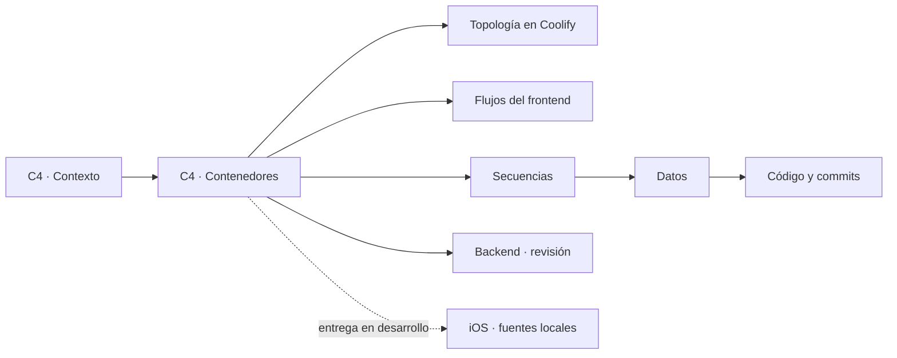

# Mapa de arquitectura Puntazo

Documentación independiente y navegable del estado real de Puntazo. Los archivos Markdown y sus bloques Mermaid son la fuente de verdad; la aplicación web sólo los transforma en una experiencia visual.

El mapa distingue **implementado**, **desplegado**, **pendiente** y **propuesto** para no confundir el código actual con el spec de destino.

## Convenciones

- **Verde:** integración real con el backend.
- **Ámbar:** implementación mock o en memoria.
- **Azul:** interfaz y navegación.
- **Rojo:** brecha o contrato pendiente.

Use los nodos del diagrama para profundizar. La barra lateral permite saltar directamente a cualquier vista.

La [topología desplegada en Coolify](#/coolify-deployment-topology) resume los
recursos de producción y testing, incluidos los servicios separados de
Backoffice.

## Corte de runtime conservado · 02/10/2026

API y bases en esquema `0033`, servicios funcionales de comercio/fidelidad y UI Backoffice testing activa. Hay diferencias de configuración y publicación entre ambientes. Empezar por [estado observado](#/runtime-snapshot), [matriz de integración](#/integration-matrix) y [brechas](#/implementation-gaps). Para editar y compartir este recurso, ver [actualización documental](#/documentation-sync-plan).

## Desarrollo iOS · 01/11/2026

La primera edición pública será gratuita; la interna prepara StoreKit, catálogo y referidos. El [alcance aprobado y la configuración](#/ios-development), la [secuencia Apple](#/sequence-apple) y la [evidencia](#/ios-development-evidence) corresponden a fuentes locales sin despliegue. No se acredita ejecución nativa de la app ni App Store/TestFlight. Google Maps se prepara para mapa/dirección; Google OAuth iOS está pospuesto.
