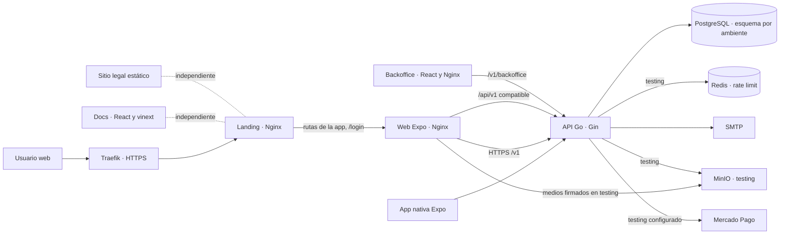

# C4 · Contenedores

Revisión de fuentes y runtime del **02/10/2026, 22:30–22:33 UTC**. Los SHA y las diferencias por ambiente están en [Estado observado](#/runtime-snapshot). Esta revisión describe arquitectura e integración; no certifica todos los invariantes de negocio ni ejecuta operaciones sobre cuentas reales.

Cada ambiente conserva su propia API, base y objetos. El diagrama resume funciones; [Topología Coolify](#/coolify-deployment-topology) cuenta los recursos y distingue activos, preparados y retenidos.

| Contenedor | Tecnología y función |
|---|---|
| Landing | HTML/CSS/JS estáticos en Nginx; raíz pública de cada dominio y proxy del resto hacia la web |
| Web/PWA y app nativa | Expo SDK 54, React Native, Expo Router, Zustand y TanStack Query; servicios HTTP reales |
| API | Go, Gin, JWT, pgx; identidad, comercio, fidelidad, analíticas, suscripción, referidos y Backoffice |
| PostgreSQL | Persistencia, ledger, sesiones, outbox y notificaciones para SSE |
| Redis | Rate limit en testing; recurso productivo sin consumidor confirmado |
| MinIO | Medios privados y URLs firmadas en testing; no conectado a la API productiva observada |
| Backoffice | UI independiente; mismo origen para sus rutas API; producción preparada sin contenedor |
| Docs / legales | Publicaciones transversales separadas de los datos del producto |

## Entrada y compatibilidad

La landing sirve `/` y redirige las antiguas páginas divididas a secciones de la misma página. El resto pertenece a Expo: `/login`, rutas autenticadas, manifest y service worker. Testing conserva `/api/v1` y el prefijo público de medios para clientes instalados. No se atribuye al Compose anterior el tráfico actual: está detenido.

El esquema `0033` corresponde al corte histórico del 02/10 indicado arriba; no selecciona una versión para nuevos despliegues. Consultar el esquema observado por ambiente en [Estado observado](#/runtime-snapshot), las [integraciones](#/integration-matrix) y las [brechas operativas](#/implementation-gaps).

## Menú PDF V1 · candidato del 18/10/2026

El candidato incorpora publicación de PDF por sucursal sin agregar contenedores: Expo gestiona el documento y la consulta pública `/menu/:branchId`; la API Go valida el PDF, persiste borrador/publicación en PostgreSQL y firma el acceso al storage privado existente. El visitante abre el archivo sin cuenta en el visor del navegador o dispositivo. Las URLs duran como máximo 300 segundos; el enlace y QR de la sucursal permanecen estables.

La migración `0041_branch_pdf_menus` amplía el esquema candidato 0040. Este apartado acredita código **desplegado y verificado en testing**: backend `c12c94da5c62fcaf062a0094109ed47fc2dedc90`, frontend `72cf2229f8f732d705a63641692aff26481d5047`. La promoción al propietario backend sigue abierta mediante [PR39](https://github.com/am-p/app-loyalty/pull/39); frontend [PR67](https://github.com/gonzalotev/app-fidelidad/pull/67) y [PR68](https://github.com/gonzalotev/app-fidelidad/pull/68) ya están integradas en `testing`. El circuito usa los repositorios separados; `puntazo-preview` está retirado. La corrección no publica producción. [Recorrido y límites V1](#/flow-branch-menu-pdf); V2 digital/IA permanece como idea futura.

## Ampliación de PDF y PWA · 18/10/2026

La ampliación mantiene los mismos contenedores: API de testing con esquema 0042 y máximo de archivo 30 MiB; entrada multipart de 31 MiB en web/landing sólo en la ruta PDF. La nueva migración amplía el CHECK y no altera 0041 ni los documentos. El SW de Expo deja pasar navegación de medios/API a la red; la apertura web usa un Blob validado del mismo origen para evitar el fallback de un SW anterior ya instalado. El origen de storage y la firma no se reescriben; las URL externas HTTPS conservan su navegación. [Estado y verificación](#/runtime-snapshot). Producción permanece fuera de esta entrega.

## Referencias de código

- [Bootstrap API](https://github.com/am-p/app-loyalty/blob/main/cmd/server/main.go)
- [Cliente HTTP Expo](https://github.com/gonzalotev/app-fidelidad/blob/main/src/core/api/client.ts)
- [Entrada y proxy landing](https://github.com/gagonzalez1/puntazo-landing/blob/main/nginx/default.conf.template)
- [Servicio PDF del candidato](https://github.com/gagonzalez1/app-loyalty/blob/closed-test-readiness/internal/service/menu.go)
- [Proxy de carga PDF y storage en testing](https://github.com/gonzalotev/app-fidelidad/blob/testing/nginx/default.conf)
