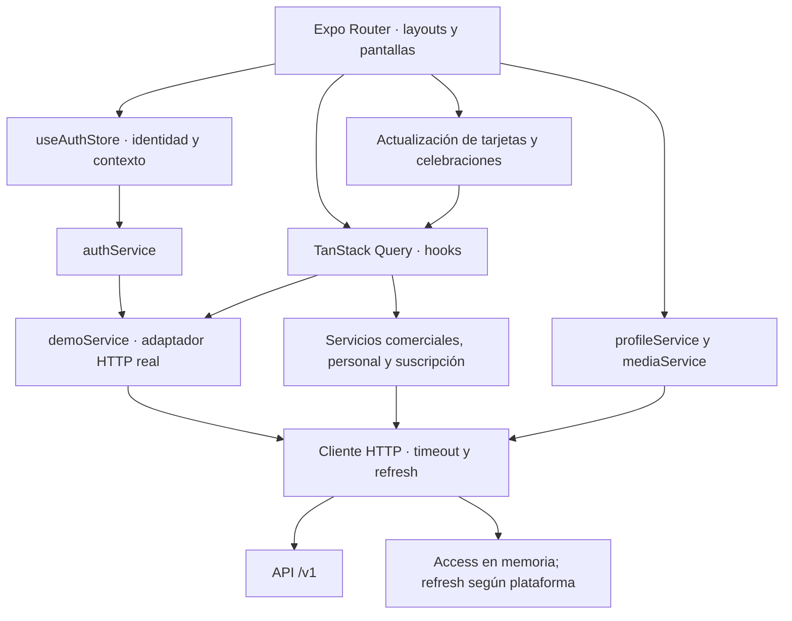

# C4 · Componentes frontend

Revisión de fuentes y runtime del **02/10/2026, 22:30–22:33 UTC**. Los SHA y las diferencias por ambiente están en [Estado observado](#/runtime-snapshot). Esta revisión describe arquitectura e integración; no certifica todos los invariantes de negocio ni ejecuta operaciones sobre cuentas reales.

`features/demo` conserva su nombre histórico, pero su servicio usa la API: no es prueba de datos simulados. Las pantallas muestran estados de carga, error y vacío a partir de respuestas del servidor.

- Router separa login/onboarding y pestañas. El acceso depende de cuenta activa, tipo de cuenta, membresías y contexto comercial.
- Zustand mantiene sesión, usuario, marcas y selección de sucursal. La selección local no otorga permisos en servidor.
- TanStack Query cachea e invalida lecturas tras escrituras. Los saldos confirmados vienen de movimientos persistidos.
- Access token en memoria. Web usa cookie HttpOnly para refresh; nativo guarda refresh en SecureStore. El cliente intenta una sola recuperación ante un 401 compatible.
- Web puede abrir SSE autenticado de tarjetas; el cliente combina actualización de consultas y comprobación de movimientos para las celebraciones.
- El helper de instalación PWA está integrado y publicado en las imágenes actuales de testing y landing testing. El corte final acredita sus SHA y salud; la instalación física en cada dispositivo no se verificó en esta revisión.

## Actualización flexible de Android · cambio del 12/10/2026

Implementada en la rama fuente `codex/android-flexible-updates-20261012` de
`gonzalotev/app-fidelidad`, basada en `main` remoto `2871299`. La integración a
main y su publicación en Google Play están pendientes; esta sección no amplía
la certificación del runtime observado el 02/10.

El layout monta `AndroidUpdatePrompt` sólo para Android. Tras restaurar la
sesión y cuando no hay otro diálogo registrado, presenta **Actualizar** y
**Más tarde** si Google Play ofrece una actualización flexible. El controlador
coordina disponibilidad, consentimiento, eventos de instalación y reentrada;
posponer evita repetir el aviso durante el proceso actual. Una nueva apertura
puede mostrarlo nuevamente.

El servicio usa el módulo local Expo SDK 54 `PuntazoPlayUpdates` y la biblioteca
oficial `com.google.android.play:app-update:2.1.0`. Google Play solicita
consentimiento y descarga mientras el usuario sigue usando Puntazo. El estado
`DOWNLOADED` ofrece **Reiniciar y actualizar** y **Más tarde**; únicamente la
acción explícita llama a `completeUpdate()`. No hay instalación automática desde
esta integración. Web, iOS, Expo Go y desarrollo usan el comportamiento vacío.

Los errores de consulta no impiden abrir la app. Los errores al iniciar o
completar la actualización liberan el bloqueo y muestran feedback. No cambian
la sesión, el contrato HTTP, el esquema ni los mecanismos PWA o push.

La secuencia completa está en [Actualización flexible Android](#/sequence-android-flexible-update).

La validación de distribución/instalación real requiere una versión que incluya
el módulo instalada desde Play y otra con `versionCode` mayor disponible para
la cuenta. Las versiones previas a la integración requieren instalar primero
esa nueva compilación nativa; no se agrega vía OTA.

## Referencias de código

- [Layout y guards](https://github.com/gonzalotev/app-fidelidad/blob/main/app/(tabs)/_layout.tsx)
- [Store de identidad](https://github.com/gonzalotev/app-fidelidad/blob/main/src/features/auth/store/useAuthStore.ts)
- [Servicios de fidelidad](https://github.com/gonzalotev/app-fidelidad/blob/main/src/features/demo/services/demoService.ts)
- [Persistencia de sesión](https://github.com/gonzalotev/app-fidelidad/blob/main/src/core/storage/tokenStorage.ts)
- [Detector de movimientos](https://github.com/gonzalotev/app-fidelidad/blob/main/src/features/transactionCelebration/hooks/useCustomerMovementDetector.ts)
- [Flujo flexible Android, rama pendiente de integrar](https://github.com/gonzalotev/app-fidelidad/tree/codex/android-flexible-updates-20261012/src/features/appUpdates)
- [Módulo Google Play, rama pendiente de integrar](https://github.com/gonzalotev/app-fidelidad/tree/codex/android-flexible-updates-20261012/modules/puntazo-play-updates)
