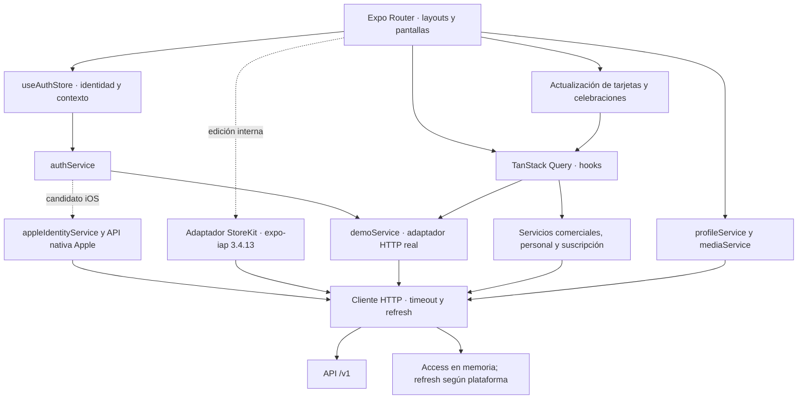

# C4 · Componentes frontend

El [delta iOS del 01/11/2026](#/ios-development) agrega fuentes locales aún sin artefacto publicado. La revisión de runtime que sigue conserva su fecha; las nuevas aristas son del candidato de desarrollo.

Revisión de fuentes y runtime del **02/10/2026, 22:30–22:33 UTC**. Los SHA y las diferencias por ambiente están en [Estado observado](#/runtime-snapshot). Esta revisión describe arquitectura e integración; no certifica todos los invariantes de negocio ni ejecuta operaciones sobre cuentas reales.

`features/demo` conserva su nombre histórico, pero su servicio usa la API: no es prueba de datos simulados. Las pantallas muestran estados de carga, error y vacío a partir de respuestas del servidor.

- Router separa login/onboarding y pestañas. El acceso depende de cuenta activa, tipo de cuenta, membresías y contexto comercial.
- Zustand mantiene sesión, usuario, marcas y selección de sucursal. La selección local no otorga permisos en servidor.
- TanStack Query cachea e invalida lecturas tras escrituras. Los saldos confirmados vienen de movimientos persistidos.
- Access token en memoria. Web usa cookie HttpOnly para refresh; nativo guarda refresh en SecureStore. El cliente intenta una sola recuperación ante un 401 compatible.
- Web puede abrir SSE autenticado de tarjetas; el cliente combina actualización de consultas y comprobación de movimientos para las celebraciones.
- El helper de instalación PWA está integrado y publicado en las imágenes actuales de testing y landing testing. El corte final acredita sus SHA y salud; la instalación física en cada dispositivo no se verificó en esta revisión.

## Delta local iOS

`appleIdentityService` coordina challenge, respuesta nativa y alta; `useAuthStore` conserva sólo el onboarding pendiente en memoria hasta completar el perfil/expirar el challenge. `AuthMethodsManager` ofrece vínculo explícito y reautenticación según `auth_methods`; una dirección relay no selecciona por sí sola una cuenta existente.

`app.config.ts`, perfiles EAS y plugins de edición separan `free` de `billing-internal`. La exclusión del módulo nativo y de entrypoints de billing del build gratuito requiere inspección del artefacto final, todavía pendiente en este corte. `StoreLocationsMap` y `AddressPicker` usan el proveedor Google preparado para iOS. La configuración OAuth Google iOS fue pospuesta, aunque sus parámetros estén previstos en código. [Evidencia](#/ios-development-evidence)

Paths del candidato: `src/features/auth/services/appleIdentityService.ts`, `nativeAppleIdentity.ios.ts`, `AuthMethodsManager.tsx`, `plugins/withIOSEdition.js` y `plugins/withStoreKitTests.js`. Los enlaces de código siguientes apuntan a ramas móviles, no acreditan que esos cambios locales ya estén publicados.

## Referencias de código

- [Layout y guards](https://github.com/gonzalotev/app-fidelidad/blob/main/app/(tabs)/_layout.tsx)
- [Store de identidad](https://github.com/gonzalotev/app-fidelidad/blob/main/src/features/auth/store/useAuthStore.ts)
- [Servicios de fidelidad](https://github.com/gonzalotev/app-fidelidad/blob/main/src/features/demo/services/demoService.ts)
- [Persistencia de sesión](https://github.com/gonzalotev/app-fidelidad/blob/main/src/core/storage/tokenStorage.ts)
- [Detector de movimientos](https://github.com/gonzalotev/app-fidelidad/blob/main/src/features/transactionCelebration/hooks/useCustomerMovementDetector.ts)
