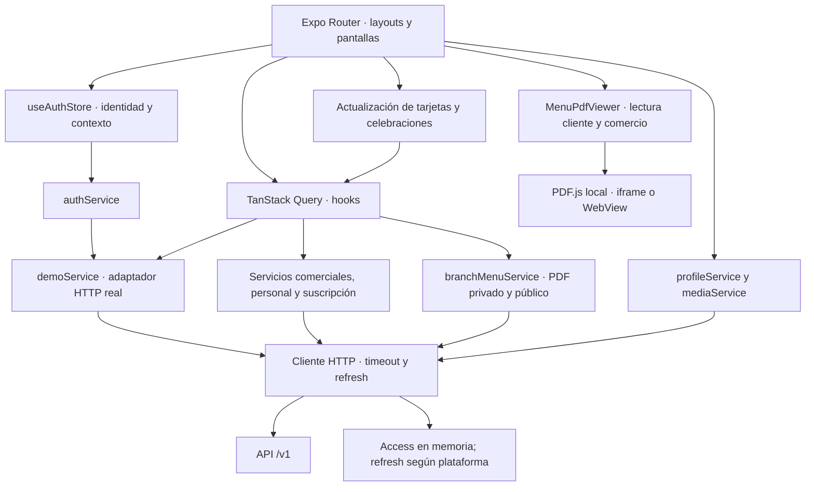

# C4 · Componentes frontend

Revisión de fuentes y runtime del **02/10/2026, 22:30–22:33 UTC**. Los SHA y las diferencias por ambiente están en [Estado observado](#/runtime-snapshot). Esta revisión describe arquitectura e integración; no certifica todos los invariantes de negocio ni ejecuta operaciones sobre cuentas reales.

`features/demo` conserva su nombre histórico, pero su servicio usa la API: no es prueba de datos simulados. Las pantallas muestran estados de carga, error y vacío a partir de respuestas del servidor.

- Router separa login/onboarding y pestañas. El acceso depende de cuenta activa, tipo de cuenta, membresías y contexto comercial.
- Zustand mantiene sesión, usuario, marcas y selección de sucursal. La selección local no otorga permisos en servidor.
- TanStack Query cachea e invalida lecturas tras escrituras. Los saldos confirmados vienen de movimientos persistidos.
- Access token en memoria. Web usa cookie HttpOnly para refresh; nativo guarda refresh en SecureStore. El cliente intenta una sola recuperación ante un 401 compatible.
- Web puede abrir SSE autenticado de tarjetas; el cliente combina actualización de consultas y comprobación de movimientos para las celebraciones.
- El helper de instalación PWA está integrado y publicado en las imágenes actuales de testing y landing testing. El corte final acredita sus SHA y salud; la instalación física en cada dispositivo no se verificó en esta revisión.

## Gate de edad y recuperación de sesión · 19/10/2026

PR73, desplegada en `ae706dda`, coloca la confirmación explícita antes de montar auth/pestañas y efectos privados (SSE, reseñas y asistente) cuando el servidor informa `adult_confirmed=false`; el menú público queda exento. El store difiere contextos y comprueba identidad/sesión antes de adoptar la respuesta. [Flujo de acceso](#/flow-auth).

La recuperación transitoria y el lock de cookie entre pestañas están **desplegados en PR74 `7dfa39a` con aceptación real parcial**: `SessionRecovery` ofrece reintento sin login prematuro, `sessionLock` usa Web Locks donde están disponibles y el cliente valida credenciales/cooldown. SSE sólo habilita refresh al expirar; el menú público directo omite restore/stream. Access en memoria, cookie HttpOnly web y SecureStore nativo se mantienen. PR74 no comparte el access vigente entre pestañas: la QA de tres pestañas volvió a rotar repetidamente, agotó cuota y dejó el QR cargando. PR75, integrada en `testing` `ed9b9fa`, añade coordinación de access sólo en memoria vía BroadcastChannel del mismo origen, marcador opaco/no secreto de autoridad en localStorage y Web Locks. Valida autoridad, destinatario, correlación y expiración original; descarta publicaciones antiguas y el access recién rechazado. El cambio de identidad invalida el contexto local y el logout propaga una nueva marca de cierre. CI, nueve unidades de protocolo y 19 casos browser aprobaron; despliegue observado a las 04:46:56 UTC y QA real de tres pestañas aprobada durante 242,73 s, con recuperación SSE y regreso desde mapa/PDF sin logout ni error de tarjeta. No hay backend ni esquema nuevo; evidencia y límites en [Estado observado](#/runtime-snapshot).

## Menú PDF V1 · corte inicial del 18/10/2026

Fuente: frontend `72cf2229f8f732d705a63641692aff26481d5047`, rama `testing`, [PR67](https://github.com/gonzalotev/app-fidelidad/pull/67) y [PR68](https://github.com/gonzalotev/app-fidelidad/pull/68) integradas en testing. Implementación desplegada y verificada en testing; el corte vigente está en [Estado observado](#/runtime-snapshot).

`CommercialBranchMenuEditor` añade Menú a las seis secciones de Mi Tienda, con selector de sucursal y borrador/publicación separados. `expo-document-picker` selecciona un PDF; `branchMenuService` envía multipart con un único campo `archivo`. Los hooks TanStack Query conservan el estado por marca y sucursal. Las mutaciones usan la versión revisada, también al abrir una confirmación; ante 412 o respuesta incierta se reconsulta antes de continuar. No se adopta automáticamente otra versión para retirar una publicación concurrente.

La ruta `/menu/:branchId` está fuera del guard de pestañas autenticadas y consulta únicamente endpoints públicos. El mapa abre la sucursal elegida; las tarjetas consultan sucursales de su marca y presentan selector cuando corresponde. El QR del menú usa el origen web actual o `EXPO_PUBLIC_APP_URL` explícito en native, separado del QR personal. Cada apertura resuelve una URL firmada vigente; web crea la pestaña durante el gesto del usuario y native usa WebBrowser con alternativa Linking. No se añade un renderer PDF nativo.

Los permisos de la UI reflejan roles de propietario/administrador, pero el backend es quien los exige; los operadores no reciben borradores. [Flujo V1 y contrato](#/flow-branch-menu-pdf). V2 digital/IA no introduce editor, extracción ni dependencias en este candidato. Las pruebas web no acreditan instalación física de PWA ni QA en dispositivos Android/iOS.

## Corrección histórica de apertura PDF con service worker activo

La ampliación a 30 MiB conserva Expo SDK 54 y el visor del dispositivo. El SW excluye el proxy de medios y `/api` del fallback de navegación; los documentos firmados no se precachean. Para un SW anterior ya activo, `signed-menu-pdf.mjs` usa un GET sin caché para URLs del mismo origen, limita el stream a 30 MiB, valida MIME y `%PDF-` y abre un Blob en una pestaña creada por el usuario. La liberación espera al cierre del visor; no se persiste el documento en almacenamiento del navegador. Las URLs HTTPS de storage externo mantienen navegación directa y no agregan una exigencia CORS. Native conserva WebBrowser/Linking. El estado de despliegue y la reproducción con perfil anterior se registran en [Estado observado](#/runtime-snapshot).

## Cliente a pantalla completa · testing PR71/72

[PR71 frontend](https://github.com/gonzalotev/app-fidelidad/pull/71) y [PR72](https://github.com/gonzalotev/app-fidelidad/pull/72), integradas y desplegadas en la rama seleccionada `testing` como `9074aa57fe84d8f0ec03d50898d532d4857ce4c3`. Implementación autorizada y lectura pública comprobada contra testing real; fuentes y límites de aceptación en [Estado observado](#/runtime-snapshot).

`MenuPdfViewer` añade un modo de lectura usado sólo por la ruta pública de cliente: iframe web o WebView Android cargan `/pdf-viewer/read.html` con `reader.js`. La UI ocupa la pantalla con Volver superpuesto, sin metadatos ni herramientas; el scroll reserva 56 px al inicio para preservar el título. El reader dibuja páginas cercanas a la vista con scroll continuo y un presupuesto total compartido de seis millones de píxeles; cancela tareas y libera canvas fuera de vista. El fallo queda detenido y la ruta coordina como máximo una renovación de la firma, ignorando errores duplicados y respuestas de otra sucursal.

`MenuPdfPreview` del comercio mantiene `index.html` con sus controles originales. El layout raíz omite `FirstLoginTutorial` sólo en `/menu/`; al regresar al mapa se conserva el onboarding. PDF.js, origen, CSP, storage y contrato permanecen como en PR70. [Recorrido y límites de plataforma](#/flow-branch-menu-pdf).

## Corte PR70 · búsqueda y renderer interno

Implementación autorizada el **18/10/2026**, [PR70 frontend](https://github.com/gonzalotev/app-fidelidad/pull/70), integrada y desplegada en `testing` como `b7de8ec5414c3e7144fa87bb700e9c2e6e4c00a6`. La aceptación del recorrido real se registra por separado en [Estado observado](#/runtime-snapshot).

`filterStoreLocations` aplica la misma búsqueda normalizada a mapa/lista a partir del inventario completo; favoritos permanece independiente del filtro. `MenuPdfPreview` y `/menu/:branchId` comparten `MenuPdfViewer`: iframe web y WebView 13.15.0 en Android, ambos con PDF.js 6.4.299 y recursos servidos por Puntazo. Se mantiene Expo SDK 54. La descarga firmada del mismo origen reutiliza `fetchSignedMenuPdf`; «Abrir aparte» conserva el fallback para HTTPS externo. [Controles, límites y configuración nativa](#/flow-branch-menu-pdf).

El contenedor web incorpora `/pdf-viewer/` y una CSP específica para permitir su iframe del mismo origen. Workbox excluye renderer y medios del precache/fallback; no hay caché persistente de PDFs. No cambia servicios HTTP, API ni esquema; incorporar el módulo WebView requiere un nuevo build Android.

- [Renderer y controles](https://github.com/gonzalotev/app-fidelidad/blob/testing/public/pdf-viewer/viewer.js)
- [Búsqueda normalizada](https://github.com/gonzalotev/app-fidelidad/blob/testing/src/features/storeMap/lib/store-map.mjs)

## Referencias de código

- [Layout y guards](https://github.com/gonzalotev/app-fidelidad/blob/main/app/(tabs)/_layout.tsx)
- [Store de identidad](https://github.com/gonzalotev/app-fidelidad/blob/main/src/features/auth/store/useAuthStore.ts)
- [Servicios de fidelidad](https://github.com/gonzalotev/app-fidelidad/blob/main/src/features/demo/services/demoService.ts)
- [Persistencia de sesión](https://github.com/gonzalotev/app-fidelidad/blob/main/src/core/storage/tokenStorage.ts)
- [Detector de movimientos](https://github.com/gonzalotev/app-fidelidad/blob/main/src/features/transactionCelebration/hooks/useCustomerMovementDetector.ts)
- [Editor PDF y versiones](https://github.com/gonzalotev/app-fidelidad/blob/testing/src/features/merchant/components/CommercialBranchMenuEditor.tsx)
- [Servicio multipart y contratos](https://github.com/gonzalotev/app-fidelidad/blob/testing/src/features/merchant/services/branchMenuService.ts)
- [Ruta pública sin sesión](https://github.com/gonzalotev/app-fidelidad/blob/testing/app/menu/%5BbranchId%5D.tsx)
