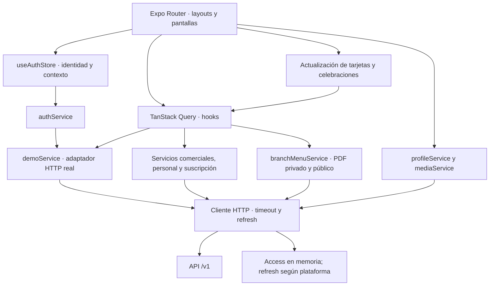

# C4 · Componentes frontend

Revisión de fuentes y runtime del **02/10/2026, 22:30–22:33 UTC**. Los SHA y las diferencias por ambiente están en [Estado observado](#/runtime-snapshot). Esta revisión describe arquitectura e integración; no certifica todos los invariantes de negocio ni ejecuta operaciones sobre cuentas reales.

`features/demo` conserva su nombre histórico, pero su servicio usa la API: no es prueba de datos simulados. Las pantallas muestran estados de carga, error y vacío a partir de respuestas del servidor.

- Router separa login/onboarding y pestañas. El acceso depende de cuenta activa, tipo de cuenta, membresías y contexto comercial.
- Zustand mantiene sesión, usuario, marcas y selección de sucursal. La selección local no otorga permisos en servidor.
- TanStack Query cachea e invalida lecturas tras escrituras. Los saldos confirmados vienen de movimientos persistidos.
- Access token en memoria. Web usa cookie HttpOnly para refresh; nativo guarda refresh en SecureStore. El cliente intenta una sola recuperación ante un 401 compatible.
- Web puede abrir SSE autenticado de tarjetas; el cliente combina actualización de consultas y comprobación de movimientos para las celebraciones.
- El helper de instalación PWA está integrado y publicado en las imágenes actuales de testing y landing testing. El corte final acredita sus SHA y salud; la instalación física en cada dispositivo no se verificó en esta revisión.

## Menú PDF V1 · candidato del 18/10/2026

Fuente: frontend `72cf2229f8f732d705a63641692aff26481d5047`, rama `testing`, [PR67](https://github.com/gonzalotev/app-fidelidad/pull/67) y [PR68](https://github.com/gonzalotev/app-fidelidad/pull/68) integradas en testing. Implementación desplegada y verificada en testing; el corte vigente está en [Estado observado](#/runtime-snapshot).

`CommercialBranchMenuEditor` añade Menú a las seis secciones de Mi Tienda, con selector de sucursal y borrador/publicación separados. `expo-document-picker` selecciona un PDF; `branchMenuService` envía multipart con un único campo `archivo`. Los hooks TanStack Query conservan el estado por marca y sucursal. Las mutaciones usan la versión revisada, también al abrir una confirmación; ante 412 o respuesta incierta se reconsulta antes de continuar. No se adopta automáticamente otra versión para retirar una publicación concurrente.

La ruta `/menu/:branchId` está fuera del guard de pestañas autenticadas y consulta únicamente endpoints públicos. El mapa abre la sucursal elegida; las tarjetas consultan sucursales de su marca y presentan selector cuando corresponde. El QR del menú usa el origen web actual o `EXPO_PUBLIC_APP_URL` explícito en native, separado del QR personal. Cada apertura resuelve una URL firmada vigente; web crea la pestaña durante el gesto del usuario y native usa WebBrowser con alternativa Linking. No se añade un renderer PDF nativo.

Los permisos de la UI reflejan roles de propietario/administrador, pero el backend es quien los exige; los operadores no reciben borradores. [Flujo V1 y contrato](#/flow-branch-menu-pdf). V2 digital/IA no introduce editor, extracción ni dependencias en este candidato. Las pruebas web no acreditan instalación física de PWA ni QA en dispositivos Android/iOS.

## Referencias de código

- [Layout y guards](https://github.com/gonzalotev/app-fidelidad/blob/main/app/(tabs)/_layout.tsx)
- [Store de identidad](https://github.com/gonzalotev/app-fidelidad/blob/main/src/features/auth/store/useAuthStore.ts)
- [Servicios de fidelidad](https://github.com/gonzalotev/app-fidelidad/blob/main/src/features/demo/services/demoService.ts)
- [Persistencia de sesión](https://github.com/gonzalotev/app-fidelidad/blob/main/src/core/storage/tokenStorage.ts)
- [Detector de movimientos](https://github.com/gonzalotev/app-fidelidad/blob/main/src/features/transactionCelebration/hooks/useCustomerMovementDetector.ts)
- [Editor PDF y versiones](https://github.com/gonzalotev/app-fidelidad/blob/testing/src/features/merchant/components/CommercialBranchMenuEditor.tsx)
- [Servicio multipart y contratos](https://github.com/gonzalotev/app-fidelidad/blob/testing/src/features/merchant/services/branchMenuService.ts)
- [Ruta pública sin sesión](https://github.com/gonzalotev/app-fidelidad/blob/testing/app/menu/%5BbranchId%5D.tsx)
