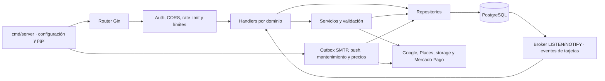

# C4 · Componentes backend

Revisión de fuentes y runtime del **02/10/2026, 22:30–22:33 UTC**. Los SHA y las diferencias por ambiente están en [Estado observado](#/runtime-snapshot). Esta revisión describe arquitectura e integración; no certifica todos los invariantes de negocio ni ejecuta operaciones sobre cuentas reales.

| Dominio | Entrada implementada |
|---|---|
| Identidad | Registro, login, Google, refresh/logout, verificación y recuperación, cambio de email |
| Cuenta | `/v1/me`, foto, exportación y baja |
| Comercio | Marcas, sucursales, programas SELLOS/PUNTOS, beneficios, imágenes, personal e invitaciones |
| Cliente | QR/código, tarjetas, historial, push y solicitudes de reseña |
| Operación | Preview, acumulación, canje y consulta de resultado por clave idempotente |
| Analíticas | Resumen e historial por día/semana/mes a partir del ledger y zona horaria de la marca |
| Suscripción y referidos | Checkout, resultado, cancelación, webhook, códigos, atribuciones y recompensas |
| Backoffice | Login/cookie, clientes, campañas, influenciadores, precios, historial y liquidación |

REST tiene plazo de 12 segundos; el stream SSE se registra por separado y revalida sesión. Backoffice tiene sesiones propias, respuestas sin caché, límite de cuerpo y cabecera de escritura. Los repositorios usan PostgreSQL para permisos, transacciones y versiones. Los providers de media, rate limit, correo y cobro dependen del entorno.

Las migraciones se ejecutan con `cmd/migrate`; `0033` es el esquema del corte histórico del 02/10. La versión observada por ambiente se registra en [Estado observado](#/runtime-snapshot). No se crea una única tabla `users` al iniciar el servidor.

## Referencias de código

- [Router](https://github.com/am-p/app-loyalty/blob/main/cmd/server/router.go)
- [Rutas comerciales](https://github.com/am-p/app-loyalty/blob/main/cmd/server/routes_merchant.go)
- [Rutas cliente](https://github.com/am-p/app-loyalty/blob/main/cmd/server/routes_customer.go)
- [Movimientos](https://github.com/am-p/app-loyalty/blob/main/internal/repository/movement.go)
- [Workers y proveedores](https://github.com/am-p/app-loyalty/blob/main/cmd/server/main.go)
- [Migrador](https://github.com/am-p/app-loyalty/blob/main/cmd/migrate/main.go)

## Descubrimiento de sucursales · 17/10/2026

La corrección conserva handler → service → repository: validación y permisos de cliente, búsqueda literal, consulta de marcas/sucursales elegibles y persistencia transaccional de favoritos. El orden de locks coincide con las operaciones comerciales: usuario, marca y sucursal. Los medios reutilizan la firma del storage existente; no se introduce otro servicio. [Contrato y promoción](#/flow-customer-map-menu).

## Menú PDF V1 · candidato del 18/10/2026

Backend `c12c94da5c62fcaf062a0094109ed47fc2dedc90`, [PR39 al propietario](https://github.com/am-p/app-loyalty/pull/39) abierta. Implementado en el candidato; desplegado y verificado en testing. La migración 0041 añade documentos y estado de menú por sucursal, sobre la dependencia 0036–0040 de la entrega del mapa. No acredita integración en main ni entrega productiva.

`handler/menu.go` distingue administración autenticada y consulta pública. Autoriza propietario/administrador activo de la marca y sucursal exactas antes de leer el archivo; exige mayoría de edad en las rutas privadas y `If-Match` para mutar. El servicio valida PDF real mediante pdfcpu, con límite de 10 MiB, 1–30 páginas, sin cifrado, timeout de tres segundos y límites de recursos. Reutiliza semáforo y rate limit de cargas, con límite multipart propio sin ampliar imágenes.

El repositorio reserva la carga sin apuntarla como borrador, guarda el objeto inmutable y confirma el borrador después de repetir autorización y versión. Publicar cambia los punteros bajo transacción; orden de locks marca → sucursal → menú/documentos. La firma de URLs se realiza antes del commit con los recursos protegidos. La compensación solo retira cargas `UPLOAD_PENDING`, evitando borrar una activación cuyo commit tuvo respuesta incierta.

La consulta pública nunca selecciona el borrador ni datos personales. Las URLs HTTPS firmadas duran como máximo 300 segundos; retirar impide nuevas firmas. El mantenimiento existente elimina objetos retirados tras seis minutos de gracia, con lease y reintentos. Triggers de baja efectiva de marca/sucursal retiran sus documentos; anonimizar un propietario no retira menús si la marca sigue activa con otro propietario. [Flujo y aceptación V1](#/flow-branch-menu-pdf); V2 digital/IA no está implementada.

- [Handler y errores PDF](https://github.com/gagonzalez1/app-loyalty/blob/closed-test-readiness/internal/handler/menu.go)
- [Parser y coordinación de storage](https://github.com/gagonzalez1/app-loyalty/blob/closed-test-readiness/internal/service/menu.go)
- [Transacciones y limpieza PDF](https://github.com/gagonzalez1/app-loyalty/blob/closed-test-readiness/internal/repository/menu.go)
