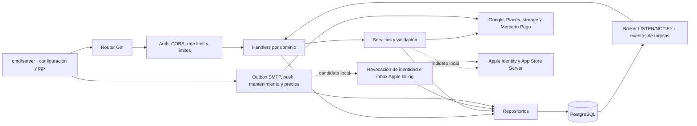

# C4 · Componentes backend

La [entrega iOS del 01/11/2026](#/ios-development) añade implementación local en el fork de trabajo y promoción pendiente al dueño `am-p/app-loyalty`. No se atribuyen sus migraciones/proveedores al runtime histórico que sigue.

Revisión de fuentes y runtime del **02/10/2026, 22:30–22:33 UTC**. Los SHA y las diferencias por ambiente están en [Estado observado](#/runtime-snapshot). Esta revisión describe arquitectura e integración; no certifica todos los invariantes de negocio ni ejecuta operaciones sobre cuentas reales.

| Dominio | Entrada implementada |
|---|---|
| Identidad | Registro, login, Google, refresh/logout, verificación y recuperación, cambio de email |
| Cuenta | `/v1/me`, foto, exportación y baja |
| Comercio | Marcas, sucursales, programas SELLOS/PUNTOS, beneficios, imágenes, personal e invitaciones |
| Cliente | QR/código, tarjetas, historial, push y solicitudes de reseña |
| Operación | Preview, acumulación, canje y consulta de resultado por clave idempotente |
| Analíticas | Resumen e historial por día/semana/mes a partir del ledger y zona horaria de la marca |
| Suscripción y referidos | Checkout, resultado, cancelación, webhook, códigos, atribuciones y recompensas |
| Backoffice | Login/cookie, clientes, campañas, influenciadores, precios, historial y liquidación |

REST tiene plazo de 12 segundos; el stream SSE se registra por separado y revalida sesión. Backoffice tiene sesiones propias, respuestas sin caché, límite de cuerpo y cabecera de escritura. Los repositorios usan PostgreSQL para permisos, transacciones y versiones. Los providers de media, rate limit, correo y cobro dependen del entorno.

Las migraciones se ejecutan con `cmd/migrate`; `0033` es el esquema observado. No se crea una única tabla `users` al iniciar el servidor.

## Componentes locales de la entrega iOS

| Componente | Responsabilidad y límite |
|---|---|
| `internal/appleidentity` | JWKS/RS256, issuer/audience/expiración/nonce, código y client secret ES256; ningún fallback de identidad ficticia |
| `apple_auth` en handler/service/repository | Challenge con propósito, alta con datos completos, vínculo explícito, reautenticación, versiones y rotación de sesiones |
| Cola de revocación | Tokens cifrados; alta de trabajo en la transacción de baja, leases y reintentos sin bloquear la eliminación por caída de Apple |
| `internal/applebilling` | Firma/cadena/OCSP, entorno, bundle/grupo/productos y API de servidor; confianza local Xcode separada de producción |
| `apple_billing` e inbox | Intenciones, cadena permanente por marca, capacidad/gracia y notificaciones V2 durables; persistencia separada de Mercado Pago |

Las rutas están enumeradas por plano en la [matriz de integración](#/integration-matrix). Los controles de escritura incluyen comprobación transaccional y no descansan sólo en la UI. Verificador y apertura de nuevas compras tienen flags separados, ambos apagados por defecto. Credenciales, Sandbox y ejecución nativa real siguen pendientes. La aplicación de `0044`/`0045` se comprobó sólo en PostgreSQL aislado de pruebas en esta tarea.

## Referencias de código

- [Router](https://github.com/am-p/app-loyalty/blob/main/cmd/server/router.go)
- [Rutas comerciales](https://github.com/am-p/app-loyalty/blob/main/cmd/server/routes_merchant.go)
- [Rutas cliente](https://github.com/am-p/app-loyalty/blob/main/cmd/server/routes_customer.go)
- [Movimientos](https://github.com/am-p/app-loyalty/blob/main/internal/repository/movement.go)
- [Workers y proveedores](https://github.com/am-p/app-loyalty/blob/main/cmd/server/main.go)
- [Migrador](https://github.com/am-p/app-loyalty/blob/main/cmd/migrate/main.go)
