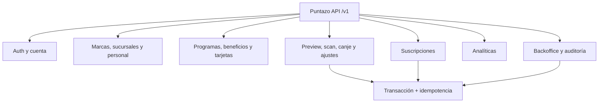

# Backend · Contrato API propuesto

> **Alcance del 02/10/2026:** este diseño conserva sus acuerdos y propuestas originales. La implementación evolucionó: consultar [datos actuales](#/data-current), [integración real](#/integration-matrix) y [estado observado](#/runtime-snapshot). La coincidencia con código no aprueba automáticamente una decisión `PC-xx` ni convierte todo el spec/OpenAPI en contrato desplegado.

> **PROPUESTA CODEX `PC-02` a `PC-08`, `PC-12` a `PC-14`.** El archivo
> [`openapi.yaml`](/openapi.yaml) es el contrato formal de transporte y debe revisarse
> antes de generar handlers o SDK.

## Convenciones propuestas

- Base URL: `/v1`.
- Recurso individual: `{ "data": {...}, "request_id": "..." }`.
- Colección: agrega `pagination` con `page`, `page_size`, `total_items` y `total_pages`.
- Error: `code`, `message`, `details` y `request_id`.
- Mutaciones concurrentes: `If-Match` y respuesta `412 PRECONDITION_FAILED`.
- Scan, canje, ajustes y suscripciones: header `Idempotency-Key` UUID obligatorio.
- Paginación MVP: página 1, tamaño 20 por defecto y máximo 100.
- Un recurso de otra marca responde `404` para no revelar su existencia.

## Contratos de mayor riesgo

| Operación | Request determinante | Resultado |
|---|---|---|
| `POST /movimientos/preview` | QR, sucursal, operación, importe o beneficio | Cálculo temporal sin mutar saldo |
| `POST /movimientos/scan` | `preview_id`, QR, sucursal, centavos y moneda | Movimiento `CREDITO` y saldo posterior |
| `POST /movimientos/canje` | `preview_id`, QR, sucursal y beneficio | Movimiento `DEBITO` y remanente |
| `POST /backoffice/.../suscripciones` | plan, sucursales, inicio y motivo | Suscripción y snapshots de precio |
| `PATCH /backoffice/suscripciones/{id}` | acción discriminada y motivo | Cambio inmediato o programado |
| `POST /marcas/{id}/invitaciones` | email, rol y sucursales | Invitación de un solo uso |

## Autorización propuesta

- `PROPIETARIO`: configuración total de su marca y personal.
- `ADMINISTRADOR`: configuración, sucursales y personal, salvo convertir propietarios.
- `OPERADOR`: scan/canje sólo en sucursales asignadas.
- `SOPORTE`: lectura y ajustes con motivo; no factura.
- `FINANZAS`: suscripciones; no ajusta saldos.
- `ADMIN_SISTEMA`: planes y operación interna completa, siempre auditada.

El cliente final sólo accede a `/clientes/me` y a sus propias tarjetas y movimientos.

## Anexo implementado · menú PDF V1 candidato del 18/10/2026

Este anexo acotado se verificó en backend `c12c94da5c62fcaf062a0094109ed47fc2dedc90` y frontend `72cf2229f8f732d705a63641692aff26481d5047`. [PR39 backend](https://github.com/am-p/app-loyalty/pull/39) abierta; [PR67](https://github.com/gonzalotev/app-fidelidad/pull/67) y [PR68](https://github.com/gonzalotev/app-fidelidad/pull/68) integradas en testing; **desplegado y verificado en testing**. El resto de este documento conserva su condición propuesta. El OpenAPI del repositorio fuente describe estas operaciones implementadas; el OpenAPI objetivo enlazado arriba no acredita su despliegue ni aprueba otros `PC-xx`.

Las rutas siguientes incluyen `/v1`. El nombre `branch_id` identifica la sucursal; el router privado usa internamente el parámetro `resource_id`, con el mismo significado.

| Método y ruta | Solicitud y respuesta implementadas |
|---|---|
| GET `/v1/marcas/:brand_id/sucursales/:branch_id/menu` | Estado privado y ETag `"version"` |
| POST anterior + `/documentos` | Multipart con un único campo `archivo`; 201 con nuevo borrador |
| PUT anterior + `/publicacion` | JSON `{document_id: UUID}` del borrador propio; 200 con publicación actualizada y draft null |
| DELETE anterior + `/publicacion` | 200 con published null; conserva borrador |
| DELETE anterior + `/borrador` | 200 con draft null; conserva publicación |
| GET `/v1/public/sucursales/:branch_id/menu` | Datos públicos de marca/sucursal y published o null, sin cuenta |
| GET `/v1/public/marcas/:brand_id/menus` | Array completo de sucursales activas con dirección, coordenadas opcionales y `has_menu`; sin paginación |

El envelope JSON es `{data,request_id}`. `BranchMenuState` contiene `brand_id`, `branch_id`, `version`, `draft` y `published`. Sin menú previo devuelve versión lógica 1 y documentos null, sin escribir en GET. `MenuDocument` expone UUID, nombre saneado, MIME PDF, bytes, páginas, fecha, URL HTTPS y `url_expires_at`; no expone la clave del objeto. La consulta pública nunca devuelve el borrador, datos personales ni membresías.

Administrar requiere usuario, membresía, marca y sucursal activos sin baja, rol PROPIETARIO/ADMINISTRADOR, mayoría de edad y relación marca–sucursal exacta. OPERADOR no consulta el estado privado. Todas las mutaciones requieren `If-Match`: 428 `PRECONDITION_REQUIRED` si falta, 412 `PRECONDITION_FAILED` si no coincide. La UI conserva la versión revisada y reconsulta ante conflicto o resultado incierto. Publicar de nuevo el documento ya publicado o retirar un puntero vacío puede conservar la versión, siempre respetando la condición.

PDF: hasta 10 MiB, 1–30 páginas, sin cifrado, validado por contenido. Errores: 413 `MENU_PDF_TOO_LARGE`; 415 `MENU_PDF_TYPE_UNSUPPORTED`; 422 `MENU_PDF_INVALID`, `MENU_PDF_PASSWORD_PROTECTED` o `MENU_PDF_PAGE_LIMIT`; 503 `MENU_STORAGE_UNAVAILABLE`. Marca/sucursal pública inactiva, dada de baja o inexistente responde 404. Consultas y administración emiten `Cache-Control: no-store`.

Las URLs firmadas duran hasta 300 segundos. Retirar impide firmas nuevas; las ya emitidas pueden seguir vigentes hasta expirar. El enlace web estable es `/menu/:branchId`, con QR independiente del personal. [Flujo V1](#/flow-branch-menu-pdf). V2 digital/IA permanece fuera de esta implementación.

- [Rutas privadas](https://github.com/gagonzalez1/app-loyalty/blob/closed-test-readiness/cmd/server/routes_merchant.go)
- [Rutas públicas](https://github.com/gagonzalez1/app-loyalty/blob/closed-test-readiness/cmd/server/routes_public.go)
- [Handler, validación de versión y códigos](https://github.com/gagonzalez1/app-loyalty/blob/closed-test-readiness/internal/handler/menu.go)
- [OpenAPI implementado del candidato](https://github.com/gagonzalez1/app-loyalty/blob/closed-test-readiness/openapi.yaml)
