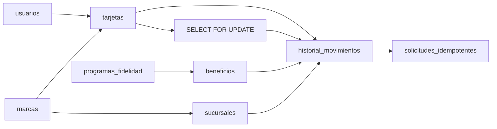

# Backend · PostgreSQL físico propuesto

> **Alcance del 02/10/2026:** este diseño conserva sus acuerdos y propuestas originales. La implementación evolucionó: consultar [datos actuales](#/data-current), [integración real](#/integration-matrix) y [estado observado](#/runtime-snapshot). La coincidencia con código no aprueba automáticamente una decisión `PC-xx` ni convierte todo el spec/OpenAPI en contrato desplegado.

> **PROPUESTA CODEX `PC-09`, `PC-10` y `PC-11`.** No son migraciones ejecutadas.

## Tipos e invariantes

| Concepto | PostgreSQL propuesto |
|---|---|
| IDs | `BIGINT GENERATED ALWAYS AS IDENTITY` |
| Tiempo | `TIMESTAMPTZ` UTC |
| Email | `CITEXT` único |
| Estado/rol | `TEXT` + `CHECK` |
| Dinero | `BIGINT` en unidad mínima + `CHAR(3)` |
| Saldos y cantidades | `BIGINT`, nunca negativos |
| Optimismo | `version INTEGER NOT NULL DEFAULT 1` |

Un movimiento guarda `operacion` y `sentido` por separado. `ACUMULACION` siempre
es `CREDITO`; `CANJE`, `DEBITO`; un `AJUSTE` admite ambos. `cantidad` es siempre
positiva y el check verifica la aritmética entre saldo anterior y posterior.

## Eliminación y trazabilidad

- Usuarios, marcas, sucursales, tarjetas y beneficios: baja lógica y FKs `RESTRICT`.
- Historial: nunca se elimina y nunca queda huérfano.
- Asignaciones sin historia: `CASCADE` sólo en correcciones administrativas.
- Beneficio canjeado: conserva snapshot de nombre y requisito.
- Imagen: desvinculación inmediata y borrado del objeto después de 24 horas.

## Índices mínimos

- Email, Google ID y QR hasheado únicos.
- Membresía única por usuario y marca; índice por marca, rol y activo.
- Tarjeta única por usuario y marca.
- Programa único por marca y tipo; máximo uno activo en MVP 1.
- Suscripción activa única por marca.
- Movimiento por tarjeta y fecha descendente; por sucursal y fecha.
- Operación y tipo de saldo únicos para evitar doble escritura.
- Invitación pendiente única por marca y email.

## Transacción de saldo

1. Reservar idempotencia.
2. Validar actor, sucursal, marca, plan y suscripción.
3. Crear tarjeta con `ON CONFLICT DO NOTHING` cuando falta.
4. Bloquear tarjeta con `SELECT ... FOR UPDATE`.
5. Revalidar beneficio y calcular con enteros.
6. Actualizar saldo, insertar movimiento y persistir respuesta.
7. Confirmar todo en un único commit.

El orden de locks es tarjeta → beneficio → suscripción. Los errores PostgreSQL
`40001` y `40P01` admiten hasta tres reintentos con jitter.

## Anexo implementado · esquema 0041 de testing

La migración `0041_branch_pdf_menus` en backend `c12c94da5c62fcaf062a0094109ed47fc2dedc90` implementa este anexo; **desplegado y verificado en testing**. [PR39](https://github.com/am-p/app-loyalty/pull/39) está abierta y depende de las migraciones 0036–0040 de la entrega del mapa, ausentes en el main oficial observado (0035). No se modifican números ni SQL previamente aplicados. Las propuestas físicas del resto del documento permanecen propuestas.

`branch_menu_documents` almacena UUID, marca/sucursal, nombre de archivo, MIME PDF, tamaño entre 1 y 10 MiB, entre 1 y 30 páginas, SHA-256 de 32 bytes, clave de objeto única y estados `UPLOAD_PENDING`, `READY`, `DELETE_PENDING`, `DELETED`. Incluye fecha, `delete_after`, `lease_owner` y `lease_until`; el índice de limpieza cubre estado y fechas. La clave única `(id,sucursal_id,marca_id)` permite FKs compuestas desde los punteros del menú.

`branch_menus` tiene PK por sucursal, marca, versión positiva y punteros nullable al borrador y al publicado. Ambas FKs `(document_id,sucursal_id,marca_id)` y la FK sucursal–marca preservan aislamiento de tenant/sucursal. Un CHECK impide que draft y published señalen el mismo documento. Sin fila previa, el repositorio devuelve versión lógica 1; la primera carga confirmada crea versión 2. GET no crea tablas ni filas.

El orden implementado de locks para menú es marca → sucursal → menú/documentos. La carga reserva un documento desvinculado, realiza el PUT al storage sin retener locks de base y confirma el borrador solo después de revalidar permiso y versión. Publicar mueve draft a published en una transacción y retira el documento anterior. La firma ocurre antes del commit, también en la lectura pública protegida; un fallo previo revierte los cambios de punteros. La compensación solo afecta `UPLOAD_PENDING`: no retira un `READY` confirmado si se perdió la respuesta del commit.

Los triggers de baja efectiva de marca/sucursal desvinculan menús e incrementan su versión antes de programar documentos para limpieza. La fecha usa `clock_timestamp()+6 minutes`, cubriendo las URLs de hasta 300 segundos con margen. La cola excluye documentos referenciados y usa lease/reintentos. La anonimización con otro propietario activo conserva los menús de la marca. [Datos V1](#/data-current), [operación PDF](#/backend-operations) y [recorrido](#/flow-branch-menu-pdf). No se agregan tablas de productos, precios o importaciones de V2.

- [DDL y triggers exactos](https://github.com/gagonzalez1/app-loyalty/blob/closed-test-readiness/migrations/0041_branch_pdf_menus.up.sql)
- [Locks, versiones y compensación](https://github.com/gagonzalez1/app-loyalty/blob/closed-test-readiness/internal/repository/menu.go)
- [Regresiones de upgrade y concurrencia](https://github.com/gagonzalez1/app-loyalty/blob/closed-test-readiness/internal/repository/menu_integration_test.go)
