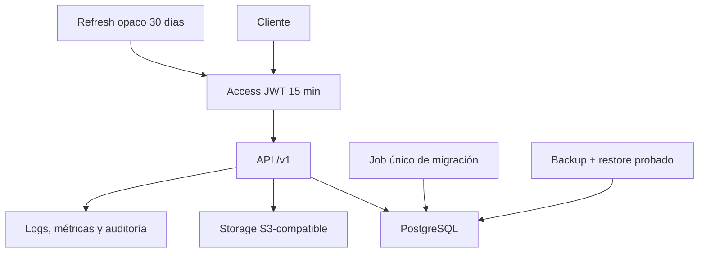

# Backend · Seguridad y operación propuestas

> **Alcance del 02/10/2026:** este diseño conserva sus acuerdos y propuestas originales. La implementación evolucionó: consultar [datos actuales](#/data-current), [integración real](#/integration-matrix) y [estado observado](#/runtime-snapshot). La coincidencia con código no aprueba automáticamente una decisión `PC-xx` ni convierte todo el spec/OpenAPI en contrato desplegado.

> **PROPUESTA CODEX `PC-07`, `PC-11` y `PC-12`.** Requiere revisión de seguridad e infraestructura.

## Sesiones y límites

- Access JWT: 15 minutos, audiencia separada para app y Backoffice.
- Refresh: token opaco hasheado, 30 días, rotación y detección de reutilización.
- MFA obligatorio para Backoffice en producción.
- Login: 10 intentos por IP cada 10 minutos, más límite por email.
- Scan/canje: 60 operaciones por operador y minuto.
- JSON: máximo 1 MiB. Imagen: máximo 5 MiB.

## Imágenes

- Bucket privado S3-compatible; claves generadas por backend.
- Sólo JPEG, PNG y WebP, validados por contenido real.
- Variantes normalizadas: logo `1024×1024`, icono `512×512`.
- Checksum SHA-256 y metadatos en PostgreSQL.
- Eliminar significa desvincular y programar; no borrar dentro del request.

## Migraciones

- SQL numerado y versionado en Git; sin crear tablas al iniciar la API.
- Job único antes del despliegue.
- Expand → código compatible → backfill → verificación → contract.
- Índices grandes con `CREATE INDEX CONCURRENTLY`.
- Backup verificado y rollback antes de cambios destructivos.

## Observabilidad y recuperación

- Logs JSON con `request_id`, actor, marca, ruta, status y duración, sin secretos.
- Métricas de latencia, 5xx, DB, scans, canjes, locks e idempotencias.
- Alertas iniciales: 5xx mayor a 2 % por 5 min, p95 mayor a 1 s o DB no disponible.
- Backups diarios, retención 30 días y restauración probada mensualmente.
- `/health/live`, `/health/ready` y `/version`; readiness comprueba esquema requerido.

Toda mutación de Backoffice registra actor, motivo y estados anterior/posterior en
una auditoría inmutable.

## Anexo implementado · operación PDF V1 candidata

Backend `c12c94da5c62fcaf062a0094109ed47fc2dedc90` y frontend `72cf2229f8f732d705a63641692aff26481d5047`, ramas de integración `closed-test-readiness` y `testing`. [PR39 backend](https://github.com/am-p/app-loyalty/pull/39) abierta; [PR67](https://github.com/gonzalotev/app-fidelidad/pull/67) y [PR68](https://github.com/gonzalotev/app-fidelidad/pull/68) integradas en testing. Código implementado, **desplegado y verificado en testing**. El resto del documento conserva su condición propuesta; este anexo no acredita una nueva prueba de proveedores ni cambia producción.

La carga privada autoriza antes de leer multipart, reutiliza el semáforo y rate limits de medios y exige un único campo `archivo`. El límite de archivo PDF es 10 MiB, con margen de cuerpo de 64 KiB; la entrada landing y el proxy web de testing permiten 11 MiB solo en la ruta exacta de documentos (archivo hasta 10 MiB más multipart). No se amplía el límite de imágenes. pdfcpu opera en modo stateless, validación estricta, sin validar enlaces de red y con timeout de tres segundos, límites de objetos/streams/decodificación y 1–30 páginas. Rechaza cifrado y contraseña; admite escaneos y no extrae productos/precios.

El storage existente recibe objetos privados inmutables con checksum SHA-256. Se persiste `UPLOAD_PENDING` antes de cargar; solo la activación autorizada y versionada cambia el borrador. Los fallos anteriores al commit mantienen la publicación. Si la respuesta del commit es incierta, el cliente reconsulta; no hay rollback de una publicación posterior por un error de transporte.

Las URLs HTTPS duran como máximo 300 segundos y las respuestas JSON emiten `no-store`. La firma ocurre con locks, antes del commit de lectura/publicación; retirar impide nuevas firmas. La desvinculación programa borrado mediante `clock_timestamp()+6 minutes`, sin prometer revocación instantánea de URLs ya emitidas.

El worker de mantenimiento existente reclama documentos desvinculados con lease de cinco minutos y `FOR UPDATE SKIP LOCKED`. Una carga pendiente abandonada es elegible tras 15 minutos. El fallo de borrado libera el lease y reprograma el intento una hora después; el éxito marca `DELETED`. Los triggers cubren baja de sucursal/marca y cierre real de marca al anonimizar su último propietario. No se retiran menús si otro propietario mantiene activa la marca.

La versión requerida del candidato es `0041`; la publicación debe aplicar antes la migración 0041 sobre las 0040 existentes y verificar versión/readiness del proceso nuevo. El main oficial observado termina en 0035: para promover hay que incluir la dependencia 0036–0040, sin reutilizar versiones. El DOWN de 0041 elimina las tablas de menús y sus datos; no es una recuperación de aplicación con documentos en uso. Conservar el esquema expandido y alinear `EXPECTED_SCHEMA_VERSION` al revertir solo el binario.

El circuito de testing usa API y frontend separados; `puntazo-preview` está retirado. El acceso real al PDF, el QR, roles, reemplazo fallido, limpieza y consulta sin sesión requieren aceptación contra testing; exportar JS nativo o ejecutar navegador no acredita QA físico Android/iOS. [Flujo V1](#/flow-branch-menu-pdf) y [evidencia por ambiente](#/runtime-snapshot). V2 digital/IA no añade proveedores ni procesos operativos.

- [Parser y storage del candidato](https://github.com/gagonzalez1/app-loyalty/blob/closed-test-readiness/internal/service/menu.go)
- [Límites HTTP y errores](https://github.com/gagonzalez1/app-loyalty/blob/closed-test-readiness/internal/handler/menu.go)
- [Worker de limpieza PDF](https://github.com/gagonzalez1/app-loyalty/blob/closed-test-readiness/internal/maintenance/worker.go)
- [Proxy multipart de testing](https://github.com/gonzalotev/app-fidelidad/blob/testing/nginx/default.conf)

- [Límite de entrada PDF en landing testing](https://github.com/gagonzalez1/puntazo-landing/blob/testing/nginx/default.conf.template)

## Ampliación operativa · 30 MiB y esquema 0042 · 18/10/2026

La fuente backend `64bb3fc901293791adcf7738c49d3bbf290c8a20` implementa 30 MiB por archivo PDF y 30 MiB + 64 KiB por multipart. El middleware exceptúa sólo el POST de documentos del menú; los proxies web/landing coordinan 31 MiB para esa ruta. JSON e imágenes mantienen sus límites. La configuración seleccionada para testing es `MEDIA_UPLOAD_GLOBAL_CONCURRENCY=2` y `MEDIA_UPLOAD_ACTOR_CONCURRENCY=2`, para conservar margen en la API de 768 MiB; ambos valores se verificaron efectivos en el proceso nuevo.

El parser sigue stateless, estricto, sin red y con timeout de 3 segundos. Entrada y stream se acotan al tamaño PDF de 30 MiB; los otros caps permanecen: objeto 2 MiB, decodificación 32 MiB, imagen 64 MiB y 25 millones de píxeles, además de los límites existentes de objetos, xref y recursión. No se amplía el parser de páginas (1–30), el TTL firmado (300 segundos), la gracia de limpieza ni los permisos. El escaneo RGB válido de 30 MiB y la frontera + 1 byte pasaron; race, vet, vulnerabilidades alcanzables, OpenAPI y Docker también.

Readiness requiere 0042. Se aplicó `0042_branch_pdf_30mib` sobre 0041 sin alterar SQL aplicado. Restore aislado y base de testing aprobaron upgrade y segundo pase, con agregados y fingerprints de menús preservados. El DOWN nuevo aborta ante cualquier documento mayor de 10 MiB: **no usar DOWN en live**. El rollback de aplicación conserva 0042 y `EXPECTED_SCHEMA_VERSION=0042`; no restaura automáticamente la base. El anexo anterior de 10 MiB/0041 queda como corte histórico de las 16 UTC.

**Runtime API confirmado:** Coolify `zlohkesbgfevzpxzdg7skgsx` terminó 23:47:39 UTC del 18/10/2026 para API `64bb3fc`; esquema 0042/42 migraciones, readiness 200, healthy y cero reinicios. Límites efectivos 768 MiB/1 CPU y concurrencia global 2 / actor 2 verificados. Landing `6533196`, PR11 integrada, terminó 23:43:33 UTC con proxy 31 MiB; frontend `067dc68` integra PR69, tiene CI aprobada y terminó su despliegue a las 23:53:18 UTC. Pasaron 137 unidades, cinco PWA, build web y export Android JS; este último no acredita un dispositivo físico.

**Aceptación live de 30 MiB aprobada:** carga exacta por UI y API, revisión PDF HTTP 200 con tamaño/hash esperado y descarte de los borradores sin cambiar la publicación. El exceso de un byte fue rechazado; los ocho negativos conservaron estado. El perfil con SW anterior actualizó su worker y abrió el PDF real sin HTML del SPA. [Estado observado](#/runtime-snapshot) registra las fuentes y los límites de la evidencia; producción no recibe esta entrega.

- [Middleware exacto de cuerpos](https://github.com/gagonzalez1/app-loyalty/blob/closed-test-readiness/internal/middleware/request.go)
- [Caps del parser](https://github.com/gagonzalez1/app-loyalty/blob/closed-test-readiness/internal/service/menu.go)
- [Expansión y recuperación 0042](https://github.com/gagonzalez1/app-loyalty/blob/closed-test-readiness/migrations/README.md)
