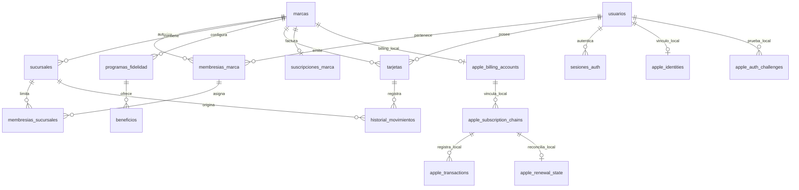

# Datos · Estado implementado

El [delta iOS del 01/11/2026](#/ios-development) añade tablas locales de identidad y billing Apple. Se validaron en una base aislada de pruebas; no se aplicaron a los ambientes descritos en el corte histórico. El DER distingue esas relaciones con el sufijo `local`.

Revisión de fuentes y runtime del **02/10/2026, 22:30–22:33 UTC**. Los SHA y las diferencias por ambiente están en [Estado observado](#/runtime-snapshot). Esta revisión describe arquitectura e integración; no certifica todos los invariantes de negocio ni ejecuta operaciones sobre cuentas reales.

Ambas bases observadas contienen **41 tablas públicas**, incluida `schema_migrations`. Este DER muestra el núcleo y omite columnas/tablas auxiliares; no es un DDL completo.

| Grupo | Tablas principales y función |
|---|---|
| Identidad | `usuarios`, `sesiones_auth`, `tokens_identidad_email`, `contadores_codigo_usuario`; versiones, verificación y códigos inmutables |
| Tenancy | `marcas`, `sucursales`, `membresias_marca`, `membresias_sucursales`; roles y alcance por marca/sucursal |
| Fidelidad | `programas_fidelidad`, `beneficios`, `tarjetas`; sellos/puntos, saldos y versiones |
| Operación | `previews_movimiento`, `historial_movimientos`, `solicitudes_idempotentes`; confirmación, snapshots y deduplicación |
| Comercio | `accesos_demo`, `suscripciones_marca`, `invitaciones_marca`, `invitaciones_sucursales`, `archivos_marca` |
| Asíncrono | `email_outbox`, `push_tokens`, `push_notifications`, `eventos_mercado_pago` |
| Reseñas | `configuracion_resenas`, `progreso_resenas`, `invitaciones_resenas` |
| Referidos | `referral_campaigns`, `referral_influencers`, `referral_codes`, `referral_attributions`, `referral_charges`, `referral_rewards`, `referral_merchant_credit_allocations` |
| Administración | `backoffice_users`, `backoffice_sessions`, `backoffice_audit`, `subscription_prices` y tablas de cambios/items/historial de precios |

`0032` registra primer login y comienzo de trial, marcando como estimados los datos históricos. `0033` añade el código inmutable y su contador; los usuarios anteriores conservan el código heredado. El QR lo genera el servidor mediante HMAC y conserva su hash; no se construye como un ID visible en el frontend.

La baja conserva el ledger y anonimiza según el código de cuenta. La auditoría de todas las restricciones y políticas de retención queda fuera de este corte de arquitectura. El [DER objetivo](#/data-target) mantiene su carácter propuesto.

## Persistencia local Apple · 01/11/2026

| Migración de trabajo | Tablas y responsabilidad |
|---|---|
| `0044_apple_identity` | `apple_identities`, `apple_auth_challenges`, `apple_identity_revocations`: subject único, nonce hasheado con propósito/expiración y tokens cifrados para revocación durable |
| `0045_apple_billing` | `apple_billing_accounts`, `apple_purchase_intents`, `apple_subscription_chains`, `apple_transactions`, `apple_renewal_state`, `apple_notification_inbox`, `apple_referral_offers`, `apple_referral_charges`, `apple_claim_reservations`: vínculo permanente, eventos y contabilidad separados de Mercado Pago |

Identidad Apple y comprador Apple no son el mismo vínculo. La baja elimina la identidad y encola el token cifrado en la misma transacción; su export sólo incluye subject, correo relay y fechas. El binding comercial opaco se conserva para impedir que otra marca reclame la cadena; una notificación no reactiva una marca eliminada. Esto describe el código local y no establece una nueva política general de retención del resto de la cuenta.

La conciliación comercial usa entorno y transacción como claves; eventos antiguos no deben reactivar derechos o anular recompensas de una reversión posterior. El ledger Apple conserva moneda y milliunits, separado de los minor units de Mercado Pago. El trial de esta entrega parte del registro comercial persistido, no del primer login; el nombre histórico de `0032` no cambia esa regla. Las migraciones aplicadas se preservan: confirmar numeración y restricciones antes de promover `0044`/`0045` al repositorio dueño.

## Referencias de código

- [Migraciones actuales](https://github.com/am-p/app-loyalty/blob/main/migrations/README.md)
- [Núcleo inicial](https://github.com/am-p/app-loyalty/blob/main/migrations/0001_demo_sellos.up.sql)
- [Trial](https://github.com/am-p/app-loyalty/blob/main/migrations/0032_first_login_trial.up.sql)
- [Códigos](https://github.com/am-p/app-loyalty/blob/main/migrations/0033_user_codes.up.sql)
- [Baja y exportación](https://github.com/am-p/app-loyalty/blob/main/internal/repository/account.go)
