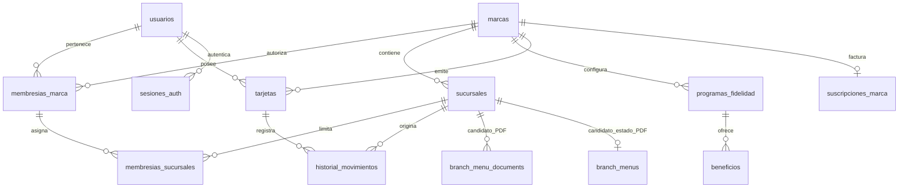

# Datos · Estado implementado

Revisión de fuentes y runtime del **02/10/2026, 22:30–22:33 UTC**. Los SHA y las diferencias por ambiente están en [Estado observado](#/runtime-snapshot). Esta revisión describe arquitectura e integración; no certifica todos los invariantes de negocio ni ejecuta operaciones sobre cuentas reales.

Ambas bases observadas en ese corte del 02/10 contienen **41 tablas públicas**, incluida `schema_migrations`; el número no describe la ampliación candidata 0041. Este DER muestra el núcleo y omite columnas/tablas auxiliares; no es un DDL completo.

| Grupo | Tablas principales y función |
|---|---|
| Identidad | `usuarios`, `sesiones_auth`, `tokens_identidad_email`, `contadores_codigo_usuario`; versiones, verificación y códigos inmutables |
| Tenancy | `marcas`, `sucursales`, `membresias_marca`, `membresias_sucursales`; roles y alcance por marca/sucursal |
| Fidelidad | `programas_fidelidad`, `beneficios`, `tarjetas`; sellos/puntos, saldos y versiones |
| Operación | `previews_movimiento`, `historial_movimientos`, `solicitudes_idempotentes`; confirmación, snapshots y deduplicación |
| Comercio | `accesos_demo`, `suscripciones_marca`, `invitaciones_marca`, `invitaciones_sucursales`, `archivos_marca` |
| Asíncrono | `email_outbox`, `push_tokens`, `push_notifications`, `eventos_mercado_pago` |
| Reseñas | `configuracion_resenas`, `progreso_resenas`, `invitaciones_resenas` |
| Referidos | `referral_campaigns`, `referral_influencers`, `referral_codes`, `referral_attributions`, `referral_charges`, `referral_rewards`, `referral_merchant_credit_allocations` |
| Administración | `backoffice_users`, `backoffice_sessions`, `backoffice_audit`, `subscription_prices` y tablas de cambios/items/historial de precios |

`0032` registra primer login y comienzo de trial, marcando como estimados los datos históricos. `0033` añade el código inmutable y su contador; los usuarios anteriores conservan el código heredado. El QR lo genera el servidor mediante HMAC y conserva su hash; no se construye como un ID visible en el frontend.

La baja conserva el ledger y anonimiza según el código de cuenta. La auditoría de todas las restricciones y políticas de retención queda fuera de este corte de arquitectura. El [DER objetivo](#/data-target) mantiene su carácter propuesto.

## Referencias de código

- [Migraciones actuales](https://github.com/am-p/app-loyalty/blob/main/migrations/README.md)
- [Núcleo inicial](https://github.com/am-p/app-loyalty/blob/main/migrations/0001_demo_sellos.up.sql)
- [Trial](https://github.com/am-p/app-loyalty/blob/main/migrations/0032_first_login_trial.up.sql)
- [Códigos](https://github.com/am-p/app-loyalty/blob/main/migrations/0033_user_codes.up.sql)
- [Baja y exportación](https://github.com/am-p/app-loyalty/blob/main/internal/repository/account.go)

## Favoritos del mapa · candidato del 17/10/2026

La migración0040 agrega `sucursales_favoritas(usuario_id,sucursal_id,created_at)`, clave primaria compuesta y referencias con borrado en cascada. La API también elimina preferencias al anonimizar una cuenta, cuya fila de usuario se conserva. Las migraciones0036–0040 se toman sin alterar de PR34, preservando sus números, restricciones e índices. El esquema observado por ambiente y su publicación se registran en [Estado observado](#/runtime-snapshot); los modelos objetivo de menús digitales no se incorporan. [Contrato de mapa y plan V1](#/flow-customer-map-menu).

## Menú PDF V1 · esquema 0041 de testing

Implementado en backend `c12c94da5c62fcaf062a0094109ed47fc2dedc90`, desplegado y verificado en testing; pendiente de promoción por [PR39](https://github.com/am-p/app-loyalty/pull/39). `0041_branch_pdf_menus` agrega dos tablas, sin alterar migraciones previas ni introducir categorías/productos de V2.

| Tabla | Persistencia e integridad implementadas |
|---|---|
| `branch_menu_documents` | UUID, marca/sucursal, nombre saneado, MIME PDF, tamaño, páginas, SHA-256, clave de objeto única, estado de carga y campos de gracia/lease |
| `branch_menus` | Una fila por sucursal, versión positiva, punteros nullable al borrador y a la publicación; ambos no pueden señalar el mismo documento |

Las FKs compuestas `(document_id,sucursal_id,marca_id)` impiden asignar a una sucursal el PDF de otra, incluso dentro de la misma marca. Documentos y estado también referencian la relación real sucursal–marca. El estado lógico inicial es versión 1 con ambos punteros null; GET no crea filas. Una carga confirmada crea/reemplaza el borrador y aumenta la versión sin reemplazar la publicación. Los estados del documento son `UPLOAD_PENDING`, `READY`, `DELETE_PENDING` y `DELETED`.

Publicación/retiro/descarte modifican punteros y versión bajo transacción. Los documentos retirados dejan de ser públicos y se programan para borrado físico tras seis minutos; URLs emitidas previamente vencen en hasta 300 segundos. Los triggers cubren baja efectiva de marca/sucursal, incluido cierre de marca al anonimizar su último propietario. Si otro propietario mantiene la marca activa, los menús permanecen. [Flujo V1](#/flow-branch-menu-pdf); el esquema efectivamente desplegado pertenece a [Estado observado](#/runtime-snapshot).

- [DDL 0041 y triggers](https://github.com/gagonzalez1/app-loyalty/blob/closed-test-readiness/migrations/0041_branch_pdf_menus.up.sql)
- [Lecturas, versiones y publicación](https://github.com/gagonzalez1/app-loyalty/blob/closed-test-readiness/internal/repository/menu.go)

## Ampliación del límite PDF · esquema 0042 · 18/10/2026

La fuente `closed-test-readiness` verificada en backend `64bb3fc901293791adcf7738c49d3bbf290c8a20` conserva 0041 intacta y agrega `0042_branch_pdf_30mib`: sólo amplía `branch_menu_documents_byte_size_check` a 1–31.457.280 bytes (30 MiB). No agrega tablas ni cambia punteros, versiones, checksums, metadatos o datos de otros dominios. Las relaciones del DER y el resto de invariantes del anexo anterior siguen vigentes; sus cifras históricas de 0041/10 MiB no son el límite actual de la fuente.

La migración restore y live de 0041 a 0042 aprobó ambos pases preservando agregados y fingerprints de menús; readiness y el valor esperado de esquema pasan a 0042. El DOWN aborta si hay metadatos mayores de 10 MiB, incluidos retirados. No ejecutar DOWN en live ni eliminar documentos para forzar una reversión: el rollback de aplicación conserva el esquema expandido.

**Runtime API confirmado:** testing ejecuta `64bb3fc`, esquema 0042/42 migraciones y readiness 200 desde el despliegue terminado 23:47:39 UTC del 18/10/2026. Se preserva la publicación anterior y la evidencia del corte histórico.

**Aceptación live de 30 MiB aprobada:** carga exacta por UI y API, revisión PDF HTTP 200 con tamaño/hash esperado y descarte de los borradores sin cambiar la publicación. El exceso de un byte fue rechazado; los ocho negativos conservaron estado. El perfil con SW anterior actualizó su worker y abrió el PDF real sin HTML del SPA. [Estado observado](#/runtime-snapshot) registra las fuentes y los límites de la evidencia; producción no recibe esta entrega.

- [CHECK de tamaño expandido](https://github.com/gagonzalez1/app-loyalty/blob/closed-test-readiness/migrations/0042_branch_pdf_30mib.up.sql)
- [Regresión de conservación](https://github.com/gagonzalez1/app-loyalty/blob/closed-test-readiness/internal/repository/menu_integration_test.go)
