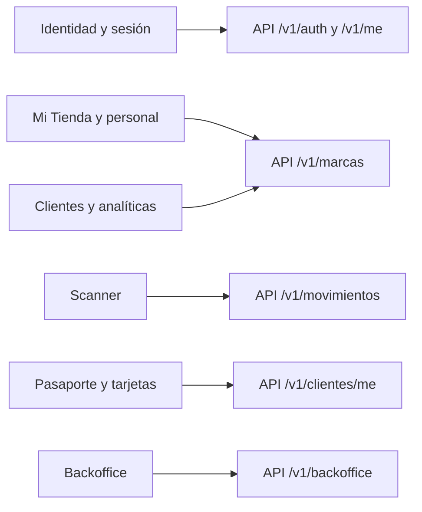

# Datos · Matriz pantalla–API

La tabla histórica conserva su corte de runtime. El [delta iOS local](#/ios-development) se registra por separado abajo: rutas implementadas en el checkout de trabajo no equivalen a rutas desplegadas ni al OpenAPI objetivo.

Revisión de fuentes y runtime del **02/10/2026, 22:30–22:33 UTC**. Los SHA y las diferencias por ambiente están en [Estado observado](#/runtime-snapshot). Esta revisión describe arquitectura e integración; no certifica todos los invariantes de negocio ni ejecuta operaciones sobre cuentas reales.

| Flujo | Integración verificada en código | Límite del despliegue observado |
|---|---|---|
| Registro y acceso | `/auth/register`, `/demo/comercios`, `/auth/login`, `/auth/google`; todos bajo `/v1` | Configuración de altas/verificación y Google condiciona su ejecución |
| Sesión y perfil | `/auth/refresh`, `/auth/logout`, `/me`, foto, export/baja y cambio de email | SMTP configurado en ambos; no se enviaron correos en esta revisión |
| Contexto y personal | `/marcas`, sucursales, `/personal`, `/invitaciones` | Permisos se deciden en API, no por la pestaña visible |
| Clientes | `/marcas/:id/clientes`, búsqueda y paginación | Datos reales, no arrays de ejemplo |
| Scanner | Preview, scan/canje e idempotencia; QR o código de cliente | Requiere conexión; no se confirma offline |
| Mi Tienda | Marca/programa/beneficios/plantilla, edición versionada e imágenes | Media S3 activo en testing; deshabilitado en API productiva observada |
| Analíticas | Resumen + movimientos; `/metricas/periodo` con `day/week/month` | UI por períodos en testing; main publicado conserva resumen operativo |
| Cliente | QR/código, tarjetas, movimientos y SSE web | Los saldos pertenecen al usuario autenticado; fuente común en PostgreSQL |
| Suscripciones | Consulta, checkout, resultado, confirmación por email y cancelación | Mercado Pago configurado en testing; deshabilitado en producción |
| Referidos / Backoffice | Campañas, códigos, atribuciones, recompensas, precios e historial | UI testing activa; producción preparada sin contenedor |
| Push / reseñas | Token Expo, worker; configuración Places e invitaciones/eventos de reseña | Existencia en código no prueba entrega push ni reseña publicada |
| Instalación PWA asistida | Helper integrado en ramas testing frontend/landing | Publicado en las imágenes actuales de testing; instalación física no verificada |

Las rutas de esta tabla son relativas a `/v1` salvo que se indique el prefijo. Su existencia se comprobó en el router real y las llamadas frontend. No se sustituyó por el OpenAPI objetivo. La revisión runtime comprobó versiones, salud, configuración no secreta y estructura de las bases; no creó movimientos, cobros ni sesiones de usuarios.

## Delta local iOS · 01/11/2026

| Pantalla o proceso | Contrato implementado en el candidato local | Estado y límite |
|---|---|---|
| Acceso/alta Apple | `POST /v1/auth/apple/challenge`, `POST /v1/auth/apple` | Challenge 5 minutos, nonce intacto hacia Apple; no consumir código antes de completar perfil. Credenciales y consentimiento reales pendientes |
| Métodos de acceso y reauth | `POST /v1/auth/apple/link`, `POST /v1/auth/reauthenticate`; `auth_methods.apple` adicional | Vínculo explícito, autenticación reciente y versión; relay no produce fusión automática |
| Privacidad/cuenta | `GET /v1/me/export` y `DELETE /v1/me` existen en backend; candidato frontend añade descarga web y hoja nativa de compartir/guardar | La prueba API de exportación y baja no equivale a completar la acción desde la UI. La evidencia nativa de exportación llegó a mostrar la hoja del sistema y cancelar limpió el temporal; no se completó Guardar en Archivos. La baja nativa sigue pendiente; la prueba API no acredita revocación real en Apple |
| Estado comercial | `GET /v1/marcas/:brand_id/billing`, `GET /v1/marcas/:brand_id/billing/apple/catalog` | `FREE` conserva acceso; 20 productos. Catálogo de precios/ofertas reales pendiente de App Store Connect |
| Compra/restauración interna | `POST /v1/marcas/:brand_id/billing/apple/intents`, `POST /v1/marcas/:brand_id/billing/apple/sync` | Intención/idempotencia y gates de compra nueva. `sync` admite `restore?: boolean` (default `false`); sólo Restaurar explícito habilita reclamar una transacción tokenless existente tras validación criptográfica y estado canónico Apple, aun con compras nuevas deshabilitadas o trial activo. Se valida proveedor/programa/capacidad/referido antes de reservar y asignar token; reserva de cadena inmutable y confirmación canónica antes de guardar derechos. Prueba HTTP local en `90cde5d29f86c8f16dfb91ab4273c48dd4f45dc4` confirmó recibo Xcode válido `200`/una fila, duplicado idempotente, firma alterada `400`, conflicto de otra marca `409` y `503` para nuevas compras deshabilitadas mientras la compra existente sincronizó durante trial. No prueba puente JS/StoreKit ni App Store API/Sandbox reales; ver [evidencia](#/ios-development-evidence) |
| Eventos Apple | `POST /v1/apple/app-store/notifications` | Sobre V2/JWS anidado verificados, inbox durable e idempotencia; cadena desconocida queda pendiente sin derechos |
| Mapa/dirección iOS | `StoreLocationsMap` y `AddressPicker` con proveedor Google | En Release3c5de42 se observaron tiles reales, permisos, selección/guardado y reapertura de dirección; los módulos nativos siguen presentes en7a. Pinch/regresión completa y OAuth Google iOS real permanecen pendientes |
| Google OAuth iOS | Parámetros y adaptador nativo preparados | Configuración externa pospuesta expresamente por el usuario; no acreditar login iOS |

Estas rutas respetan el envelope existente, `X-Client-Platform`, sesión y versiones. El frontend hace preflight de entitlements antes de preparar y antes de comprar/canjear; sólo una asociación única confirmada por servidor permite continuar con cadena existente. Reserva durable permite reanudar la misma operación/offer para el mismo actor, marca y producto tras incertidumbre. Carreras entre dispositivos posteriores al preflight y Ask to Buy antes de exponer una transacción conservan límites de observabilidad de Apple; propiedad de cadena se valida en backend. **No se desplegaron estas rutas en esta entrega.** La edición iOS gratis excluye el recorrido de compra y enlaces a facturación externa; la interna requiere flags separados de verificación y nuevas compras. Ver [secuencia Apple](#/sequence-apple), [programa y suscripción](#/flow-plan-selection) y [evidencia](#/ios-development-evidence).

El frontend de exportación/baja se documenta en [Perfil del cliente](#/flow-customer-profile) y en la [evidencia iOS](#/ios-development-evidence). El export JSON fue comprobado por API y la hoja nativa se abrió/canceló en dispositivos; no se verificó guardar el archivo desde la hoja. La baja fue comprobada por API, incluida la anonimización y revocación de sesiones de la cuenta descartable; la confirmación y ejecución de baja desde la app nativa no se completaron. Estas pruebas locales no acreditan despliegue.

Los artefactos `free` e interno de `32f9e82` y el guard de caché son evidencia de la revisión previa; no representan el HEAD de producto actual `7a47558`, que modifica el coordinador de reseñas. En ese HEAD, 434/434 pruebas y TypeScript pasaron localmente, y el cambio de contexto/reserva tiene cobertura nueva. La CI actual de push quedó verde (161 navegador sin retry); las auditorías `free`/interno/Android de `7a47558` pasaron e incluyen el coordinador exacto. Las seis pruebas de reseñas pasaron tanto en Chromium como WebKit; esto no acredita UI nativa ni nuevas compras. El CI push previo de `32f9e82` tuvo una falla real de carrera en reseñas; ver el análisis en [evidencia de entrega](#/ios-development-evidence). No hay despliegue.

## Referencias de código

- [Servicios cliente y movimientos](https://github.com/gonzalotev/app-fidelidad/blob/main/src/features/demo/services/demoService.ts)
- [Comercio](https://github.com/gonzalotev/app-fidelidad/blob/main/src/features/merchant/services/commercialService.ts)
- [Suscripción](https://github.com/gonzalotev/app-fidelidad/blob/main/src/features/merchant/services/subscriptionService.ts)
- [Rutas reales](https://github.com/am-p/app-loyalty/blob/main/cmd/server/router.go)
- [Analíticas de testing](https://github.com/gonzalotev/app-fidelidad/blob/testing/src/features/merchant/services/merchantService.ts)
