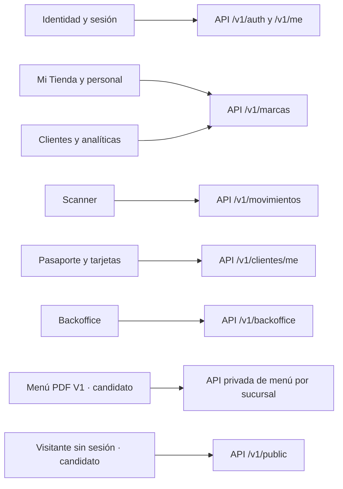

# Datos · Matriz pantalla–API

Revisión de fuentes y runtime del **02/10/2026, 22:30–22:33 UTC**. Los SHA y las diferencias por ambiente están en [Estado observado](#/runtime-snapshot). Esta revisión describe arquitectura e integración; no certifica todos los invariantes de negocio ni ejecuta operaciones sobre cuentas reales.

| Flujo | Integración verificada en código | Límite del despliegue observado |
|---|---|---|
| Registro y acceso | `/auth/register`, `/demo/comercios`, `/auth/login`, `/auth/google`; todos bajo `/v1` | Configuración de altas/verificación y Google condiciona su ejecución |
| Sesión y perfil | `/auth/refresh`, `/auth/logout`, `/me`, foto, export/baja y cambio de email | SMTP configurado en ambos; no se enviaron correos en esta revisión |
| Contexto y personal | `/marcas`, sucursales, `/personal`, `/invitaciones` | Permisos se deciden en API, no por la pestaña visible |
| Clientes | `/marcas/:id/clientes`, búsqueda y paginación | Datos reales, no arrays de ejemplo |
| Scanner | Preview, scan/canje e idempotencia; QR o código de cliente | Requiere conexión; no se confirma offline |
| Mi Tienda | Marca/programa/beneficios/plantilla, edición versionada e imágenes | Media S3 activo en testing; deshabilitado en API productiva observada |
| Analíticas | Resumen + movimientos; `/metricas/periodo` con `day/week/month` | UI por períodos en testing; main publicado conserva resumen operativo |
| Cliente | QR/código, tarjetas, movimientos y SSE web | Los saldos pertenecen al usuario autenticado; fuente común en PostgreSQL |
| Suscripciones | Consulta, checkout, resultado, confirmación por email y cancelación | Mercado Pago configurado en testing; deshabilitado en producción |
| Referidos / Backoffice | Campañas, códigos, atribuciones, recompensas, precios e historial | UI testing activa; producción preparada sin contenedor |
| Push / reseñas | Token Expo, worker; configuración Places e invitaciones/eventos de reseña | Existencia en código no prueba entrega push ni reseña publicada |
| Instalación PWA asistida | Helper integrado en ramas testing frontend/landing | Publicado en las imágenes actuales de testing; instalación física no verificada |

Las rutas de esta tabla son relativas a `/v1` salvo que se indique el prefijo. Su existencia se comprobó en el router real y las llamadas frontend. No se sustituyó por el OpenAPI objetivo. La revisión runtime comprobó versiones, salud, configuración no secreta y estructura de las bases; no creó movimientos, cobros ni sesiones de usuarios.

## Referencias de código

- [Servicios cliente y movimientos](https://github.com/gonzalotev/app-fidelidad/blob/main/src/features/demo/services/demoService.ts)
- [Comercio](https://github.com/gonzalotev/app-fidelidad/blob/main/src/features/merchant/services/commercialService.ts)
- [Suscripción](https://github.com/gonzalotev/app-fidelidad/blob/main/src/features/merchant/services/subscriptionService.ts)
- [Rutas reales](https://github.com/am-p/app-loyalty/blob/main/cmd/server/router.go)
- [Analíticas de testing](https://github.com/gonzalotev/app-fidelidad/blob/testing/src/features/merchant/services/merchantService.ts)

## Corrección del mapa · 17/10/2026

El candidato agrega el descubrimiento autenticado `/v1/clientes/me/tiendas` y `PUT/DELETE` de favoritos por sucursal. El frontend conserva todas las filas, incluidas las de ubicación pendiente, y separa error de ausencia de locales. Contrato, alcance y promoción en [Mapa y menú PDF](#/flow-customer-map-menu); evidencia runtime y límites en [Estado observado](#/runtime-snapshot). V1 PDF se implementa en el candidato siguiente, descrito abajo; V2 continúa como idea futura.

## Menú PDF V1 · candidato del 18/10/2026

Código cotejado: backend `c12c94da5c62fcaf062a0094109ed47fc2dedc90`, frontend `72cf2229f8f732d705a63641692aff26481d5047`. [PR39 backend](https://github.com/am-p/app-loyalty/pull/39) abierta; [PR67](https://github.com/gonzalotev/app-fidelidad/pull/67) y [PR68](https://github.com/gonzalotev/app-fidelidad/pull/68) integradas en testing. Estas conexiones están implementadas, **desplegadas y verificadas en testing**; no amplían la evidencia runtime del corte histórico anterior.

| Pantalla/acción | Llamada real del candidato | Condición |
|---|---|---|
| Mi Tienda → Menú | GET `/v1/marcas/:brand_id/sucursales/:branch_id/menu` | Propietario/administrador activo, mayoría de edad y sucursal exacta |
| Subir PDF | POST anterior + `/documentos`, multipart `archivo` | If-Match, 10 MiB, 1–30 páginas, sin cifrado; crea borrador |
| Publicar/retirar | PUT/DELETE anterior + `/publicacion` | If-Match; PUT envía `document_id` del borrador |
| Descartar borrador | DELETE anterior + `/borrador` | Publicación conservada, condición de versión |
| Mapa → Ver menú | Navegación `/menu/:branchId`, GET `/v1/public/sucursales/:branch_id/menu` | Consulta sin sesión; solo publicación vigente o null |
| Tarjetas → selector | GET `/v1/public/marcas/:brand_id/menus` | Sucursales activas de la marca y disponibilidad pública |
| QR y apertura PDF | Enlace estable de sucursal; URL HTTPS firmada renovada al abrir | Sin cuenta ni instalación; URL hasta 300 segundos, visor externo |

La carga usa el storage privado existente. No se incrementa el límite de imágenes ni se agrega un proveedor de IA. El frontend presenta conflicto de versión y reconsulta ante resultado incierto, sin reemplazar silenciosamente la versión revisada. [Recorrido V1](#/flow-branch-menu-pdf). El circuito de testing usa repositorios separados; `puntazo-preview` está retirado.

- [Servicios frontend PDF](https://github.com/gonzalotev/app-fidelidad/blob/testing/src/features/merchant/services/branchMenuService.ts)
- [Rutas privadas reales](https://github.com/gagonzalez1/app-loyalty/blob/closed-test-readiness/cmd/server/routes_merchant.go)
- [Rutas públicas reales](https://github.com/gagonzalez1/app-loyalty/blob/closed-test-readiness/cmd/server/routes_public.go)
