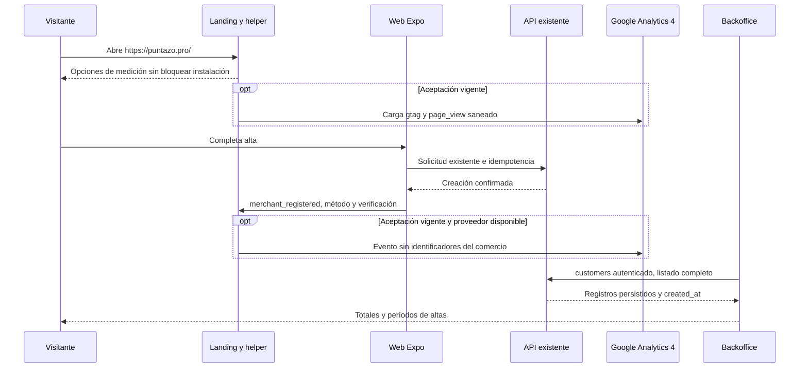

# Visitas y altas de comercios

Configuración autorizada por el usuario el 01/11/2026: Google Analytics 4 como proveedor. Esta revisión se limita a adquisición; las analíticas de puntos, sellos y movimientos siguen siendo otro dominio.

## Fuentes y límites

| Medida | Fuente | Interpretación |
|---|---|---|
| Comercios registrados | Backoffice, `GET /v1/backoffice/customers`, `marcas.created_at` | Una marca por comercio; listado completo sin paginación. Incluye marcas cerradas y pruebas porque no existe un indicador de pruebas. |
| Hoy / últimos 7 / últimos 30 días | Mismo listado, cálculo del Backoffice | Días calendario de Buenos Aires, incluido hoy; fechas inválidas y futuras excluidas. No modifica registros ni agrega consultas al servidor. |
| Visitas y origen web | GA4, `page_view` manual | Sólo navegador web con aceptación vigente, sin bloqueo del proveedor. No representa todas las visitas. |
| Alta observada en web | GA4, `merchant_registered` como evento clave | Respuesta de creación confirmada, mejor esfuerzo; puede perderse por cierre, bloqueo o falta de consentimiento. El total persistido se consulta en Backoffice. |

El alta por correo cuenta cuando `POST /v1/demo/comercios` crea la marca, aunque requiera verificar el correo después. Google cuenta sólo `account_created=true` y `PERSONAL_MARCA`. Login existente, restauración de sesión, invitaciones, empleados, sucursales, compras y pagos no cuentan como alta de comercio. La instrumentación nativa es no-op: no se instaló un SDK móvil ni se publicó un AAB por este cambio.

## Recorrido y contrato

Puente v1: `window.puntazoMeasure(nombre, datos?, opciones?)`. Cola temporal acotada a 30 llamadas. Eventos públicos: `page_view` con una página del diccionario; `merchant_registered` con `method=email|google` y `verification=required|not_required`. La clave de deduplicación vive en opciones locales y nunca se envía a Google. El helper registra además `landing_action` con acciones enumeradas de instalación, Google Play, acceso y alta.

Sólo se nombran `/`, `/login`, `/account-type`, `/merchant-registration`, `/subscription` y `/verify-email`. No se envían formularios, nombres, correos, identificadores de usuarios o marcas, tokens, QR, rutas dinámicas, queries ni fragmentos. URL, título y referrer se reemplazan por valores controlados antes de configurar gtag y emitir eventos. La atribución acepta fuentes y medios enumerados; descarta campañas y parámetros arbitrarios. El tráfico directo se traduce a `(direct)/(none)` en la frontera con GA4; referencias conocidas de ChatGPT y Perplexity usan `ai-assistant` según las [reglas actuales del proveedor](https://support.google.com/analytics/answer/9756891?hl=en), salvo medio UTM válido explícito.

## Configuración y elección del visitante

- Propiedad **Puntazo web**, zona Buenos Aires y moneda ARS; identificador público `G-2MJSNJ2PES` suministrado al contenedor de landing mediante `PUNTAZO_GA4_MEASUREMENT_ID`. `PUNTAZO_MEASUREMENT_ENABLED` permite desactivarla. Sin configuración válida queda apagada.
- Producción limitada a `https://puntazo.pro`. Testing, DuckDNS y otros hosts no envían medición.
- No se cargan scripts ni se envían solicitudes de medición GA4 antes de aceptar; rechazar permite seguir usando la web. No se recuperan altas ni clics anteriores a la aceptación. Preferencia versionada durante 180 días; DNT/GPC desactivan medición.
- Cookies propias de analítica prefijadas `puntazo`, máximo 60 días, sin renovación automática. Revocar desde preferencias detiene eventos y elimina sólo estas cookies; no elimina sesión de Puntazo ni interrumpe formularios.
- Medición mejorada, Signals, datos proporcionados por usuarios y personalización publicitaria desactivados; consentimientos publicitarios denegados. Retención de eventos y usuarios de 2 meses, sin reinicio por actividad. Sin Google Ads ni GTM.
- `merchant_registered` es evento clave una vez por evento, sin valor monetario. Dimensiones de evento: `action`, `method`, `verification`.

GA4 procesa datos técnicos y cookies de analítica si el visitante acepta; no se presenta como una medición anónima ni exacta del universo de visitas. Esta documentación técnica no modifica el estado de aprobación de los documentos legales.

## Compatibilidad y publicación

El QR impreso contiene exactamente **`https://puntazo.pro/`**. Se mantiene esa entrada; `www` redirige hacia la raíz conservando ruta y query. Un QR sin etiquetas de campaña no se puede distinguir de una visita directa; tampoco se atribuyen retroactivamente registros históricos.

Web publicada desde main `f77ab72078ecccf3ef049dadc01b479299755176`, despliegue `rcxa41n1inu9kpwhrwoaicpi`. Landing de medición publicada desde `eeb2f1681382657c714226a3f1abf96c408371df`, despliegue `6opzt71zmzyidokr8ljg3wne`; corrección permanente de DNS del proxy integrada mediante PR18 en `d88d4ea6383bbc0e543945964a9b75500be0a258`, publicada mediante `lrsrnfvevxduxwkhbh89leuj`, finished03:12:29UTC02/11. Prueba real: 1 usuario y 1 vista en GA4 Realtime tras aceptación explícita, sin conversiones falsas. Backoffice publicado desde `main` resuelto a `9158c02e0aea34943d7689c95f16829aeba80d04`, despliegue `aiar8ryutpaxcpxcbxoadq5w`, saludable y con cero reinicios. Se reprodujo y corrigió una falla de resolución tras renovar la web: un `proxy_pass` literal de fotos conservaba un upstream implícito con IP anterior. Se recuperó el acceso reiniciando oficialmente la landing; PR18 elimina el último proxy literal. Una prueba Nginx aislada reemplazó el upstream por otra IP y comprobó cuatro rutas con URI/query/headers y los mismos workers, sin recarga. La API productiva sigue en `9c802f7e5422464a9b3280364bfeba0b8e614389`, esquema `0043`; no se modificó ni desplegó backend.

Estos SHA son evidencia de esta revisión, nunca selectores para futuros builds: volver a obtener el HEAD remoto de las ramas elegidas antes de construir o desplegar.

## Referencias de código

- [Puente y política del helper](https://github.com/gagonzalez1/puntazo-landing/tree/main/public/landing)
- [Adaptador web y nativo](https://github.com/gonzalotev/app-fidelidad/tree/main/src/core/acquisition)
- [Altas por período en Backoffice](https://github.com/gagonzalez1/puntazo-backoffice/blob/main/src/acquisition.ts)
- [Servicios de alta existentes](https://github.com/gonzalotev/app-fidelidad/blob/main/src/features/demo/services/demoService.ts)
