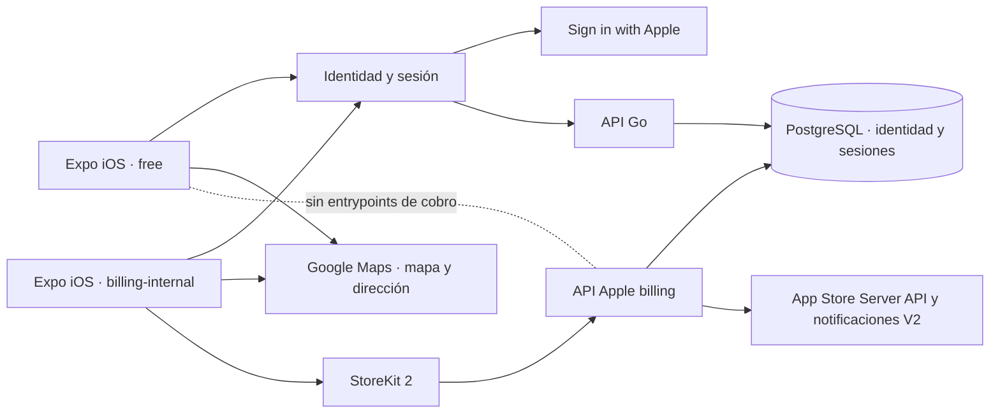

# Desarrollo iOS · edición gratis y StoreKit interno

**Corte del 01/11/2026, plano de fuentes.** El usuario aprobó implementar Apple junto con email y Google, Google Maps en iOS y el cobro Apple completo en una edición interna. La primera edición pública será gratuita. La implementación está guardada en las ramas seleccionadas y sus PR de promoción siguen pendientes; no acredita una app subida, un despliegue ni compras de App Store reales. La [evidencia y los pendientes](#/ios-development-evidence) separan esas etapas.

El contrato de esta entrega fue aprobado expresamente por el usuario. No convierte otras rutas del OpenAPI objetivo ni decisiones `PC-xx` en acuerdos. **Mis logros, PR104, queda fuera** de la integración.

## Fuentes seleccionadas y promoción

| Pieza | Repositorio, remoto y rama elegidos | Checkout de esta tarea |
|---|---|---|
| Frontend | `gonzalotev/app-fidelidad`, `origin/develop` | `.worktrees/ios-development/frontend` |
| Backend de trabajo | `gagonzalez1/app-loyalty`, `fork/develop` | `.worktrees/ios-development/backend` |
| Dueño del backend | `am-p/app-loyalty`; requiere PR de promoción | No sustituir su árbol con el fork completo |
| Documentación | `gagonzalez1/puntazo-docs`, `origin/main`; trabajo en `docs/ios-development-20261101` | `.worktrees/ios-development/docs` |

Los paths son relativos al workspace Puntazo. Los commits iniciales sólo son evidencia del punto de partida; **ningún SHA de este documento selecciona un build futuro**. Antes de construir/publicar, fetch de las ramas elegidas y `verify-context.py --require-clean` sobre los checkouts reales. La reconciliación final debe registrar commits, PR y diferencias con el runtime.

## Dos ediciones del frontend

`EXPO_PUBLIC_IOS_EDITION` admite `free` y `billing-internal`; el valor por defecto es `free`.

| Edición | Comportamiento aprobado | Límite de publicación |
|---|---|---|
| `free` | Acceso sin facturación, incluso cuando haya vencido el trial comercial; el propietario ve **Plan y facturación → Prueba gratuita** en Mi Tienda. Sin checkout, enlaces a cobros externos ni Mercado Pago en el recorrido iOS | Debe excluir autolinking de `expo-iap` y entrypoints JavaScript de billing del artefacto, además de sus botones |
| `billing-internal` | Catálogo, intención de compra, compra/restauración, sincronización y gestión de suscripción Apple | Perfil interno; `expo-iap` fijado en `3.4.13`; configuración `.storekit` local para desarrollo |

El empaquetado y el harness nativo están en preparación/verificación. Esta tabla fija las condiciones de aceptación; no prueba por sí misma el contenido de un `.ipa`. Una activación pública futura requiere un nuevo build y revisión de Apple. No se contempla encender funciones de cobro ocultas mediante un flag remoto. La regla 2.5.19 prohíbe incluir funciones ocultas, inactivas o sin documentar en el binario. [Guidelines oficiales](https://developer.apple.com/app-store/review/guidelines/)

El aviso gratuito fue solicitado expresamente por el usuario en el seguimiento del 01/11. Reutiliza la selección de edición del build, sin añadir otro flag comercial: `free` muestra el estado informativo y `billing-internal` conserva el acceso interno a compras. El aviso no consulta suscripciones ni inventa vencimientos, no reinicia el trial del servidor y no implica cancelar cobros de proveedores ya contratados. Cambiar la variable selecciona la siguiente compilación; no habilita compras en una app gratuita ya instalada. La habilitación pública sigue requiriendo catálogo/configuración y una nueva versión revisada.

## Identidad y sesión

La [secuencia Apple](#/sequence-apple) incorpora challenge/nonce, alta de cliente o comercio, vinculación explícita y reautenticación. `auth_methods.apple` es un campo adicional. La sesión sigue siendo propia de Puntazo: access token en memoria, refresh nativo en SecureStore y cookie HttpOnly en web, con `X-Client-Platform` y versiones vigentes.

El servidor verifica firma/JWKS, issuer, audience, expiración y nonce; intercambia el código sólo cuando el perfil de alta está completo. No une cuentas por coincidencia de email. Una dirección relay puede vincularse después de demostrar control de la cuenta existente, sin cambiar su ID ni sustituir su correo principal. La baja elimina la identidad y deja únicamente el token cifrado necesario para revocación durable; el export no contiene tokens, códigos ni nonces.

**Google OAuth iOS fue pospuesto por decisión del usuario.** La preparación de configuración no acredita un cliente OAuth emitido/configurado ni un login Google real en iPhone. El acceso existente por email y Google de otros canales conserva sus reglas.

## Trial, catálogo y derechos comerciales

- El trial de Puntazo es **un mes calendario desde el registro comercial persistido**. Agregar sucursales, iniciar sesión o restaurar no lo reinicia.
- La primera edición gratuita no restringe el uso por ese vencimiento. La edición interna sólo ofrece iniciar la compra cuando terminó el trial.
- El catálogo tiene **20 suscripciones mensuales**: `com.puntazo.app.merchant.{sellos|puntos}.{1..10}.monthly`, en un grupo de suscripción Apple. Programa y capacidad son derechos distintos del tipo de cuenta y del rol.
- Una compra cubre una marca con varias sucursales, hasta su capacidad. No admite un precio arbitrario calculado en el cliente. Productos, precios, territorios y ofertas reales se administran en App Store Connect.
- No se añade otro mes gratuito introductorio de Apple. El beneficio al referido se aplica después del trial mediante el offer code configurado para su producto/campaña; si falta esa oferta, el servidor rechaza la intención y no descarta silenciosamente el beneficio.
- Se conservan atribuciones y recompensas de referidos de marca/influenciador, separadas por proveedor, entorno y moneda. `price` de Apple usa milliunits; no se suma como si fueran los minor units ARS de Mercado Pago. El ledger pendiente no acredita una liquidación financiera: Apple indica usar sus reportes para contabilidad. [Precio firmado y reportes](https://developer.apple.com/documentation/AppStoreServerAPI/price)
- Tras el período cubierto por Apple hay **siete días de gracia operativa** por expiración/fallo de renovación. Luego la marca queda en consulta, conservando cuenta, privacidad, export, billing y las acciones de regularización. Reembolso/revocación retira los derechos inmediatamente; una reversión se acepta sólo desde evidencia Apple verificada.
- Un exceso de capacidad o programa incompatible no borra sucursales, saldos ni movimientos. Permite desactivar/corregir y resolver billing; las escrituras se controlan en servidor para todos los canales.
- No se permite una suscripción Mercado Pago y Apple simultánea para una marca, ni se migra automáticamente un contrato entre proveedores.

## Sincronización y eventos Apple

El cliente inicia una intención autorizada e idempotente y envía el JWS al servidor. El vínculo `originalTransactionId`–marca queda permanente. Restaurar no permite mover una cadena a otra marca.

La sincronización ordinaria de una compra nueva o canje de offer code sin `appAccountToken` exige una intención pendiente autorizada y una cadena sin reclamar. La ruta acepta además `restore?: boolean` (por defecto `false`): sólo la acción explícita Restaurar lo activa. Ese camino permite al dueño autenticado de la marca reclamar una compra existente sin token después de verificar criptográficamente el JWS y consultar el estado canónico de Apple, incluso con compras nuevas deshabilitadas o durante el trial. Antes de reservar la reclamación inmutable y antes de asignar remotamente el token, el servidor valida proveedor, programa, capacidad y condiciones del referido. Confirma el token en estado firmado canónico antes de guardar derechos. Rechaza tokens, cadenas o reservas ajenos; la restauración nunca transfiere una asociación existente. El webhook sin vínculo permanece pendiente y no adivina la marca. Sólo se finaliza la transacción StoreKit después de que el servidor confirme la sincronización.

La primera reclamación combina posesión de la transacción privada verificada, titularidad autenticada de la marca y reserva permanente; el JWS no demuestra por sí solo la identidad Apple de quien la presenta. La recuperación automática no asocia una cadena a la marca seleccionada. El cliente consulta entitlements antes de preparar y justo antes de comprar o canjear: sólo continúa con una cadena existente si el servidor confirma una asociación única para ese usuario y marca. Una reserva durable del dispositivo mantiene operaciones diferidas o inciertas; una hoja de canje cerrada sólo puede reanudarse con la misma oferta, actor, marca y producto. Las carreras originadas en otro dispositivo después de la consulta y Ask to Buy antes de que StoreKit exponga una transacción dependen de los límites de observabilidad de Apple; el servidor sigue haciendo cumplir la propiedad de la cadena.

Las notificaciones V2 y sus JWS anidados se verifican antes de persistir el evento durable y responder 2xx. Los workers reconcilian eventos desordenados e interrupciones. Una CA autofirmada con `CA=true` y uso sólo `DigitalSignature` se admite para validación directa/pinning únicamente en el entorno Xcode explícito; Production y Sandbox mantienen la validación estricta. La prueba HTTP local con recibo firmado de Xcode no activa una excepción de confianza en producción ni demuestra integración con App Store Server API.

## Configuración y secretos

Todos los valores siguientes son nombres de configuración, no credenciales incluidas en esta documentación.

| Configuración | Función y estado |
|---|---|
| `EXPO_PUBLIC_IOS_EDITION` | Selección de edición en build; default `free` |
| `EXPO_PUBLIC_GOOGLE_MAPS_IOS_API_KEY` | `ios.config.googleMapsApiKey`; Google en `StoreLocationsMap` y `AddressPicker`. Es clave pública restringida por app/API, no una clave privada |
| `EXPO_PUBLIC_GOOGLE_IOS_CLIENT_ID` | Cliente iOS y URL scheme inverso preparados; configuración OAuth real pospuesta |
| `EXPO_PUBLIC_GOOGLE_CLIENT_ID` | Audiencia web/servidor existente; no reemplazarla por el ID iOS |
| `APPLE_IDENTITY_CLIENT_ID`, `APPLE_IDENTITY_TEAM_ID`, `APPLE_IDENTITY_KEY_ID`, `APPLE_IDENTITY_PRIVATE_KEY_PATH`, `APPLE_IDENTITY_REDIRECT_URI` | Verificador/intercambio de identidad; credenciales ausentes deshabilitan el proveedor. Configuración parcial falla cerrada |
| `OUTBOX_ENCRYPTION_KEY` | Base64 de exactamente 32 bytes para cifrar tokens; se carga en `Repo.OutboxCipherKey`. No confundir con la clave JWT |
| `APPLE_BILLING_ENABLED` | Verificación, API de servidor y reconciliación; default `false` |
| `APPLE_IAP_PURCHASES_ENABLED` | Inicio de nuevas compras, separado del verificador; default `false` |
| `APPLE_BILLING_ENVIRONMENT`, `APPLE_BILLING_ALLOW_XCODE` | Entorno `Production`, `Sandbox` o `Xcode`; `APP_ENV=production` rechaza Sandbox/Xcode |
| `APPLE_BILLING_APP_APPLE_ID`, `APPLE_BILLING_SUBSCRIPTION_GROUP_ID`, `APPLE_BILLING_ISSUER_ID`, `APPLE_BILLING_KEY_ID`, `APPLE_BILLING_PRIVATE_KEY_PATH`, `APPLE_BILLING_ROOTS_PATH` | Identidad de app/grupo, firma API y raíces de confianza verificadas |
| `PUNTAZO_STOREKIT_TESTS=1` | Preparación exclusiva del harness local; no demuestra que se ejecutó ni se admite como activación pública |

Claves privadas y material de cifrado pertenecen al backend, nunca a variables `EXPO_PUBLIC`. La ausencia de claves Apple, productos/ofertas reales y credenciales externas es un pendiente operacional explícito. Tampoco se acredita aquí una llamada real de Maps, entrega de relay email, Sandbox o TestFlight.

## Trazabilidad de fuentes

Los enlaces móviles son puntos de entrada; el delta iOS está comprometido y publicado en ramas de trabajo, con PRs de promoción abiertos. Eso no acredita merge al dueño, build distribuido ni despliegue; los commits y límites están en la [evidencia](#/ios-development-evidence).

- [Configuración frontend](https://github.com/gonzalotev/app-fidelidad/blob/develop/app.config.ts), `eas.json`, `plugins/withIOSEdition.js`, `plugins/withStoreKitTests.js`.
- Frontend: `src/features/auth/services/appleIdentityService.ts`, `nativeAppleIdentity.ios.ts`, `AuthMethodsManager.tsx`, `src/features/billing`, `StoreLocationsMap.tsx` y `AddressPicker.tsx`.
- [Rutas del backend de trabajo](https://github.com/gagonzalez1/app-loyalty/blob/develop/cmd/server/router.go); implementación local en `internal/{appleidentity,applebilling}`, handlers/services/repositorios Apple.
- Migraciones locales `0044_apple_identity` y `0045_apple_billing`. El destino oficial sigue siendo `am-p/app-loyalty`, mediante promoción revisada.
