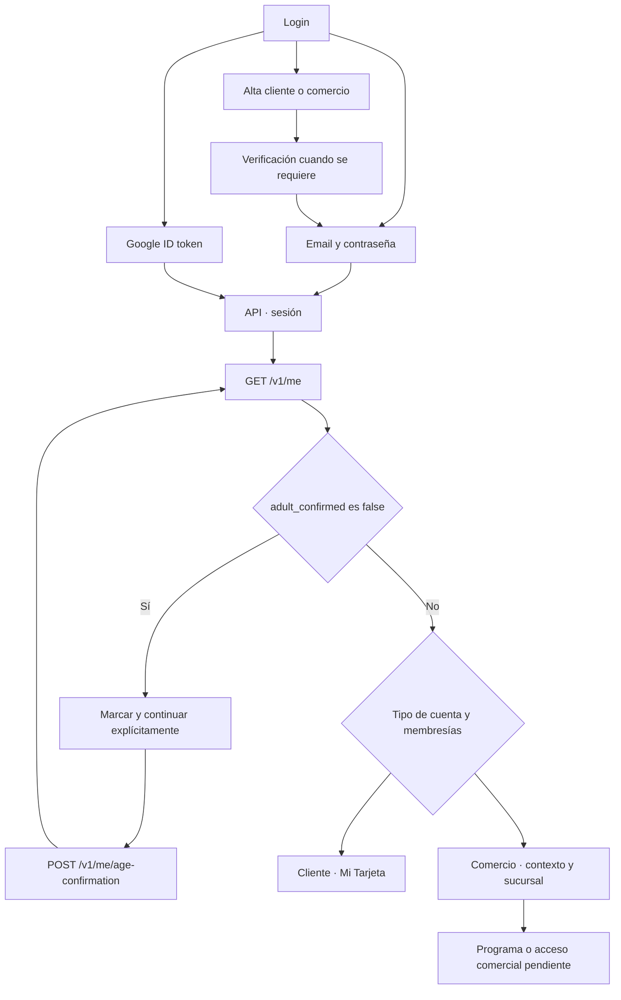

# Autenticación y onboarding

El alta de cliente usa `/v1/auth/register`; el alta comercial usa `/v1/demo/comercios`, con clave idempotente. Google tiene su propia validación y selección de tipo cuando corresponde. Si la respuesta requiere verificar email, el frontend conserva el resultado pendiente y no inventa una sesión. Tras login consulta identidad y marcas. Primer login/trial se registran en backend; no se reinician desde una selección local.

Ver [registro](#/sequence-register), [login](#/sequence-login), [Google](#/sequence-google) y [restauración](#/sequence-restore).

Revisión de fuentes y runtime del **02/10/2026, 22:30–22:33 UTC**. Los SHA y las diferencias por ambiente están en [Estado observado](#/runtime-snapshot). Esta revisión describe arquitectura e integración; no certifica todos los invariantes de negocio ni ejecuta operaciones sobre cuentas reales.

## Confirmación de edad · testing PR73

[PR73](https://github.com/gonzalotev/app-fidelidad/pull/73) se integró y publicó en testing como `ae706dda013ed43881be623ed9236e5602c93d01`. `GET /v1/me` ya informa `adult_confirmed`; cuando es explícitamente false, la persona debe marcar la confirmación y continuar. La UI envía el contrato existente `POST /v1/me/age-confirmation` con `{confirmed:true}` y adopta sólo la respuesta aceptada por el servidor. Google no acredita mayoría de edad. No hay confirmación automática ni corrección administrativa por SQL.

Hasta la aceptación no se montan pestañas ni redirecciones de login/suscripción, ni se leen contextos comerciales ni se inician SSE/notificaciones, reseñas o asistente de primer ingreso. Esto evita errores de tarjeta/mapa y el bucle del comercio restaurado sin onboarding completo. `/menu/*` conserva su consulta pública y queda fuera del modal. La cuenta ya confirmada restaura sin repetir el paso. Las comprobaciones de identidad/sesión al adoptar la respuesta están revisadas estáticamente; no se presenta esa revisión como prueba de carreras de cambio de cuenta.

La persona afectada confirmó manualmente a las 04:05:58 UTC y las consultas de tarjeta devolvieron 200. Después reportó un cierre de sesión inesperado: resolver el acceso por edad no acredita todavía estabilidad de sesión. [Cronología y límites de QA](#/runtime-snapshot).

## Recuperación de sesión · PR74 parcial y PR75 verificada

[PR74](https://github.com/gonzalotev/app-fidelidad/pull/74) está integrada en `testing` como `7dfa39a033caab134498b19738b7c63d5a574470`, desde `58d2c28fc3ca1fffef4d0faf5e54e826c04ad070`; se desplegó como `7dfa39a` a las 04:26:46 UTC. **La QA real mostró una mejora parcial, sin cerrar la estabilidad entre pestañas.**

La corrección conserva credenciales ante refresh 429, 5xx, fallo de red o respuesta 2xx malformada y expone reintento/cooldown, respetando Retry-After. Una restauración transitoria muestra recuperación con Reintentar; no redirige automáticamente a login. El rechazo definitivo 401 del refresh sí invalida la sesión. Web Locks serializa las escrituras de cookie entre pestañas del mismo origen donde la API está disponible; los access tokens siguen en memoria y el refresh web en cookie HttpOnly. SecureStore nativo se conserva, sin almacenamiento persistente nuevo de tokens web.

SSE sólo habilita renovación cuando el access token ha expirado; un 401 del stream con token aún vigente no dispara rotaciones ni logout. En carga directa de `/menu/*` no se restaura sesión ni se abre SSE; al regresar a una ruta privada se restaura cuando corresponde. [Secuencia de restauración y validación](#/sequence-restore). No cambia API, esquema ni reglas del backend. En QA real con tres pestañas ya no se repitió el logout, pero nuevas rotaciones sucesivas agotaron la cuota de refresh y el QR quedó cargando. Web Locks serializa escrituras y no comparte por sí solo la vigencia del access entre pestañas.

[PR75](https://github.com/gonzalotev/app-fidelidad/pull/75), desde `fix/shared-web-session-20261019`, está integrada en `testing` `ed9b9facc73c9ca60e2a16fb96f7e7847fa89f16`. Comparte access sólo en memoria mediante BroadcastChannel del mismo origen, con marcador opaco no secreto de autoridad en localStorage y Web Locks; no persiste tokens ni cambia backend/cuota. La revisión del protocolo, nueve unidades específicas y 19 casos browser aprobaron, incluido el escenario de tres pestañas con REST que rechaza SID antiguos, expiración, reload y logout/cambio de identidad. Esas pruebas usan respuestas simuladas y no equivalen a la carrera de confirmación de edad. CI y workflow de despliegue aprobados; despliegue observado a las 04:46:56 UTC y QA real de tres pestañas aprobada durante 242,73 s, sin nuevo login, spinner ni error de tarjeta. La aceptación se limita a esa ventana y recorrido; los logs agregados no identifican actor o pestaña.

- [Gate y estado de auth de testing](https://github.com/gonzalotev/app-fidelidad/blob/testing/src/features/auth/store/useAuthStore.ts)
- [Cliente de sesión de testing](https://github.com/gonzalotev/app-fidelidad/blob/testing/src/core/api/client.ts)

## Referencias de código

- [Implementación frontend](https://github.com/gonzalotev/app-fidelidad/blob/main/src/features/auth/store/useAuthStore.ts)
- [Rutas API](https://github.com/am-p/app-loyalty/blob/main/cmd/server/router.go)
