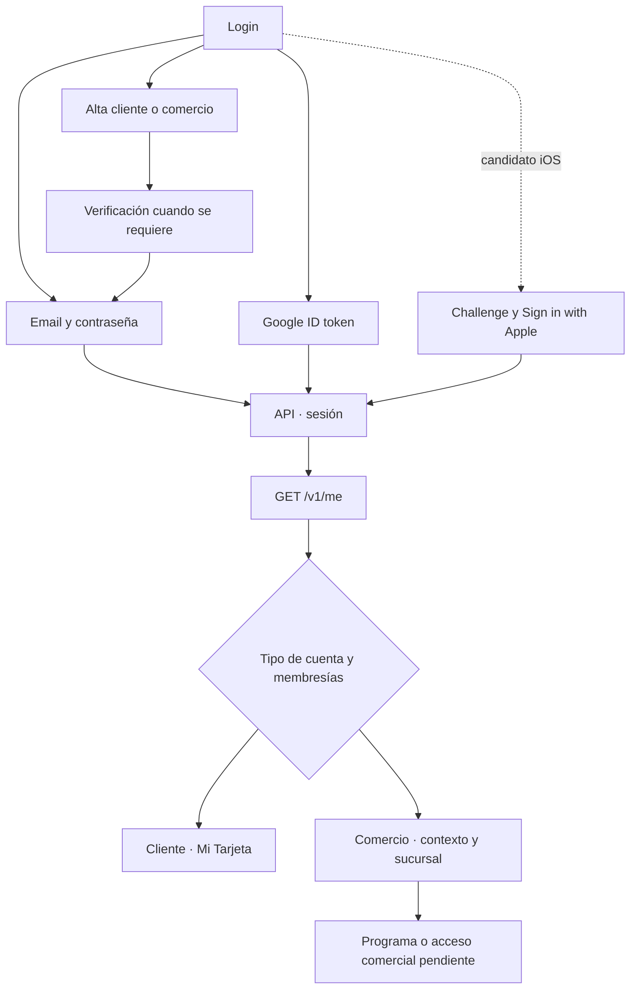

# Autenticación y onboarding

El [candidato iOS del 01/11/2026](#/ios-development) añade Apple en fuentes locales. Su verificación externa queda pendiente; el corte de runtime de octubre conserva su fecha.

El alta de cliente usa `/v1/auth/register`; el alta comercial usa `/v1/demo/comercios`, con clave idempotente. Google tiene su propia validación y selección de tipo cuando corresponde. Si la respuesta requiere verificar email, el frontend conserva el resultado pendiente y no inventa una sesión. Tras login consulta identidad y marcas. En el delta iOS, el trial comercial se cuenta desde el registro persistido y nunca se reinicia al iniciar sesión o elegir contexto; no se atribuye ese cambio al runtime histórico.

Apple solicita un challenge por propósito (`login`, `link` o `reauthenticate`) y entrega el nonce sin transformarlo a la API nativa. El servidor verifica el ID token, completa perfil/tipo y recién entonces intercambia el código y consume la prueba. El perfil recibido una sola vez de Apple se conserva sólo en memoria durante el onboarding pendiente, hasta completar o expirar.

`auth_methods.apple` añade un método de acceso; no cambia el usuario ni fusiona cuentas por correo. `AuthMethodsManager` exige reautenticación reciente antes del vínculo explícito, respeta versión/`If-Match` y rota la sesión. Baja/export incluyen identidad y revocación durable sin exponer credenciales. Google OAuth iOS está pospuesto por decisión del usuario.

Ver [registro](#/sequence-register), [login](#/sequence-login), [Google](#/sequence-google), [Apple](#/sequence-apple) y [restauración](#/sequence-restore).

Revisión de fuentes y runtime del **02/10/2026, 22:30–22:33 UTC**. Los SHA y las diferencias por ambiente están en [Estado observado](#/runtime-snapshot). Esta revisión describe arquitectura e integración; no certifica todos los invariantes de negocio ni ejecuta operaciones sobre cuentas reales.

## Referencias de código

- [Implementación frontend](https://github.com/gonzalotev/app-fidelidad/blob/main/src/features/auth/store/useAuthStore.ts)
- [Rutas API](https://github.com/am-p/app-loyalty/blob/main/cmd/server/router.go)
