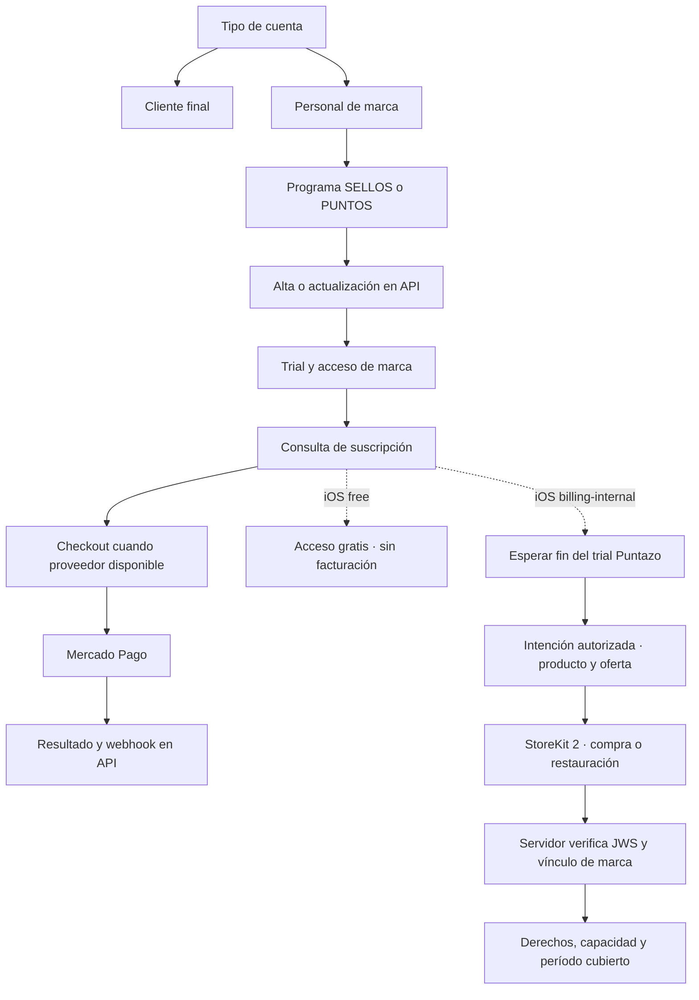

# Programa y suscripción comercial

La [entrega iOS local del 01/11/2026](#/ios-development) prepara Apple en una edición interna y mantiene la primera edición pública gratis. El recorrido Mercado Pago de abajo conserva su corte histórico; no se habilita como alternativa de cobro en el iOS gratuito.

Las pantallas de selección ya no modifican un plan mock global. El alta comercial y la edición del programa se persisten; la suscripción consulta `/v1/marcas/:id/suscripcion`. Checkout/cancelación usan claves idempotentes y el resultado se obtiene del servidor. El cobro depende de la configuración de Mercado Pago: testing lo habilita y producción observada lo deshabilita. No se confirma una suscripción sólo por navegar de regreso a la app.

Cuenta, rol de membresía, programa y estado de cobro no son sinónimos. No se fijan precios comerciales en esta documentación.

## Apple preparado, edición pública gratis

El trial dura un mes calendario desde el **registro comercial**, no desde una compra Apple. La edición interna espera su fin para ofrecer comprar; no añade una prueba introductoria Apple. El catálogo tiene 20 productos mensuales: SELLOS/PUNTOS por capacidad de 1 a 10 sucursales. Una compra cubre una sola marca y un producto del único grupo configurado; el servidor comprueba programa y sucursales activas. El precio proviene de StoreKit/App Store Connect, no de un cálculo variable del frontend.

La intención idempotente vincula dueño, marca, producto y `appAccountToken`. Un offer code de referido se configura por campaña/producto y se aplica **después del trial**; si falta, el servidor no vende omitiendo el descuento. Los dos tipos de promoción (marca e influenciador) conservan su atribución y contabilidad separada por proveedor/moneda. El canje sin token exige intención autorizada, reserva de cadena y confirmación por API Apple antes de dar acceso. Restaurar no cambia la marca vinculada. El cliente finaliza la transacción sólo tras sincronización exitosa del servidor.

La expiración o fallo de renovación admite siete días de gracia operativa después del período cubierto; luego se permiten consulta, privacidad/export y resolución de billing. Reembolso/revocación retira derechos inmediatamente. Exceso de capacidad o programa incompatible restringe escrituras sin borrar datos, y permite desactivar sucursales/corregir el programa. Son controles del backend para todos los canales. No se combinan MP y Apple ni se migra automáticamente una suscripción. Eliminar la cuenta no cancela por sí solo una suscripción de Apple: su gestión corresponde al usuario en Apple.

En modo `FREE` no se aplican restricciones por vencimiento comercial ni se muestra checkout/enlace a cobros externos en iOS. Pasar a cobros públicos requiere otro build y revisión. Las credenciales, productos/ofertas y ejecución StoreKit real están pendientes; [evidencia de la entrega](#/ios-development-evidence).

Revisión de fuentes y runtime del **02/10/2026, 22:30–22:33 UTC**. Los SHA y las diferencias por ambiente están en [Estado observado](#/runtime-snapshot). Esta revisión describe arquitectura e integración; no certifica todos los invariantes de negocio ni ejecuta operaciones sobre cuentas reales.

## Referencias de código

- [Implementación frontend](https://github.com/gonzalotev/app-fidelidad/blob/main/src/features/merchant/services/subscriptionService.ts)
- [Rutas API](https://github.com/am-p/app-loyalty/blob/main/cmd/server/router.go)
