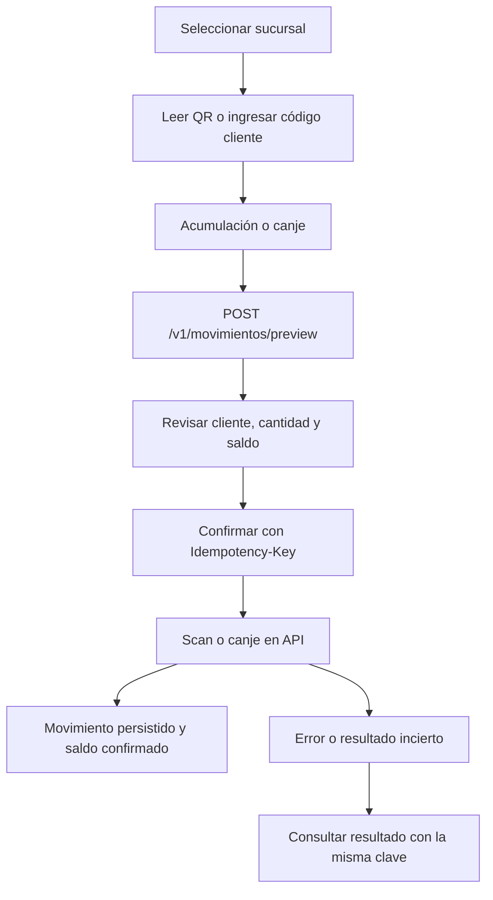

# Scanner y operación

La cámara es una entrada de identidad; el código manual es otra. La API resuelve identidad, autorización, preview y escritura. El programa determina sellos/puntos; el canje identifica beneficio. La confirmación no usa un array local. Ante fallo de red después del commit, se consulta idempotencia para evitar duplicar una operación. Sin conexión se bloquea la operación; no existe cola offline de confirmaciones.

En QA nativa iOS 26.5, denegar cámara conserva disponible el ingreso manual: buscar el código sintético `CL-1` abrió la vista previa y se pudo cancelar sin confirmar un movimiento. Desde Ajustes del sistema se permitió después el acceso y, al volver a la app, el estado de permiso se actualizó. En el dispositivo de QA, la API nativa resolvió la consulta de lentes (184 ms) con una lista vacía; la app muestra correctamente que no hay cámara disponible y conserva la opción manual. No se probó captura física. La app pausa el scanner al ir a segundo plano y ofrece recuperación desde Ajustes cuando el permiso está denegado.

Ver [secuencia de scan](#/sequence-scan).

Revisión de fuentes y runtime del **02/10/2026, 22:30–22:33 UTC**. Los SHA y las diferencias por ambiente están en [Estado observado](#/runtime-snapshot). Esta revisión describe arquitectura e integración; no certifica todos los invariantes de negocio ni ejecuta operaciones sobre cuentas reales.

## Referencias de código

- [Implementación frontend](https://github.com/gonzalotev/app-fidelidad/blob/main/src/features/demo/services/demoService.ts)
- [Rutas API](https://github.com/am-p/app-loyalty/blob/main/cmd/server/router.go)
