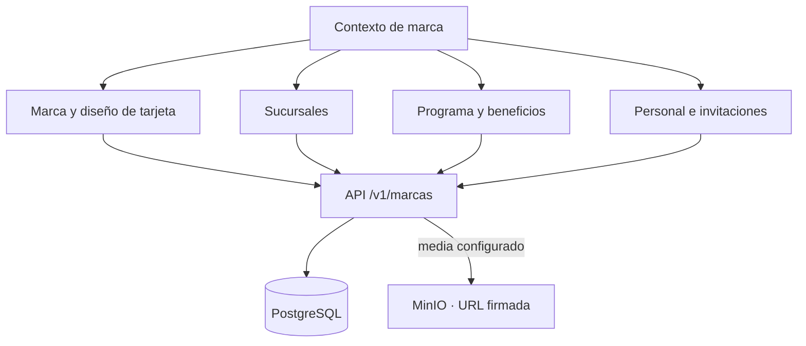

# Mi Tienda y edición comercial

`commercialService` usa lecturas y escrituras reales para marca, sucursal, programa y beneficios. Las mutaciones versionadas envían la precondición correspondiente; un conflicto requiere releer. `personnelService` gestiona personal/invitaciones y `mediaService` las imágenes. No se atribuyen permisos de propietario al operador.

La plantilla forma parte del diseño de marca y sus valores se restringen en migraciones. Media funciona en testing; la API productiva observada tiene el proveedor deshabilitado. La mejora de guardado/imagen de beneficio está en testing y difiere de main.

Para iOS, el selector privado de fotos abre y su acción secundaria **Cancelar** lo cierra; el perfil permanece intacto y el botón vuelve a estar disponible. La selección y subida desde la interfaz nativa aún no se verificaron. En pruebas separadas contra la API real de desarrollo, la subida de una imagen de perfil/logo y la descarga mediante URL firmada respondieron correctamente (`200`); la URL sin firma fue rechazada (`403`). Esto verifica la API/media, no el recorrido completo de selección/subida nativa ni el comportamiento de otros ambientes. Las imágenes HEIC y grandes se normalizan con el helper de marca existente; la app no solicita permiso de Fotos de forma innecesaria.

Revisión de fuentes y runtime del **02/10/2026, 22:30–22:33 UTC**. Los SHA y las diferencias por ambiente están en [Estado observado](#/runtime-snapshot). Esta revisión describe arquitectura e integración; no certifica todos los invariantes de negocio ni ejecuta operaciones sobre cuentas reales.

## Referencias de código

En la rama de desarrollo iOS, el propietario ve **Plan y facturación → Prueba gratuita** en la pestaña General de Mi Tienda cuando el build usa `EXPO_PUBLIC_IOS_EDITION=free` (también por defecto). Es un aviso estático de la edición gratuita, sin fechas ni acciones de pago y sin llamadas al servicio de suscripciones. No aparece para administradores, operadores ni clientes. Web y Android conservan sus recorridos. La edición `billing-internal` muestra el acceso interno Apple en su lugar; la [separación y publicación futura](#/ios-development) requieren un nuevo build, no un flag remoto.

- [Implementación frontend](https://github.com/gonzalotev/app-fidelidad/blob/main/src/features/merchant/services/commercialService.ts)
- [Rutas API](https://github.com/am-p/app-loyalty/blob/main/cmd/server/router.go)
