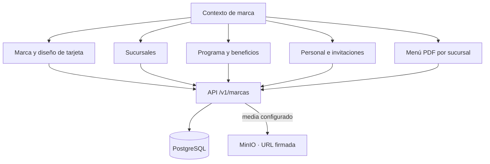

# Mi Tienda y edición comercial

`commercialService` usa lecturas y escrituras reales para marca, sucursal, programa y beneficios. Las mutaciones versionadas envían la precondición correspondiente; un conflicto requiere releer. `personnelService` gestiona personal/invitaciones y `mediaService` las imágenes. No se atribuyen permisos de propietario al operador.

La plantilla forma parte del diseño de marca y sus valores se restringen en migraciones. Media funciona en testing; la API productiva observada tiene el proveedor deshabilitado. La mejora de guardado/imagen de beneficio está en testing y difiere de main.

Revisión de fuentes y runtime del **02/10/2026, 22:30–22:33 UTC**. Los SHA y las diferencias por ambiente están en [Estado observado](#/runtime-snapshot). Esta revisión describe arquitectura e integración; no certifica todos los invariantes de negocio ni ejecuta operaciones sobre cuentas reales.

## Menú PDF V1 · 18/10/2026

Mi Tienda incorpora la sección **Menú**, con selector de sucursal y administración limitada a propietario/administrador. Elegir el archivo, subir un borrador, revisarlo y publicarlo son pasos separados; la publicación anterior se conserva durante un reemplazo. Los controles bloquean cambios de sucursal mientras se elige el archivo, se confirma una acción o hay una escritura pendiente. La versión revisada se envía como precondición; un conflicto exige releer antes de confirmar otra vez. El enlace y QR corresponden a la sucursal, sin usar el QR personal del cliente.

[Contrato, límites y recorrido](#/flow-branch-menu-pdf) · [Estado de testing y promoción](#/runtime-snapshot). La implementación de V1 no aprueba ni incorpora la idea futura de editor digital/IA.

## Referencias de código

- [Implementación frontend](https://github.com/gonzalotev/app-fidelidad/blob/main/src/features/merchant/services/commercialService.ts)
- [Rutas API](https://github.com/am-p/app-loyalty/blob/main/cmd/server/router.go)

- [Editor PDF V1](https://github.com/gonzalotev/app-fidelidad/blob/testing/src/features/merchant/components/CommercialBranchMenuEditor.tsx)
