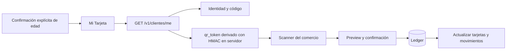

# Pasaporte QR del cliente

La pantalla renderiza el `qr_token` recibido. El QR no es el ID visible ni se reconstruye con un patrón frontend. PostgreSQL conserva el hash y la API valida la identidad para operar. El código humano es una alternativa manual: los nuevos códigos son inmutables y los anteriores conservan el formato heredado. Mostrar un QR no autentica al operador.

La detección de movimientos prepara una lectura base, compara saldos y valida movimientos antes de celebrar; web dispone además de eventos SSE autenticados para refrescar tarjetas.

Revisión de fuentes y runtime del **02/10/2026, 22:30–22:33 UTC**. Los SHA y las diferencias por ambiente están en [Estado observado](#/runtime-snapshot). Esta revisión describe arquitectura e integración; no certifica todos los invariantes de negocio ni ejecuta operaciones sobre cuentas reales.

## Edad antes de las lecturas privadas · testing PR73

La API testing `64bb3fc`/0042 devuelve 403 `ADULT_CONFIRMATION_REQUIRED` antes del handler de pasaporte/tarjetas/mapa si falta la confirmación vigente. No depende de poseer tarjetas de comercios. El frontend de PR73 (`ae706dda`) presenta la acción explícita y difiere esas pantallas hasta que `GET /v1/me` y la respuesta del endpoint de confirmación permitan continuar. [Flujo de acceso](#/flow-auth). El menú público no exige completar este paso.

Tras la confirmación manual de la cuenta afectada a las 04:05:58 UTC se observaron consultas de pasaporte/tarjetas 200. El cierre posterior de sesión fue un incidente distinto. PR74 conserva credenciales ante fallos transitorios de refresh y evita rotaciones por SSE con access aún vigente, se desplegó en testing `7dfa39a`, pero la QA real con tres pestañas agotó la cuota de refresh y dejó el QR cargando. PR75 integra esa coordinación en `testing` `ed9b9fa`, con access compartido en memoria, CI y 19 pruebas browser aprobadas. Desplegada a las 04:46:56 UTC y verificada en tres pestañas reales durante 242,73 s: tarjeta visible sin login, spinner ni error, también después de mapa → búsqueda → PDF → regreso a tarjeta. Esta aceptación está limitada a la ventana observada y no acredita QA física nativa. [Estado observado](#/runtime-snapshot).

## Referencias de código

- [Implementación frontend](https://github.com/gonzalotev/app-fidelidad/blob/main/app/(tabs)/my-card/index.tsx)
- [Rutas API](https://github.com/am-p/app-loyalty/blob/main/cmd/server/router.go)
