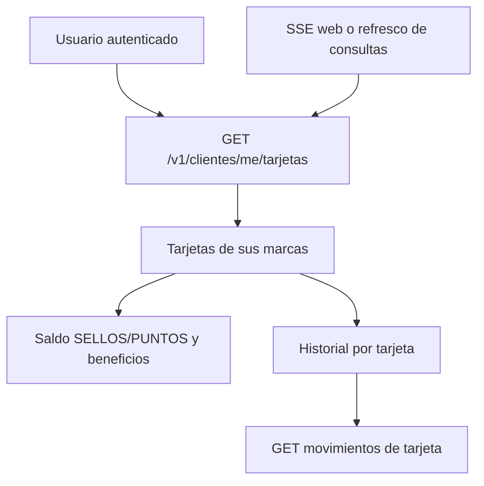

# Tarjetas de fidelidad

El servicio recorre páginas de tarjetas del usuario. El historial consulta una tarjeta autorizada; sus saldos y snapshots provienen del ledger. Logos/imágenes usan URLs temporales cuando media está disponible, con fallback visual si la firma falla. No hay un cliente fijo `501` compartido por las cuentas.

## Invitación a reseñar en Google · delta local 01/11/2026

En `origin/develop` `7a47558`, `ReviewInvitationCoordinator` consulta invitaciones pendientes para las entradas/actualizaciones de tarjetas del cliente. Sólo reserva cuando el cliente está en la ruta de tarjetas, foreground y listo para mostrar; al presentar, confirma `PRESENTADA` después de renderizar. Un único diálogo ofrece abrir el enlace o registrar `OMITIDA`; las reservas y el acuse no se apilan. Refrescar candidatos no descarta una reserva ya obtenida. Las respuestas tardías se ignoran si cambió actor, sesión, ruta o readiness.

El backend conserva un lease durante 60 s y excluye invitaciones con lease vigente; no acepta una segunda reserva concurrente. Si la app descarta una respuesta tardía después de que el servidor obtuvo el lease, el servidor oculta esa invitación hasta que venza. El cliente no programa un timer; si el próximo ingreso, actualización de tarjetas o reconexión ocurre antes del vencimiento, hará falta otro trigger posterior para verla de nuevo. La carrera del CI push de `32f9e82` motivó el fix: una renovación de candidatos invalidaba el resultado de una reserva vigente y la fixture anterior aceptaba duplicados. El mock ahora representa el lease y el `409` del backend. En `7a47558`, 10 tests nuevos, 434/434 unitarias y TypeScript pasaron localmente; las seis pruebas de reseñas pasaron en Chromium/WebKit y las auditorías de ambos Releases iOS y Android JS pasaron; la CI del push pasó 161 casos sin retry, con resultado del PR enlazado en evidencia. Ver [evidencia iOS](#/ios-development-evidence).

Revisión de fuentes y runtime del **02/10/2026, 22:30–22:33 UTC**. Los SHA y las diferencias por ambiente están en [Estado observado](#/runtime-snapshot). Esta revisión describe arquitectura e integración; no certifica todos los invariantes de negocio ni ejecuta operaciones sobre cuentas reales.

## Referencias de código

- [Implementación frontend](https://github.com/gonzalotev/app-fidelidad/blob/main/src/features/demo/services/demoService.ts)
- [Rutas API](https://github.com/am-p/app-loyalty/blob/main/cmd/server/router.go)
- [Coordinador de reseñas en develop](https://github.com/gonzalotev/app-fidelidad/blob/develop/src/features/reviewRequests/components/ReviewInvitationCoordinator.tsx)
