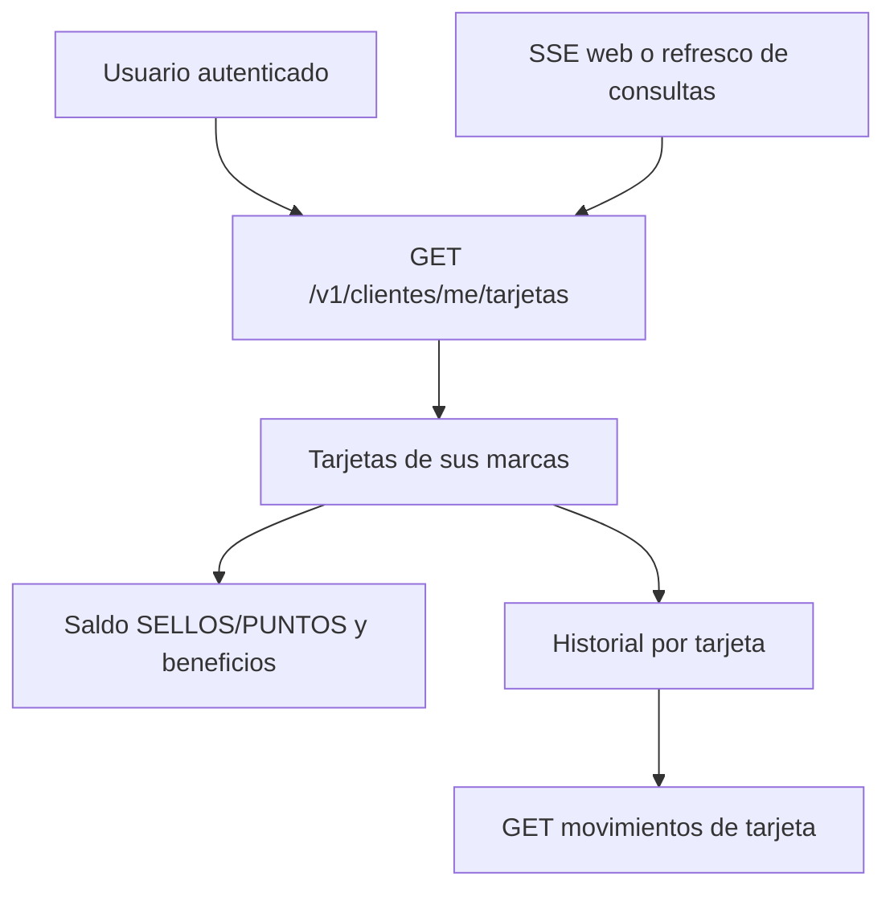

# Tarjetas de fidelidad

El servicio recorre páginas de tarjetas del usuario. El historial consulta una tarjeta autorizada; sus saldos y snapshots provienen del ledger. Logos/imágenes usan URLs temporales cuando media está disponible, con fallback visual si la firma falla. No hay un cliente fijo `501` compartido por las cuentas.

## Densidad y búsqueda · actualización 16/11/2026

El cambio de frontend [PR 151](https://github.com/gonzalotev/app-fidelidad/pull/151), dirigido a `testing`, coloca el buscador dentro del mismo desplazamiento que las tarjetas y la actividad. Al recorrer la lista deja de reservar una franja fija; vuelve a verse al regresar al inicio. Cambiar entre Sellos, Puntos y Actividad devuelve la lista al inicio y conserva el texto buscado. Las pestañas permanecen disponibles.

Se elimina el subtítulo redundante y se reducen los márgenes y la fila de acciones de premios/tienda, manteniendo botones de al menos 44 px, los modelos compartidos y el tamaño de texto y logos. No cambian API, saldos ni suscripciones. El objetivo de web móvil es mostrar al menos dos tarjetas y media al desplazar la búsqueda fuera del área visible, sujeto a la altura disponible y al tamaño de texto del usuario. Esta sección describe el cambio propuesto en ese PR; su publicación requiere comprobar el runtime.

Revisión de fuentes y runtime del **02/10/2026, 22:30–22:33 UTC**. Los SHA y las diferencias por ambiente están en [Estado observado](#/runtime-snapshot). Esta revisión describe arquitectura e integración; no certifica todos los invariantes de negocio ni ejecuta operaciones sobre cuentas reales.

## Referencias de código

- [Implementación frontend](https://github.com/gonzalotev/app-fidelidad/blob/main/src/features/demo/services/demoService.ts)
- [Rutas API](https://github.com/am-p/app-loyalty/blob/main/cmd/server/router.go)
