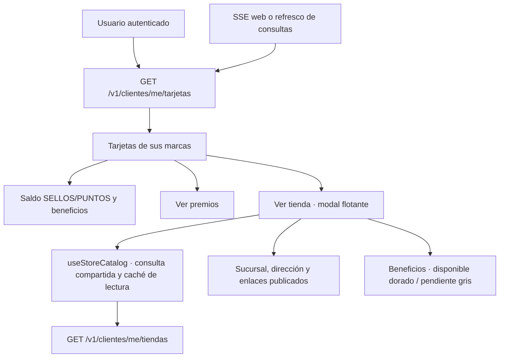

# Tarjetas de fidelidad

El servicio recorre páginas de tarjetas del usuario. El historial consulta una tarjeta autorizada; sus saldos y snapshots provienen del ledger. Logos/imágenes usan URLs temporales cuando media está disponible, con fallback visual si la firma falla. No hay un cliente fijo `501` compartido por las cuentas.

Revisión de fuentes y runtime del **02/10/2026, 22:30–22:33 UTC**. Los SHA y las diferencias por ambiente están en [Estado observado](#/runtime-snapshot). Esta revisión describe arquitectura e integración; no certifica todos los invariantes de negocio ni ejecuta operaciones sobre cuentas reales.

## Actualización de tarjetas en testing · 15/11/2026

Integrado en el frontend oficial mediante [PR 148](https://github.com/gonzalotev/app-fidelidad/pull/148), rama `testing`, commit `c2bfa2d109773a5be49c791935164189f4baf8cc`. Publicado y verificado en `https://testing.puntazo.pro/my-loyalty-cards/`: imagen activa healthy y hashes de HTML, service worker y manifest coincidentes con ese commit. API dd2003875d22c41c764b7df6a9be2db3d428398e, schema 0051 y readiness ok, sin cambios de backend. Este corte no acredita publicación de estas tarjetas en producción.

Las 18 plantillas de sellos y 21 de puntos comparten un componente React Native con cuerpo compacto, logo de 40×40 y acciones integradas a mitades. Se mantienen los colores configurados por la marca, sus códigos de plantilla y los adornos de cada familia. Cómic conserva borde blanco grueso en oscuro.

Los sellos muestran cinco posiciones con índices absolutos y el saldo acumulado, sin denominador fijo. Los requisitos reales se representan con regalos dorados; los sellos completos usan su icono lleno. El movimiento reducido limita la animación y las señales de premio nuevo usan transacciones confirmadas, sin modificar saldos localmente.

Ver tienda abre un modal con las sucursales reales del catálogo existente. Muestra dirección, favoritos de la respuesta en vivo y menú/enlaces publicados cuando están disponibles. Beneficios está centrado y presenta disponibilidad según los requisitos y estado activo recibidos en la tarjeta; no crea una regla nueva de vencimiento en el cliente. Sin conexión se informa que los datos guardados son de lectura y los enlaces que dependen del estado actualizado permanecen deshabilitados. Cerrar el modal devuelve el foco al botón de origen.

La verificación con sesión real cubrió sellos, puntos, ambos temas, datos del comercio y premios disponibles/pendientes a 402×874 y en escritorio. La exportación JavaScript de iOS y Android también aprobó; no se verificaron dispositivos nativos.

El catálogo solo se consulta mientras el modal está montado. La sesión, caché y actualizaciones de tarjetas conservan los servicios y eventos existentes; no se agregan endpoints, migraciones ni datos de muestra.

## Referencias de código

- [Implementación frontend](https://github.com/gonzalotev/app-fidelidad/blob/main/src/features/demo/services/demoService.ts)
- [Rutas API](https://github.com/am-p/app-loyalty/blob/main/cmd/server/router.go)

- [Tarjetas aprobadas en este corte](https://github.com/gonzalotev/app-fidelidad/blob/c2bfa2d109773a5be49c791935164189f4baf8cc/src/components/cards/shared/ApprovedCard.tsx)
- [Modal de tienda en este corte](https://github.com/gonzalotev/app-fidelidad/blob/c2bfa2d109773a5be49c791935164189f4baf8cc/src/features/demo/components/CardStoreAction.tsx)
