# Tarjetas de fidelidad

## Card unificada C · testing

La opción C fue seleccionada explícitamente por el usuario y está implementada y desplegada en [PR79](https://github.com/gonzalotev/app-fidelidad/pull/79), `testing` `d20abd436ff935a346905a791f076017cbf96d4c`. Mis Tarjetas agrupa nombre/logo, progreso de marca y acciones en una sola superficie neutra: `CustomerCardSummary` muestra sellos o puntos reales, reutilizando `LogoBadge`, `RewardDiamonds` y tokens de tema. Ver premios y Ver menú ocupan la misma fila con igual tamaño; la superficie se adapta al modo oscuro. Las vistas del editor comercial conservan sus renderers y plantillas; el listado de cliente usa esta presentación resumida.

Tocar el resumen o el botón de premios abre el mismo catálogo, sin controles interactivos anidados. El menú conserva la consulta diferida de sucursales, apertura directa/selector y estados sin publicación/error. Se conservan saldos, beneficios, actualización por SSE y efectos de celebración; no hay API, datos, esquema, paquetes ni permisos nuevos. Dos casos nuevos verifican Sellos/Puntos, cinco anchos, temas, teclado, premios y menú; otras ocho regresiones cubren plantillas comerciales, push/celebración y PDF. QA real y límites en [Estado observado](#/runtime-snapshot). V2 digital/IA sigue idea.

```mermaid
flowchart TD
 U[Usuario autenticado] --> API[GET /v1/clientes/me/tarjetas]
 API --> C[Tarjetas de sus marcas]
 C --> B[Saldo SELLOS/PUNTOS y beneficios]
 C --> H[Historial por tarjeta]
 C --> PDF[Ver menú]
 PDF --> S[Elegir sucursal si hay varias]
 S --> V[Publicación PDF vigente]
 H --> M[GET movimientos de tarjeta]
 E[SSE web o refresco de consultas] --> API
```

El servicio recorre páginas de tarjetas del usuario. El historial consulta una tarjeta autorizada; sus saldos y snapshots provienen del ledger. Logos/imágenes usan URLs temporales cuando media está disponible, con fallback visual si la firma falla. No hay un cliente fijo `501` compartido por las cuentas.

Revisión de fuentes y runtime del **02/10/2026, 22:30–22:33 UTC**. Los SHA y las diferencias por ambiente están en [Estado observado](#/runtime-snapshot). Esta revisión describe arquitectura e integración; no certifica todos los invariantes de negocio ni ejecuta operaciones sobre cuentas reales.

## Acceso a menú PDF V1 · 18/10/2026

La acción **Ver menú** consulta las sucursales activas de la marca. Con varias sucursales ofrece selección explícita en orden alfabético; el selector de tarjetas no solicita ubicación. Una única sucursal abre su página pública. La consulta no crea una tarjeta ni cambia saldos o beneficios; sin publicación presenta un estado vacío claro. La URL firmada se renueva al abrir el PDF en el visor del navegador o dispositivo.

[Flujo PDF](#/flow-branch-menu-pdf) · [Fuente y despliegue verificados](#/runtime-snapshot). El corte anterior de esta página conserva su fecha histórica.

## Referencias de código

- [Implementación frontend](https://github.com/gonzalotev/app-fidelidad/blob/main/src/features/demo/services/demoService.ts)
- [Rutas API](https://github.com/am-p/app-loyalty/blob/main/cmd/server/router.go)

- [Acción de menú de una tarjeta](https://github.com/gonzalotev/app-fidelidad/blob/testing/src/features/demo/components/CardMenuAction.tsx)
