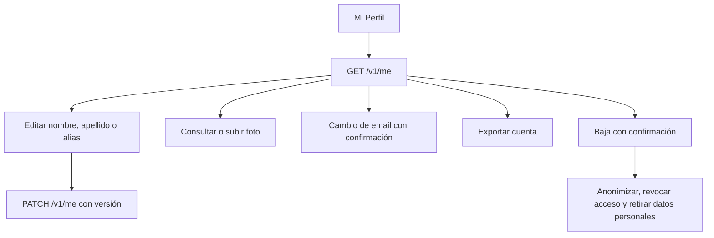

# Perfil del cliente

`profileService` consulta identidad real y envía mutaciones con precondición de versión. El cambio de email requiere autenticación reciente y correo de confirmación. La baja elimina las tarjetas y el historial personal, anonimiza la cuenta y revoca su acceso y sesiones. Los movimientos de otras personas permanecen, pero se elimina la atribución al operador dado de baja. Si la cuenta es el último propietario activo de una marca, la baja cierra esa marca automáticamente; no requiere transferirla antes. Si queda otro propietario activo, la marca no se cierra por esta causa. Foto depende del proveedor de media del ambiente. Las fechas/identidad no se rellenan como fixtures compartidas.

## Exportar datos de la cuenta

El backend de trabajo `gagonzalez1/app-loyalty`, `fork/develop` en `7fd33df`, ya ofrece `GET /v1/me/export` para los datos propios de la cuenta autenticada. La entrega desde el perfil está implementada en `gonzalotev/app-fidelidad`, `origin/develop` HEAD `32f9e82da26f07789b7fd92f3480fd6ea9700260`; el código de producto export/baja/teclado es igual a `f4ceb708`. `4878aea` corrigió la expectativa de una prueba existente y `32f9e82` añade un guard de caché de Metro y tests sin cambios de UI; la PR sigue abierta. El comportamiento descarga un JSON desde web y abre la hoja nativa de guardar/compartir en iOS y Android.

En web, antes del ajuste de teclado, Chrome pasó 4/4 exportaciones y WebKit pasó 5/5 pruebas focalizadas de exportación/cancelación de baja en `8aef3f8`. Tras el fix de teclado `f4ceb708`, las pruebas en viewport reducido pasaron 5/5 tanto en Chrome (16,9 s) como WebKit (19,1 s); no equivalen a una regresión completa del sitio. La CI de `4878aea` terminó con 161 pruebas de navegador aprobadas, 418 aprobaciones y un test Swift omitido; la CI del HEAD `32f9e82` sigue en curso y su cambio es sólo el guard de caché de Metro. En iOS y Android, el archivo temporal se guarda en almacenamiento privado. La app impide que una finalización tardía abra la hoja después de cerrar el flujo o cambiar de sesión; el temporal se elimina al volver de la hoja, al descartarla o ante un error. Si se cierra sesión mientras la hoja del sistema sigue abierta, la app no puede revocar esa hoja: su limpieza ocurre cuando el sistema la cierra y devuelve el control. En `8aef3f8`, `plugins/withSharingCancellation.js`, un config plugin idempotente y limitado a Expo Sharing 14.0.8, corrige la promesa pendiente que dejaba su cancelación secundaria durante prebuild iOS. En iPad se generó el JSON de la cuenta de cliente (6.358 bytes, una tarjeta y 11 movimientos) sin sobre API ni claves de credenciales; la hoja “Guardar en Archivos” se abrió. Cancelar por accesibilidad eliminó los archivos temporales y reactivó el botón. En iPhone se exportó el comercio de prueba (6.309 bytes, una membresía, cero tarjetas y 11 movimientos), también sin datos de credenciales/sobre API; la hoja de compartir apareció y cancelar por accesibilidad dejó cero temporales. No se completó un guardado desde la hoja ni la regresión completa de estos flujos.

## Baja de la cuenta

En el backend de trabajo verificado (`gagonzalez1/app-loyalty`, `fork/develop` `7fd33df`), la baja retira las tarjetas y movimientos propios, anonimiza la información de identidad y revoca sesiones/acceso. También quita el vínculo del operador borrado de movimientos que pertenecen a otras personas; esos movimientos se conservan. Cuando quien se da de baja es el último propietario activo, el backend cierra la marca y sus operaciones automáticamente. Si hay otro propietario activo, no requiere una transferencia de la marca. En iPad, escribir `BAJA` habilitó el botón; cancelar no envió `DELETE` y la cuenta de prueba permaneció intacta. La baja ejecutada por API en la cuenta desechable 5 respondió `202`; la inspección DB confirmó cuenta anonimizada, password hash nulo, sesiones revocadas, cuentas 2/3 activas, marca 2 activa y ledger de 11 movimientos intacto. Evidencia: `account-disposable-deletion-api.json`. En iPhone, la QA de `8aef3f8` encontró que el teclado tapaba el campo y las acciones. El fix ya está publicado en `f4ceb708`; las pruebas Chrome/WebKit del viewport pasaron, pero la inspección visual del fix en simulador y la baja confirmada desde la app siguen pendientes. Esta descripción de las reglas refleja la fuente backend seleccionada; no afirma un despliegue.

Revisión de fuentes y runtime del **02/10/2026, 22:30–22:33 UTC**. Los SHA y las diferencias por ambiente están en [Estado observado](#/runtime-snapshot). Esta revisión describe arquitectura e integración; no certifica todos los invariantes de negocio ni ejecuta operaciones sobre cuentas reales.

## Referencias de código

- [Implementación frontend](https://github.com/gonzalotev/app-fidelidad/blob/main/src/features/profile/services/profileService.ts)
- [Rutas API](https://github.com/am-p/app-loyalty/blob/main/cmd/server/router.go)
