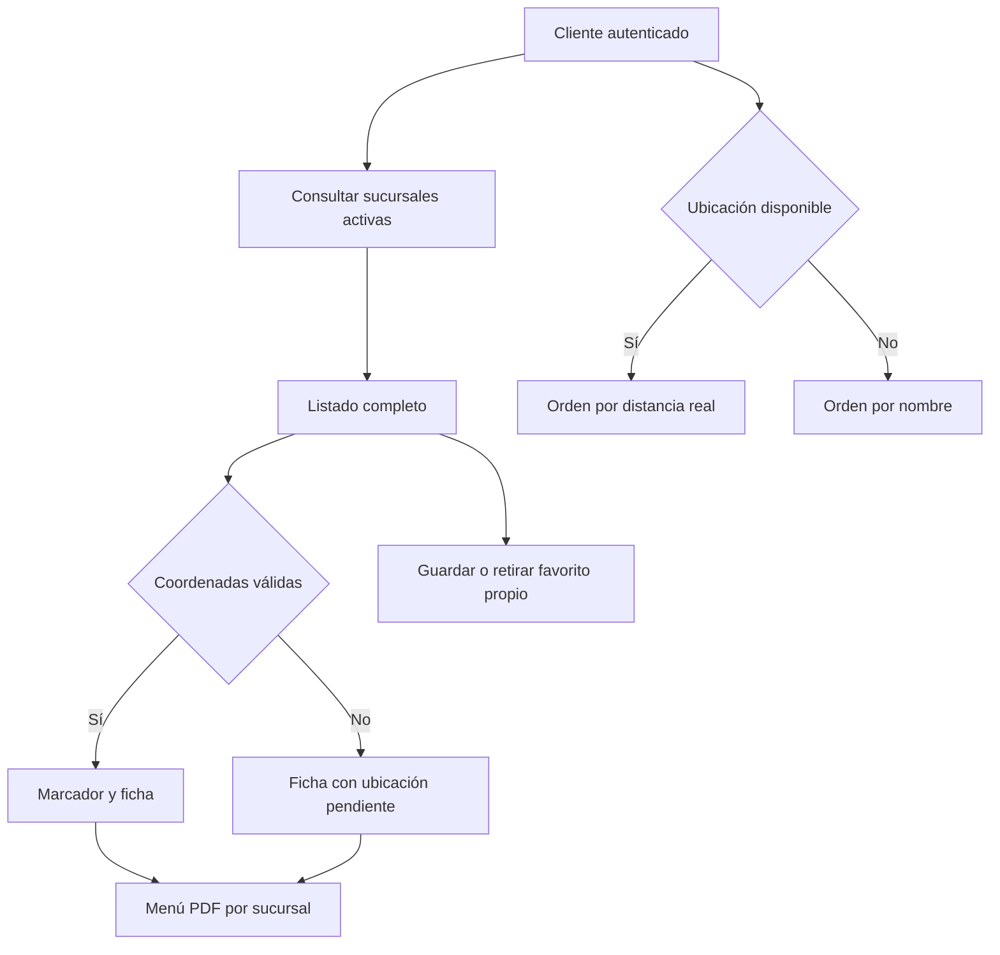

# Mapa del cliente y menú PDF

Alcance acordado el **17/10/2026**: corregir el mapa y comprobar sucursales en testing. El desarrollo de menús se limita a **V1 PDF**. La digitalización editable con IA, V2, queda documentada como idea futura y no forma parte de esta entrega.

## Mapa: comportamiento implementado y verificado en testing

`GET /v1/clientes/me/tiendas?search=...` devuelve un array completo dentro del envelope habitual. Incluye marcas y sucursales activas sin baja; no exige tarjeta previa, programa ni suscripción pagada para descubrir un local. La búsqueda literal está limitada a 200 caracteres y contempla marca, sucursal, localidad y dirección. Los campos opcionales corresponden a datos reales; las imágenes se firman con el almacenamiento existente y los beneficios publicados se filtran por vigencia.

`PUT` y `DELETE /v1/clientes/me/tiendas/:branch_id/favorito` guardan el estado por usuario, son idempotentes y devuelven el conteo de favoritos. Requieren sesión de cliente, sucursal elegible y confirmación de mayoría de edad conforme al middleware vigente. Los favoritos forman parte de la exportación propia y se retiran al anonimizar la cuenta.

La pantalla separa carga, error con reintento, listado vacío y búsqueda sin coincidencias. Los locales sin coordenadas conservan ficha y favoritos; solo los pares finitos y en rango generan marcadores. Sin permiso de ubicación se ordena por nombre y no se calcula una distancia desde Buenos Aires u otra referencia. Volver al mapa revalida datos y ubicación.

Inventario agregado autenticado inicial: 37 sucursales elegibles, 3 con coordenadas completas y 34 sin ellas. Corte posterior de las 22:09 UTC: 37 elegibles, 13 con coordenadas válidas y 24 pendientes; los datos cambiaron durante la comprobación. No se crean sucursales ni se asignan posiciones supuestas para llenar el mapa. La verificación del despliegue y sus límites se registra en [Estado observado](#/runtime-snapshot).

## Corte PR70 · búsqueda y visor interno del 18/10/2026

Implementación autorizada el **18/10/2026**, [PR70 frontend](https://github.com/gonzalotev/app-fidelidad/pull/70), integrada y desplegada en `testing` como `b7de8ec5414c3e7144fa87bb700e9c2e6e4c00a6`. La aceptación del recorrido real se registra por separado en [Estado observado](#/runtime-snapshot).

El mapa comparte una única consulta del inventario completo autorizado y filtra en el cliente por marca, sucursal, dirección, localidad y provincia. La coincidencia ignora mayúsculas, tildes y espacios repetidos; conserva las filas sin coordenadas. Mapa y lista usan el mismo resultado, muestran una búsqueda sin coincidencias y permiten limpiar el filtro. Los favoritos siguen usando el inventario completo.

PR70 agregó la lectura dentro de Puntazo con alternativa externa. PR71/72 evolucionan la consulta del cliente a pantalla completa con un único Volver y scroll continuo; el comercio conserva sus controles. El recorrido vigente se describe en [Menú PDF V1](#/flow-branch-menu-pdf). No cambia la API ni la base de datos. Los límites vigentes de archivo/páginas son **30 MiB y 1–30 páginas**; la sección siguiente conserva el corte inicial de 10 MiB.

## V1 PDF: implementada y verificada en testing · 18/10/2026

La implementación, el contrato y los criterios de aceptación se desarrollan en [Menú PDF V1](#/flow-branch-menu-pdf). El estado observado separa fuente, publicación de testing y producción.

- Un PDF publicado e independiente por sucursal. Propietarios y administradores pueden subirlo, previsualizarlo, publicarlo, reemplazarlo y retirarlo.
- Un reemplazo fallido conserva la publicación anterior. Límites implementados: 10 MiB, 30 páginas y sin contraseña; se admiten documentos escaneados.
- Accesos desde ficha del mapa y tarjetas, con opciones Menú y Beneficios. Las marcas con varias sucursales requieren elegir la correcta.
- Enlace estable y QR públicos para abrir el PDF sin cuenta ni instalación. Los saldos y canjes personales mantienen autenticación.
- Validación específica de PDF y almacenamiento privado con acceso de consulta controlado. La función existente de imágenes no acredita soporte PDF.
- V1 abre el documento original; no incluye búsqueda de productos, pedidos, pagos, reservas ni inventario por cantidades.

## V2: idea futura

Si se retoma, una IA podría extraer categorías, productos, precios y presentaciones del PDF, con revisión del comercio antes de publicar. El comercio podría editar productos/precios y marcar agotados; el comprador tendría un buscador. Se deberían evaluar borradores, permisos de operadores, disponibilidad inmediata, importaciones persistidas y un único formato público activo.

No se implementan ahora editor, extracción IA, proveedor, buscador de productos, tablas ni banderas de V2. Sus costos y decisiones técnicas se revisarán únicamente si se decide abordar esa versión.

## Fuentes y promoción

- Backend propietario [am-p/app-loyalty PR38](https://github.com/am-p/app-loyalty/pull/38); frontend propietario [PR66 mapa](https://github.com/gonzalotev/app-fidelidad/pull/66), [PR67 PDF](https://github.com/gonzalotev/app-fidelidad/pull/67) y [PR68 apertura](https://github.com/gonzalotev/app-fidelidad/pull/68), integradas en testing. La API PDF se propone al propietario en [PR39](https://github.com/am-p/app-loyalty/pull/39).
- La API de testing usa el fork `gagonzalez1/app-loyalty:closed-test-readiness`, que debe contener el main vigente del propietario. `puntazo-preview` está retirado del circuito.
- Migraciones 0036–0040 conservan exactamente el contenido reservado en PR34; 0040 agrega favoritos. Las anteriores se incluyen por la numeración contigua requerida por readiness, sin promover el código funcional ajeno. El trabajo separado de turnos con otras migraciones 0036–0038 requiere conciliación antes de su futura integración.
- No se modifican recursos productivos durante esta corrección de testing. Una PR abierta o pruebas con API simulada no equivalen a una entrega productiva.

## Referencias de código

- [Repositorio de sucursales y favoritos del candidato](https://github.com/gagonzalez1/app-loyalty/blob/closed-test-readiness/internal/repository/store.go)
- [Pantalla, orden y estados del candidato](https://github.com/gonzalotev/app-fidelidad/blob/testing/app/%28tabs%29/store-map/index.tsx)
