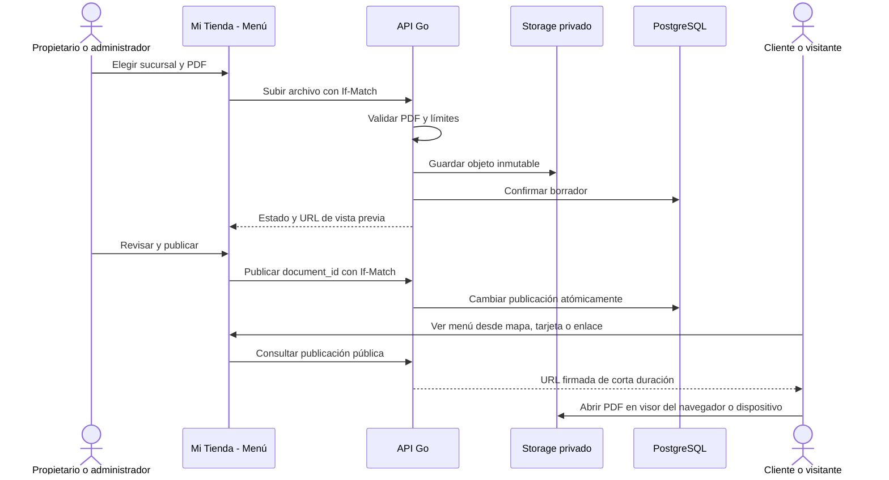

# Menú PDF V1 por sucursal

Implementación autorizada el **18/10/2026**. La V1 está implementada, publicada y comprobada en testing; las fuentes y los límites de la aceptación se registran en [Estado observado](#/runtime-snapshot). No acredita una entrega productiva. V2 digital/IA permanece únicamente como idea futura.

## Recorrido

Mi Tienda incorpora Menú, con sucursal explícita y estados de borrador/publicación separados. Elegir un archivo no publica su contenido. La tienda puede previsualizar, publicar, reemplazar, descartar el borrador o retirar la publicación. Los límites y los errores se muestran en la misma sección. Los operadores no administran documentos ni leen borradores privados.

El cliente abre el menú desde el mapa o las tarjetas. Cuando la tarjeta corresponde a una marca con varias sucursales, debe elegirla en una lista alfabética. El mapa calcula cercanía cuando dispone de ubicación real; el selector de tarjetas no usa ubicación. El enlace público estable `/menu/:branchId` y su QR permiten consultar sin cuenta ni instalación. Un local sin publicación muestra «Menú todavía no disponible».

La apertura usa el visor del navegador/dispositivo con alternativa explícita. No se incorpora un renderer PDF nativo pesado. La ficha modal del mapa se cierra antes de navegar, para mantener accionable el botón de apertura. Los archivos menores de 1 MiB muestran su tamaño en KiB. Cada apertura/vista previa resuelve una URL vigente; una URL vencida no equivale a un menú retirado. El QR del menú no reemplaza el QR de identidad del cliente.

## Apertura con PWA activa y límite ampliado

El reporte del 18/10 permitió reproducir un fallo que no aparecía en un contexto de navegador recién creado: un service worker activo respondía a la navegación del PDF firmado con `/login.html`, y Expo mostraba «Esta pantalla no existe». La descarga HTTP de la misma URL seguía siendo un PDF válido. No era un documento faltante.

La corrección excluye medios y API del fallback de navegación. Además, la apertura web de URLs del mismo origen descarga con `no-store`, comprueba MIME, cabecera `%PDF-` y un máximo real de 30 MiB, y abre un Blob PDF en la pestaña creada durante el gesto. Así también funciona mientras siga activo un SW anterior. Al cerrar el visor se libera el recurso; no se guarda en caché persistente. Las URLs HTTPS externas conservan navegación directa, sin exigir una nueva política CORS, y native conserva su visor/alternativa.

El enlace compartible continúa siendo `/menu/:branchId`. Una URL firmada copiada directamente vence a los cinco minutos: volver al enlace estable genera una nueva. La ampliación de archivo a 30 MiB no cambia páginas, permisos, publicación ni expiración. [Fuentes y aceptación del cambio](#/runtime-snapshot).

## Contrato implementado en testing

Las respuestas JSON usan el envelope habitual. El estado privado contiene `brand_id`, `branch_id`, `version`, `draft` y `published`; ambos documentos pueden ser null. Sin estado previo, la versión lógica es 1 y GET no escribe. Las mutaciones usan ETag/If-Match: falta de condición devuelve 428 y una versión desactualizada 412.

| Ruta | Operación |
|---|---|
| `/v1/marcas/:brand_id/sucursales/:branch_id/menu` | GET del estado privado |
| La anterior + `/documentos` | POST multipart, único campo archivo, crea borrador |
| La anterior + `/publicacion` | PUT con document_id publica; DELETE retira |
| La anterior + `/borrador` | DELETE descarta el borrador |
| `/v1/public/sucursales/:branch_id/menu` | GET público de la publicación vigente o null |
| `/v1/public/marcas/:brand_id/menus` | GET de sucursales elegibles y disponibilidad del menú |

Los documentos públicos exponen nombre saneado, MIME, tamaño, cantidad de páginas, fecha y URL/expiración. No exponen object keys, borradores, datos personales ni membresías. Marca y sucursal deben seguir activas, sin baja. La administración requiere propietario/administrador activo y la pertenencia exacta entre marca y sucursal; no basta ocultar botones en la UI.

## Archivo, persistencia y concurrencia

- PDF de hasta **30 MiB**, **1–30 páginas**, estructuralmente válido y sin cifrado/contraseña. Se aceptan escaneos. Un parser real valida el contenido con tiempo y recursos acotados, sin red; no se extraen productos o precios. Los errores estructurados de cifrado, incluso permisos representados como uint32 por algunos productores, se rechazan con la indicación de quitar la protección.
- Storage privado existente, objetos inmutables con checksum y estado persistido de carga. La migración nueva **0041_branch_pdf_menus** amplía el esquema 0040 sin cambiar versiones aplicadas. La ampliación posterior `0042_branch_pdf_30mib` lleva el CHECK de tamaño a 30 MiB y conserva intacta 0041; documentos, hashes y punteros no se reescriben.
- Borrador y publicación se actualizan bajo transacción; orden de locks marca → sucursal → menú/documentos. Un reemplazo fallido antes del commit conserva la publicación vigente.
- Un error de transporte después del commit deja resultado incierto: la UI debe reconsultar y pedir revisión si hubo conflicto, en lugar de adoptar silenciosamente otra versión o deshacer una publicación posterior.
- Las URLs firmadas duran como máximo cinco minutos. Retirar impide nuevas firmas; las existentes pueden seguir vigentes hasta expirar. La limpieza física se programa con margen, lease y reintentos; no debe borrar un objeto que aún esté referenciado.
- La baja efectiva de marca/sucursal retira sus documentos. Anonimizar un propietario conserva la publicación si la marca sigue activa con otro propietario.

El candidato backend depende del trabajo de mapa 0036–0040 todavía propuesto al propietario: el main oficial observado termina en 0035 y testing requiere 0042 para la ampliación de tamaño de esta entrega. El trabajo separado de turnos con otras migraciones 0036–0038 debe conciliarse antes de su integración. `puntazo-preview` está retirado.

## Criterios de aceptación

Subida válida, vista previa, publicación, cliente y enlace sin sesión; sucursal correcta; roles y aislamiento; archivo falso/protegido/excedido/>30 páginas; fallo de reemplazo, carreras y respuesta incierta; retiro; URL renovada; migración limpia/upgraded e idempotencia. Comprobar móvil/escritorio contra testing real. Una prueba con API simulada o export JS nativo no acredita QA física Android/iOS ni PWA instalada.

## Referencias de código

- [Servicio backend PDF](https://github.com/gagonzalez1/app-loyalty/blob/closed-test-readiness/internal/service/menu.go)
- [Persistencia por sucursal](https://github.com/gagonzalez1/app-loyalty/blob/closed-test-readiness/internal/repository/menu.go)
- [Editor del comercio](https://github.com/gonzalotev/app-fidelidad/blob/testing/src/features/merchant/components/CommercialBranchMenuEditor.tsx)
- [Página pública](https://github.com/gonzalotev/app-fidelidad/blob/testing/app/menu/%5BbranchId%5D.tsx)
