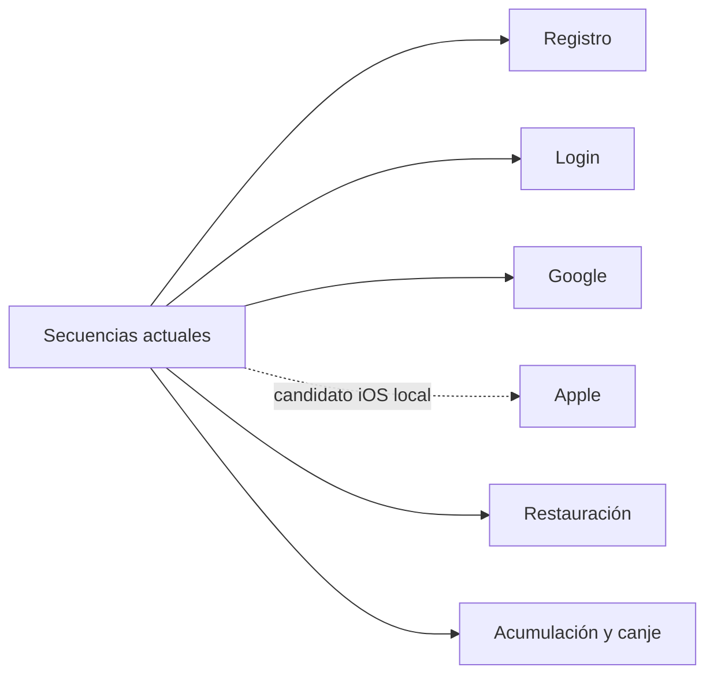

# Secuencias de ejecución

Estas vistas describen las rutas reales de las fuentes revisadas. Para saber qué configuración está publicada, leer [Estado observado](#/runtime-snapshot).

La [secuencia Apple](#/sequence-apple) corresponde al desarrollo local del 01/11/2026; no acredita credenciales configuradas ni un login real en iPhone. [Evidencia y pendientes](#/ios-development-evidence)
