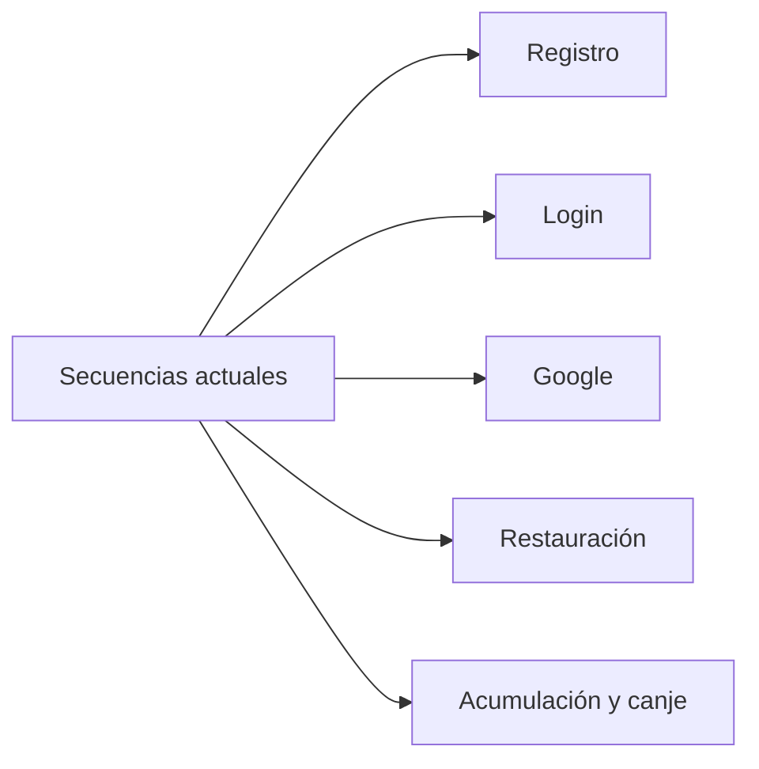

# Secuencias de ejecución

Estas vistas describen las rutas reales de las fuentes revisadas. Para saber qué configuración está publicada, leer [Estado observado](#/runtime-snapshot).

El [código de verificación del registro](#/sequence-registration-email-code) documenta el acuerdo posterior del 19/10/2026, ya implementado y probado en las fuentes enlazadas. Está publicado y habilitado en testing; la recepción en bandeja real y la QA física siguen pendientes. Producción conserva su versión anterior.
