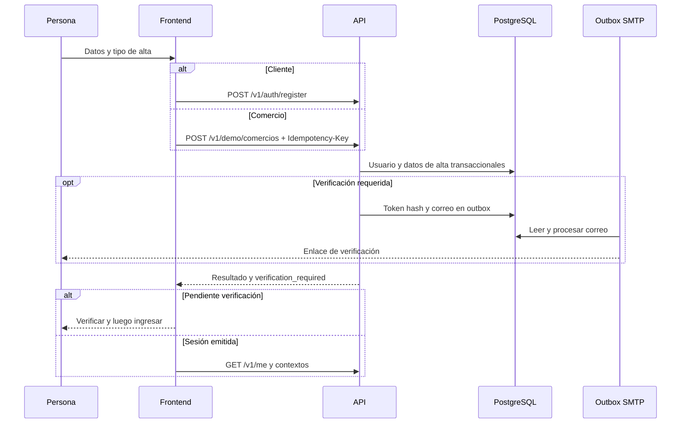

# Registro por email

El registro comercial crea contexto de marca/sucursal y programa. Una respuesta pendiente no se convierte en login. La configuración de altas y correo se verifica por ambiente; esta revisión no generó usuarios ni envió correos.

El [acuerdo del 19/10/2026 para verificación por código](#/sequence-registration-email-code) agrega un recorrido de seis dígitos para la app nueva y conserva los enlaces para clientes anteriores. El recorrido está implementado, probado y publicado en testing; la secuencia enlazada registra commits, esquema y configuración. La recepción en bandeja real sigue pendiente. El diagrama de esta página conserva la evidencia previa por enlace y producción conserva su versión anterior.

Revisión de fuentes y runtime del **02/10/2026, 22:30–22:33 UTC**. Los SHA y las diferencias por ambiente están en [Estado observado](#/runtime-snapshot). Esta revisión describe arquitectura e integración; no certifica todos los invariantes de negocio ni ejecuta operaciones sobre cuentas reales.

## Referencias de código

- [Implementación backend](https://github.com/am-p/app-loyalty/blob/main/internal/service/auth.go)
- [Servicio frontend](https://github.com/gonzalotev/app-fidelidad/blob/main/src/features/demo/services/demoService.ts)
- [Cliente y refresh](https://github.com/gonzalotev/app-fidelidad/blob/main/src/core/api/client.ts)
