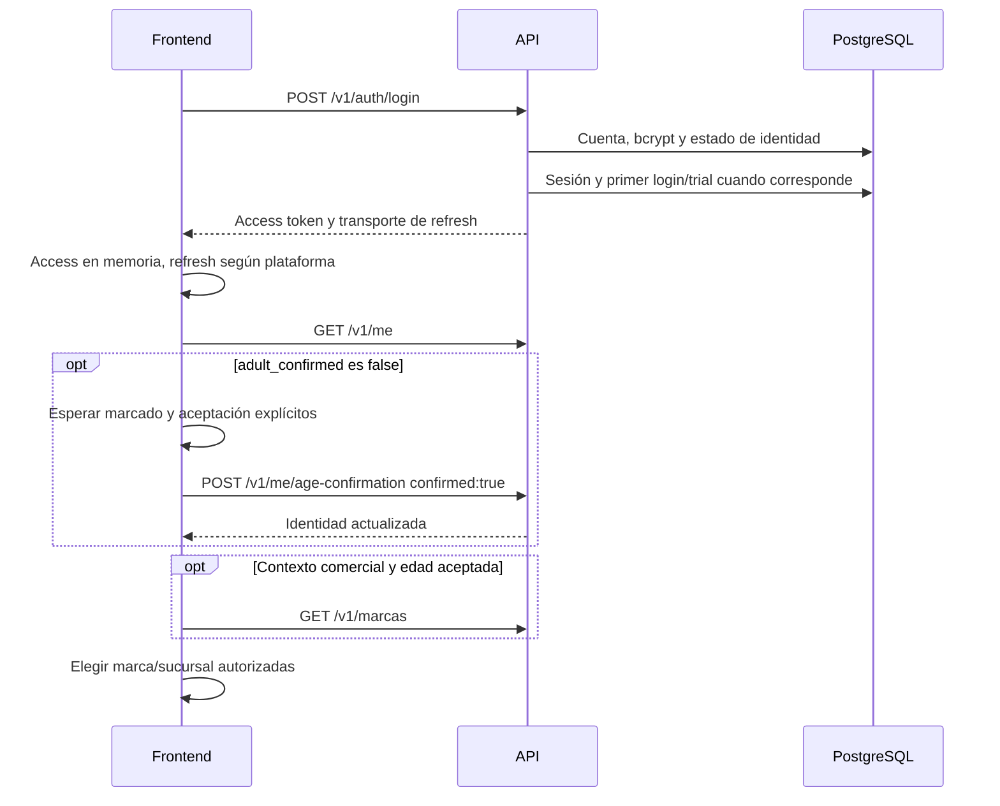

# Login por email

El servidor controla cuenta activa y verificación. La cookie web y el refresh nativo no se tratan como un JWT permanente en localStorage. La fecha histórica de primer login puede estar marcada como estimada por migración.

Revisión de fuentes y runtime del **02/10/2026, 22:30–22:33 UTC**. Los SHA y las diferencias por ambiente están en [Estado observado](#/runtime-snapshot). Esta revisión describe arquitectura e integración; no certifica todos los invariantes de negocio ni ejecuta operaciones sobre cuentas reales.

## Confirmación antes del contexto · testing PR73

El flujo de edad está desplegado en `ae706dda`; la persona marca la opción y continúa, incluso tras login Google o restauración con `adult_confirmed=false`. Los layouts de auth/pestañas esperan antes de montar redirecciones o consultas privadas. La respuesta debe pertenecer a la identidad y sesión actuales y traer confirmación aceptada por el servidor; estas guardias se revisaron en código, sin acreditar una prueba de carrera de cambio de cuenta.

La confirmación manual real del 19/10 a las 04:05:58 UTC desbloqueó las lecturas de tarjeta. Los ensayos de marcado, error 503/reintento y restauración aceptada usaron respuestas simuladas. La preservación de cookie frente a errores transitorios y la serialización entre pestañas son correcciones de PR74 desplegada en `7dfa39a`. Su QA real no repitió el logout pero mostró rotaciones repetidas entre tres pestañas y bloqueo por cuota; PR75 ya integra access compartido en memoria en `testing` `ed9b9fa`, con CI y 19 pruebas browser aprobadas, incluida coordinación de tres pestañas y cambio de identidad. La QA real posterior al despliegue de las 04:46:56 UTC aprobó tres pestañas durante 242,73 s, sin nuevo login ni error; la ventana incluye reconexiones SSE y regreso desde mapa/PDF. No acredita sesiones de mayor duración ni QA física. [Acceso](#/flow-auth) y [restauración](#/sequence-restore).

## Referencias de código

- [Implementación backend](https://github.com/am-p/app-loyalty/blob/main/internal/service/auth.go)
- [Servicio frontend](https://github.com/gonzalotev/app-fidelidad/blob/main/src/features/demo/services/demoService.ts)
- [Cliente y refresh](https://github.com/gonzalotev/app-fidelidad/blob/main/src/core/api/client.ts)
