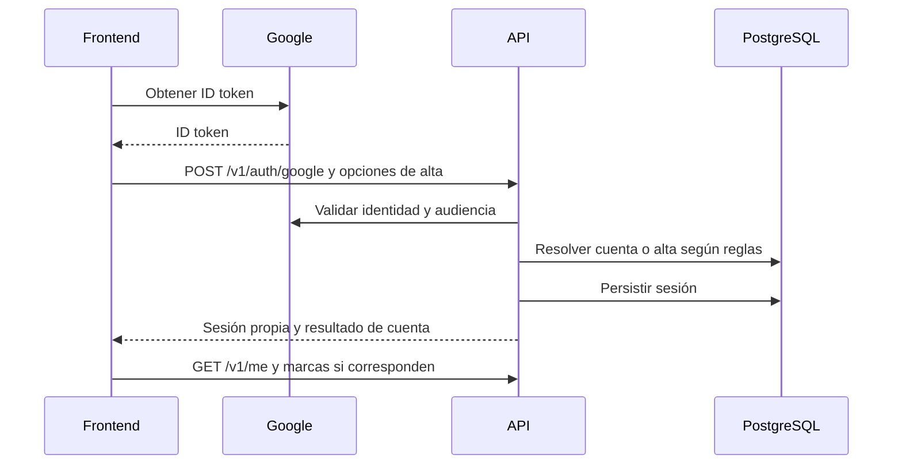

# Acceso con Google

La API distingue cuenta existente y alta, incluidos datos comerciales cuando el flujo los requiere. Los fallbacks legacy no aceptan degradar una selección de tipo/alta comercial a un contrato que no la soporta. No se probó una autenticación Google real durante este corte.

Revisión de fuentes y runtime del **02/10/2026, 22:30–22:33 UTC**. Los SHA y las diferencias por ambiente están en [Estado observado](#/runtime-snapshot). Esta revisión describe arquitectura e integración; no certifica todos los invariantes de negocio ni ejecuta operaciones sobre cuentas reales.

## Confirmación 18+ en el candidato Android del 12/10/2026

La rama `app-fidelidad:release/android-internal-20261012` (PR #61, HEAD
`a1e0622`) recupera el paso requerido por la API de testing. Google sólo aporta
identidad; no establece `adult_confirmed`. Cuando `/v1/me` devuelve
`adult_confirmed=false`, el cliente difiere contextos comerciales y pestañas,
presenta una confirmación explícita de 18 años y envía `{confirmed:true}` a
`POST /v1/me/age-confirmation`. Sólo acepta la respuesta del servidor para la
misma cuenta/sesión antes de habilitar los datos protegidos.

La ausencia del flag conserva compatibilidad con APIs previas. Las pruebas
browser del candidato cubren Google, error/reintento y restauración; usan
identidades y HTTP ficticios. La ruta de testing responde 401 sin autenticación.
No se atribuye autenticación Google real ni aceptación en un teléfono a estas
pruebas. Esta variante permanece pendiente de integrar a las ramas habituales.

## Referencias de código

- [Implementación backend](https://github.com/am-p/app-loyalty/blob/main/internal/service/auth.go)
- [Servicio frontend](https://github.com/gonzalotev/app-fidelidad/blob/main/src/features/demo/services/demoService.ts)
- [Cliente y refresh](https://github.com/gonzalotev/app-fidelidad/blob/main/src/core/api/client.ts)
