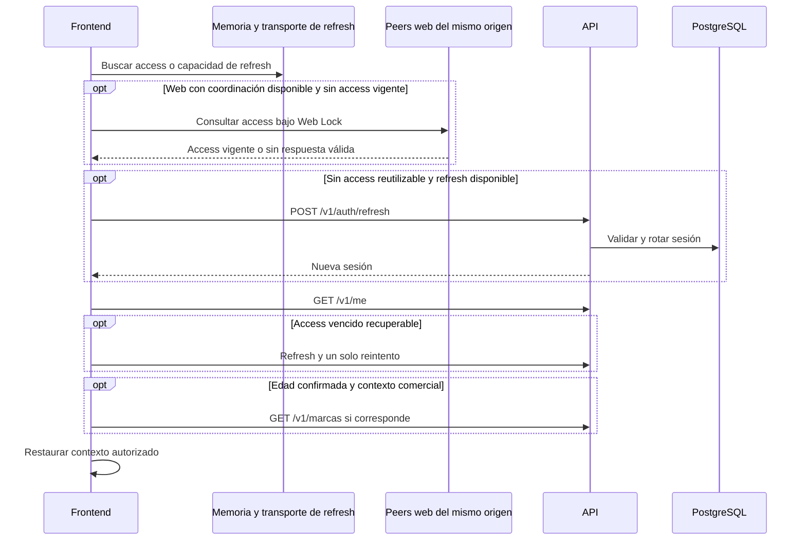

# Restauración de sesión

Web usa cookie HttpOnly y access en memoria; nativo guarda refresh en SecureStore. No se restaura un permiso comercial a partir de un plan local. La distinción entre error transitorio y revocación era el comportamiento previsto; el incidente del 19/10 detectó que el cliente desplegado borraba credenciales ante cualquier refresh no exitoso. La corrección parcial de PR74 y la coordinación de PR75 se describen a continuación.

Revisión de fuentes y runtime del **02/10/2026, 22:30–22:33 UTC**. Los SHA y las diferencias por ambiente están en [Estado observado](#/runtime-snapshot). Esta revisión describe arquitectura e integración; no certifica todos los invariantes de negocio ni ejecuta operaciones sobre cuentas reales.

## Fallos transitorios y SSE · PR74 desplegada con resultado parcial

Fuente de integración `7dfa39a033caab134498b19738b7c63d5a574470`, rama `testing`, desde `58d2c28fc3ca1fffef4d0faf5e54e826c04ad070`; CI aprobada y desplegada a las 04:26:46 UTC como `7dfa39a`. Su QA real no acreditó estabilidad entre pestañas. Un refresh 429/5xx, caída de red o payload 2xx inválido conserva credenciales y señala reintento con cooldown/Retry-After. Sólo un rechazo definitivo 401 del refresh invalida la sesión. El error de restauración muestra Reintentar y difiere redirecciones privadas hasta recuperar identidad.

La restauración simultánea se agrupa y las escrituras de cookie de auth/refresh/logout se serializan con Web Locks en pestañas del mismo origen que lo soporten. Los controles de revisión de identidad evitan adoptar resultados de una operación anterior; esa propiedad fue objeto de revisión estática, no de una prueba de carrera del POST de edad o restore. El ensayo posterior de PR75 sí cubre logout/reingreso con otra identidad. El timeout incluye la lectura del cuerpo y un payload malformado no reemplaza credenciales válidas.

SSE reintenta sin rotar mientras el access siga vigente, incluso ante 401 del stream; sólo su expiración permite renovar. Cargar un menú público omite restore y SSE; volver a privado los habilita según sesión/edad. Las credenciales de access permanecen en memoria; no se añade almacenamiento persistente web. No se cambia la rotación ni la protección contra reutilización del backend.

Quince casos browser simulados de edad/sesión pasaron, sin fallos, flaky ni skips: confirmación y reintento, sesiones restauradas de cliente/comercio (incluido onboarding incompleto), 429/503/red/2xx malformado, refresh 401 definitivo, restauración 503, SSE con access vigente/vencido, menú público sin restore y restauraciones de dos pestañas. Esas pruebas no cubrían la secuencia real de tres pestañas con lecturas REST después de rotaciones que invalidan el access de las demás: se observaron diez refresh exitosos en unos once segundos y luego 429, con QR cargando aunque sin nuevo logout. La serialización de cookie no comparte vigencia del access. No se atribuye cada request agregado a una cuenta; el resultado parcial se distingue de la aceptación posterior de PR75. [Evidencia](#/runtime-snapshot).

- [Lock de testing](https://github.com/gonzalotev/app-fidelidad/blob/testing/src/core/api/sessionLock.ts)
- [Recuperación de sesión de testing](https://github.com/gonzalotev/app-fidelidad/blob/testing/src/features/auth/components/SessionRecovery.tsx)

## Access compartido entre pestañas · PR75 desplegada y verificada

PR75 integra `fix/shared-web-session-20261019` en `testing` `ed9b9facc73c9ca60e2a16fb96f7e7847fa89f16`. Antes del refresh bajo Web Lock consulta a peers del mismo origen: BroadcastChannel transmite access en memoria y su expiración original; localStorage sólo contiene un marcador opaco/no secreto de autoridad o cierre. No transmite refresh tokens ni persiste credenciales. Correlación, destinatario, marcador y expiración impiden aceptar mensajes antiguos; se excluye el access recién rechazado. Logout invalida peers sin bucle de republicación y un token de otra identidad no se mezcla con el contexto local.

Nueve unidades de protocolo y revisión estática aprobaron; el conjunto browser final pasó 19/19 en 80,97 s, sin fallos, flaky ni skips, con respuestas simuladas. El escenario de tres pestañas comprueba uso de peers sin POST adicional tras login, una rotación al expirar, REST que rechaza SID antiguos, reload sin POST, ausencia de credenciales en storage y logout/reingreso con otra identidad. Esto no acredita la carrera del POST de edad ni QA física. CI y workflow de despliegue aprobados; despliegue observado a las 04:46:56 UTC y QA real de tres pestañas aprobada durante 242,73 s: tarjetas visibles, una renovación 200 en logs agregados, sin refresh 401/429 ni nuevo login; reconexiones SSE recuperadas sin rotación extra. La aceptación se limita a esa ventana y no atribuye requests agregados a una cuenta. [Corte y evidencia](#/runtime-snapshot).

## Referencias de código

- [Implementación backend](https://github.com/am-p/app-loyalty/blob/main/internal/service/auth.go)
- [Servicio frontend](https://github.com/gonzalotev/app-fidelidad/blob/main/src/features/demo/services/demoService.ts)
- [Cliente y refresh](https://github.com/gonzalotev/app-fidelidad/blob/main/src/core/api/client.ts)
