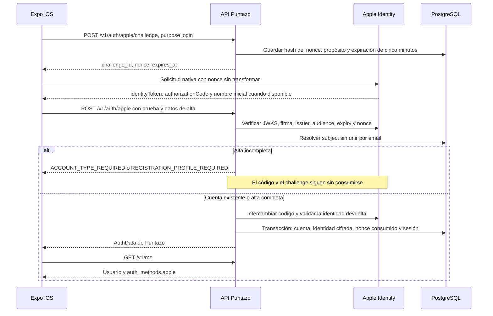

# Acceso y vinculación con Apple

## Acceso por navegador · Android, web y PWA

La edición iOS 1.0.0 (6) está disponible en Argentina. En la app iOS, Apple continúa usando su interfaz nativa. Android abre Apple en una pestaña del sistema. Web y PWA hacen el mismo recorrido de autorización desde el navegador.

1. `POST /v1/auth/apple/browser/start` registra un intento de cinco minutos y devuelve la URL de Apple. La app genera un verificador aleatorio y sólo comparte su hash. La API genera el nonce y vincula la reautenticación a la cuenta, la familia de sesión y su versión de autenticación.
2. Apple envía `state`, token y código por formulario al callback HTTPS. La API conserva la prueba cifrada hasta el canje. El retorno contiene sólo el identificador del intento. El origen web y el esquema Android están definidos por la aplicación. La PWA instalada puede completar desde la ventana que inició el acceso al volver al primer plano.
3. `POST /v1/auth/apple/browser/finish` exige el verificador, la plataforma y, para reautenticar, la sesión y versión de cuenta. La API comprueba firma, destinatario, nonce e identidad al canjear el código. El intento se consume una vez. Si Apple todavía no respondió, devuelve `APPLE_AUTH_PENDING` y permite volver a consultar.
4. La identidad se resuelve por el `sub` verificado en el grupo de Apple. El usuario conserva su cuenta y sus datos aunque Apple use un correo relay. El alta y el vínculo explícito están en iOS. La web recibe la cookie de refresh `HttpOnly` y Android usa el almacenamiento seguro del dispositivo.

Testing usa el Services ID `com.puntazo.app.testing.auth` asociado a `com.puntazo.app`. La migración 0045 conserva el vínculo iOS y añade credenciales cifradas por cliente. La baja encola ambas revocaciones en la misma transacción. Ante un problema del flujo web, deshabilitar `APPLE_BROWSER_AUTH_ENABLED` y conservar el binario 0045 y la configuración de ambos clientes para que sigan las revocaciones.

Implementación y verificación en los PR de [backend](https://github.com/am-p/app-loyalty/pull/50) y [frontend](https://github.com/gonzalotev/app-fidelidad/pull/122). La migración StoreKit del [PR 47](https://github.com/am-p/app-loyalty/pull/47) es una propuesta independiente y debe renumerarse antes de su promoción.

## Actualización de entrega · 03/11/2026

La secuencia descrita ya tiene implementación productiva en314248b/0044 y propuesta al dueño enPR48. El challenge200 genera nonce43caracteres y una prueba inválida devuelve401. La clave real está montada sólo en backend; no hay credenciales de pruebas ni fusión por correo. Consentimiento Apple, relay y revocación contra una identidad real todavía requieren validación física; los tests PostgreSQL/race de alta/vínculo/reauth/baja sí pasaron. [Fuentes y límites](#/ios-development-evidence).

**Delta de fuentes locales del 01/11/2026.** El comportamiento está implementado en el candidato de desarrollo, con pruebas controladas; no se declara publicado ni autenticado contra una cuenta Apple real. Ver [evidencia iOS](#/ios-development-evidence).

## Contrato

`POST /v1/auth/apple/challenge` admite `login`, `link` y `reauthenticate`. Los dos últimos requieren sesión y el challenge queda ligado a esa cuenta/sesión. El servidor guarda sólo el hash del nonce; su consumo se confirma en la transacción de autenticación. Un propósito distinto, expiración o replay no concede sesión.

La prueba contiene `challenge_id`, `id_token` y `authorization_code`. Para alta, `name`, `apellido`, tipo de cuenta y datos comerciales siguen la validación de Google. La implementación acepta `account_type` y su alias `tipo_cuenta`, rechazando valores contradictorios. El frontend conserva temporalmente el nombre inicial y la prueba en memoria mientras completa el perfil; no persiste credenciales Apple en el storage del onboarding.

El subject de Apple identifica la cuenta vinculada. Coincidir en email no autoriza unir ni crear una sesión sobre una cuenta existente: responde `APPLE_LINK_REQUIRED`. El usuario debe ingresar por su método actual y vincular expresamente.

## Vinculación y reautenticación

- `POST /v1/auth/apple/link`: sesión vigente, autenticación reciente de hasta diez minutos, nueva prueba de propósito `link` y versión de cuenta. Un email relay diferente es válido; no cambia la cuenta ni su correo principal.
- `POST /v1/auth/reauthenticate`: `{version,apple:{challenge_id,id_token,authorization_code}}`, excluyente con password o Google. El subject debe ser el ya vinculado.
- Link/reauth rotan sesión y `auth_version`, revocando las sesiones anteriores. Las versiones se revalidan bajo bloqueo de cuenta; el cliente conserva el transporte HTTP y control de versiones vigentes.
- `APPLE_AUTH_UNAVAILABLE` indica configuración ausente/fallo del proveedor; no activa una identidad de pruebas. `APPLE_IDENTITY_CONFLICT` evita asociar un subject a otra cuenta.

## Baja y datos

`auth_methods.apple` permite seleccionar el método de reautenticación disponible. El export incluye subject, email relay y fecha de vínculo, excluyendo tokens/códigos/nonces. La baja retira la identidad y persiste una revocación cifrada en la misma transacción; un worker reintenta aunque Apple esté caído. El proveedor de billing y su binding permanente son independientes de esa identidad.

## Referencias de código

- [Servicio de identidad existente](https://github.com/gagonzalez1/app-loyalty/blob/develop/internal/service/auth.go) y [sesión frontend](https://github.com/gonzalotev/app-fidelidad/blob/develop/src/features/auth/store/useAuthStore.ts), como entradas de las ramas móviles.
- Delta local backend: `internal/appleidentity`, `internal/{handler,service,repository}/apple_auth*`, `internal/model/apple_auth.go`, `migrations/0044_apple_identity.*.sql`.
- Delta local frontend: `src/features/auth/services/appleIdentityService.ts`, `nativeAppleIdentity.ios.ts`, `src/components/AppleSignInButton` y `AuthMethodsManager.tsx`. Los commits finales aún deben registrarse en la evidencia de integración.
