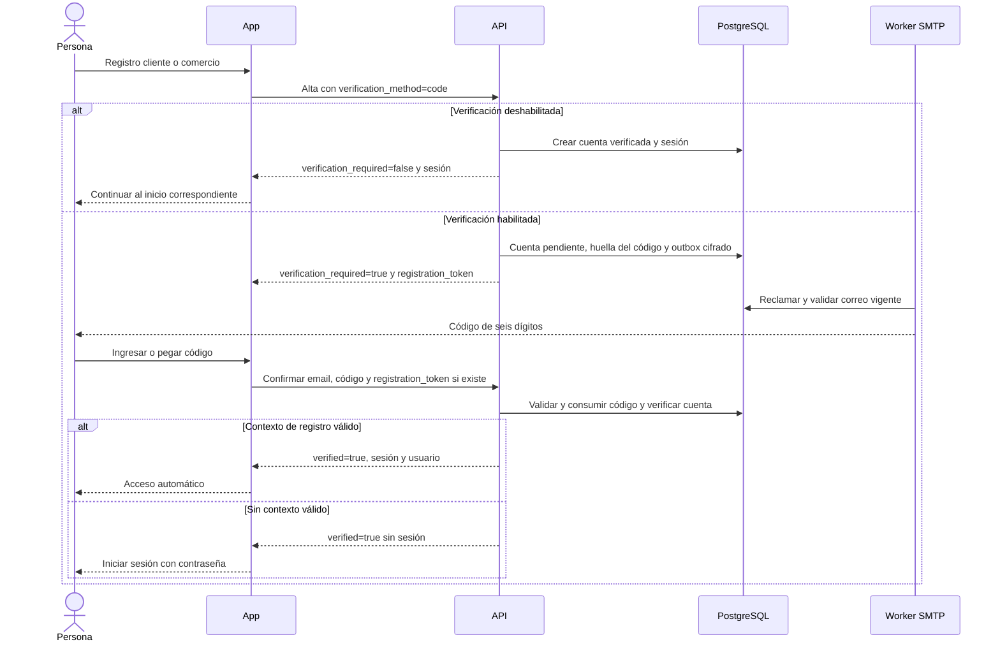

# Código de verificación del registro

**ACORDADO por el usuario el 19/10/2026, IMPLEMENTADO y PUBLICADO en testing.** API y frontend están saludables y el esquema `0043` está aplicado en testing. La pantalla pública y el bundle se verificaron. Un alta de cliente con alias nuevo elegido por el usuario confirmó recepción real, activación, sesión automática y uso único del código. Las cuentas existentes se preservaron; el alta comercial conserva cobertura automatizada y la QA física sigue pendiente. Producción no recibió este cambio.

## Política por ambiente

| Ambiente | `EMAIL_VERIFICATION_REQUIRED` | Alta nueva por email y contraseña |
|---|---|---|
| Testing durante la aceptación | `true` | Cuenta pendiente, correo con código y bloqueo de acceso hasta verificar |
| Testing después de la aceptación | `false` | Sesión inmediata; no se genera código ni correo de verificación |
| Producción | `true` obligatorio | Cuenta pendiente; la configuración productiva rechaza `false` y exige SMTP operativo |

La variable se configura en el backend y su cambio requiere reiniciar o redesplegar ese servicio. El frontend sigue `verification_required` de la respuesta y no deduce la política a partir del dominio o de una variable pública. Desactivarla sólo cambia las altas nuevas: no verifica ni habilita cuentas pendientes anteriores y no traslada verificaciones de testing a producción.

La regla alcanza a clientes y comercios que usan email y contraseña. Google conserva su validación del proveedor. Recuperación de contraseña, cambio de email e invitaciones mantienen sus contratos propios.

## Recorrido acordado

## Contrato implementado en las fuentes revisadas

- `/v1/auth/register` y `/v1/demo/comercios` aceptan `verification_method: "code"`. La omisión conserva el contrato de enlaces para clientes anteriores; los clientes nuevos solicitan código.
- El alta pendiente con código responde `verification_required: true`, `verification_method: "code"` y `registration_token`, sin sesión. Este último secreto permite el acceso automático sólo desde el contexto del mismo registro y vence a los treinta minutos, independientemente de la vigencia de diez minutos de cada código.
- `POST /v1/auth/email-verification/code/request` recibe `{email}` y responde `202` genérico sin revelar si la cuenta existe, está verificada o admite reenvío.
- `POST /v1/auth/email-verification/code/confirm` recibe `{email, code, registration_token?}`; responde un envelope con `data: {verified: true, session?, user?}`. El código es texto, no un número: debe conservar ceros iniciales.
- Una confirmación válida sin contexto de registro verifica el correo y requiere login posterior. Las sesiones emitidas siguen el manejo actual de refresh: cookie HttpOnly en web y almacenamiento seguro en nativo.

El contexto pendiente se conserva fuera de URLs y logs, con almacenamiento de sesión en web y seguro en nativo; se limpia al completar, cerrar sesión o iniciar un nuevo registro. La pantalla admite teclado numérico, pegado completo, estados de confirmación/error y reenvío con espera visible.

## Seguridad y persistencia

- Código aleatorio de seis dígitos, vigencia de diez minutos y máximo de cinco intentos. Los errores consumen intentos persistidos aunque la solicitud falle.
- Reenvío a partir de sesenta segundos, sujeto además a los presupuestos de correo existentes; un código nuevo invalida el anterior.
- Huella con clave secreta, asociada a usuario y propósito. El código sólo se conserva cifrado mientras sea necesario para la entrega; no aparece en respuestas de API ni en logs.
- La confirmación consume el código y marca el correo verificado transaccionalmente. Dos confirmaciones concurrentes no pueden reutilizarlo.
- El worker reutiliza la cola SMTP existente y comprueba vigencia antes de enviar para descartar mensajes sustituidos.
- La migración `0043_email_verification_codes` está implementada y aplicada en testing. Preserva el historial: el main oficial base contiene `0035` y la rama de publicación testing contenía hasta `0042`; el manifest admite la reserva de esos números sin exigir migraciones ajenas a cada fuente. Se ensayó en una restauración aislada y se ejecutó dos veces en live, con el segundo pase sin cambios. Producción conserva `0035`.

## Fuentes y validación · 19/10/2026

| Plano | Evidencia |
|---|---|
| Backend propietario | [PR #40 a `am-p/app-loyalty`](https://github.com/am-p/app-loyalty/pull/40) abierto con CI aprobado; fuente `7c87f3b`, sobre el ajuste de fixture `2645c11`. No se integró ni publicó en producción |
| Frontend | [PR #83](https://github.com/gonzalotev/app-fidelidad/pull/83) integrado en `gonzalotev/app-fidelidad:testing`; commit publicado `c7b13f35bd412b40f09a376d990e19cdc1a554e2`, fuente revisada `7b284b4` |
| Backend testing | Publicado desde `gagonzalez1/app-loyalty:closed-test-readiness`, commit `f976d2999c6001d2c8a78099ee44f7e74c2f6bb2`. Incluye integración `2525d2f` sobre `ea831cf` y ajuste de fixtures de migraciones heredadas; conserva las funcionalidades anteriores de testing |
| Backend local | Suite completa PostgreSQL, race de integración en 67,9 segundos, `go vet`, OpenAPI e imagen Docker API aprobados; OpenAPI conserva tres advertencias preexistentes |
| Frontend local | 173 pruebas Node, TypeScript, seis pruebas de navegador y Expo Doctor 18/18 aprobados; build web y exportación JavaScript Android aprobados |
| Recorrido HTTP local | Registro → captura de correo → confirmación con sesión automática → rechazo de reutilización, aprobado |
| Variable deshabilitada | Comprobación HTTP en ejecución con `false`: altas nuevas con sesión directa y cero correos en outbox; cuentas pendientes anteriores todavía bloqueadas |
| Preparación de migración testing | Respaldo cifrado, restauración aislada y upgrade `0042` → `0043` aplicado dos veces; recuentos y huellas de menús preservados |
| Migración live testing | `0042` → `0043`, dos pases; preservados 103 usuarios, 38 marcas, 39 sucursales, 42 tarjetas y 207 movimientos, con huellas de menús/documentos idénticas |
| API pública testing | [Versión](https://api-testing.puntazo.pro/v1/version) con `f976d29`/`0043` y [readiness](https://api-testing.puntazo.pro/v1/health/ready) HTTP 200; despliegue `sikwlzjfv5gn6mtt9dbssmy5` terminado |
| Configuración efectiva testing | `EMAIL_VERIFICATION_REQUIRED=true`, `MAIL_PROVIDER=smtp`, `EXPECTED_SCHEMA_VERSION=0043`; configuración SMTP y credenciales conservadas |
| Web pública testing | Despliegue `b8atkluanbjatqo7soqoitvr` terminado el 19/10/2026 a las 19:55:12 UTC; campo de código visible tras actualizar el service worker anterior |
| Integridad del bundle público | `/_expo/static/js/web/entry-76190cfb695766e2e7d0d62dc31bfcf5.js`, SHA-256 `c448f82791916093bbd668b5e392a7b12b7f6a7c52d64b6d1990977f94a8307b`, idéntico al contenedor. Service worker y lector comprobados |
| Producción | API conserva `dbeb03c`/`0035`, salud HTTP 200; sin promoción del backend o frontend de este cambio |

La exportación JavaScript Android no acredita una nueva compilación nativa ni aceptación en un dispositivo físico. Los SHA anteriores registran la evidencia revisada y no seleccionan futuras compilaciones o despliegues.

## Aceptación pendiente y operación

El 19/10/2026 se completó el recorrido real de cliente con un alias nuevo elegido por el usuario: envío SMTP aceptado en el primer intento a las 17:06:43 Argentina, recepción confirmada por el usuario y activación a las 17:09 mediante el código recibido. Se verificaron sesión automática del mismo registro, identidad de `/me`, cookie web segura, rechazo de reutilización, logout y rechazo de la sesión revocada. La cuenta QA 110 quedó verificada y sin sesión de prueba abierta. El alta comercial conserva cobertura automatizada; no se acredita un segundo recorrido comercial con bandeja real. Las cuentas existentes se preservaron. La recepción real se acredita por el código recibido y confirmado por el usuario, sin basarse sólo en SMTP, outbox o captura local. La evidencia local ya cubre bloqueo previo, acceso automático, variable deshabilitada, ceros iniciales, errores, vencimiento, intentos, reenvío, reutilización, concurrencia y aislamiento entre cuentas. La QA física/nativa y un nuevo AAB siguen fuera de lo verificado.

Tras la aceptación, testing puede volver a `EMAIL_VERIFICATION_REQUIRED=false` mediante API/UI oficial de Coolify y redespliegue; las cuentas pendientes conservarán el requisito. Producción debe exigir verificación cuando se promueva esta funcionalidad, con las validaciones y pruebas correspondientes. Los controles de Google, enlaces anteriores, recuperación e invitaciones se conservaron.

Registro operativo privado: workspace Contabo, `puntazo/email-code-20261019.md`. Evidencia local: `Puntazo/artifacts/email-verification-20261019/`, incluida `verification-testing.png`. La propuesta documental es [PR #13](https://github.com/gagonzalez1/puntazo-docs/pull/13); publicar la funcionalidad no implica que este portal ya haya publicado la documentación.

El código pertenece a `am-p/app-loyalty` y `gonzalotev/app-fidelidad`; el fork de backend es sólo fuente de publicación para testing. La incorporación a una rama no prueba despliegue ni entrega SMTP. Los SHA observados son evidencia histórica y no seleccionan una próxima compilación.

### Actualización concurrente posterior

La rama frontend `testing` avanzó mediante PR82 a `f209f639113a2a11c9c150dfce7b8d8b5a712fbd`, con precios de onboarding y restricciones Android; se revisó que conserva el flujo OTP y se observó ese runtime saludable durante la aceptación del correo real. El commit `c7b13f3` y su bundle anteriores conservan el carácter de evidencia de la publicación inicial de este cambio.

### Identidad visual del correo

La plantilla del código incorpora el logo real de Puntazo y la imagen existente de Mr. Puntazo sonriente y saludando. A pedido del usuario, la siguiente revisión reemplaza las imágenes adjuntas CID por URLs públicas estáticas sin identificadores de destinatarios (`/api/v1/email-assets/v1/{name}`, nombres `puntazo-logo` y `mr-puntazo` sin extensión para atravesar el proxy web), conservando texto alternativo y versión de texto plano. Así el MIME de verificación no contiene archivos adjuntos; algunos clientes pueden requerir habilitar imágenes externas.

La revisión suma «Activar mi cuenta», con un secreto de 256 bits derivado con HMAC y separado del código y del contexto de sesión. Su huella se guarda en la tabla existente de tokens dentro de la misma transacción. El enlace vence a los diez minutos y abre la pantalla de confirmación existente: GET no activa cuentas. La confirmación por POST verifica sin emitir sesión y luego solicita login; el código conserva la sesión automática con el contexto de registro. Código y enlace se consumen mutuamente y se invalidan al reenviar o agotar cinco intentos. Los correos ya en cola antes de esta revisión conservan el código y omiten un enlace que no fue emitido. No se modifica el historial de migraciones ni la recuperación de contraseña. Estado de esta revisión: publicada en testing el 19/10/2026 a las 17:41:28 Argentina, API `cdd127461bc021ab50e71b59a317a7dcd478c399`, fuente oficial PR40 `84ff7380740814bc24562000355b903d274b4da5`. Las dos imágenes públicas responden 200 y coinciden por SHA-256 con la fuente; readiness OK, contenedor healthy y cero reinicios. Suite PostgreSQL y race de consumo mutuo aprobados; no se envió un correo real adicional en esta revisión. Producción no se modificó.
