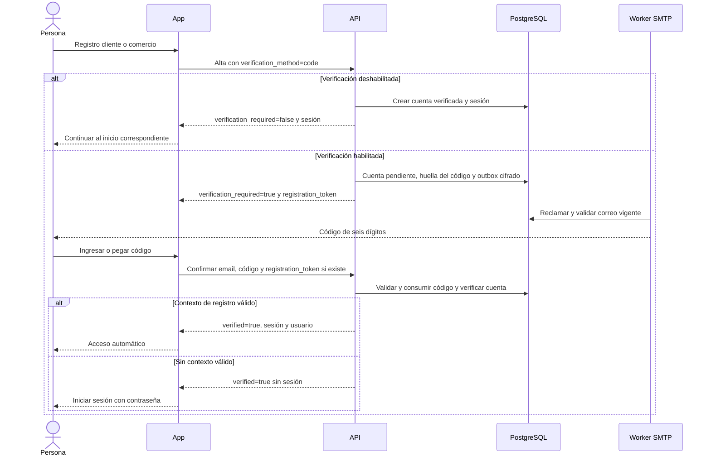

# Código de verificación del registro

**ACORDADO por el usuario el 19/10/2026 e IMPLEMENTADO en las fuentes indicadas abajo.** Las rutas y pantallas cuentan con pruebas locales; la aplicación y migración live no se modificaron en esta revisión. La captura local de correo no acredita recepción mediante el proveedor SMTP público. La verificación por enlace existente conserva su compatibilidad durante la transición.

## Política por ambiente

| Ambiente | `EMAIL_VERIFICATION_REQUIRED` | Alta nueva por email y contraseña |
|---|---|---|
| Testing durante la aceptación | `true` | Cuenta pendiente, correo con código y bloqueo de acceso hasta verificar |
| Testing después de la aceptación | `false` | Sesión inmediata; no se genera código ni correo de verificación |
| Producción | `true` obligatorio | Cuenta pendiente; la configuración productiva rechaza `false` y exige SMTP operativo |

La variable se configura en el backend y su cambio requiere reiniciar o redesplegar ese servicio. El frontend sigue `verification_required` de la respuesta y no deduce la política a partir del dominio o de una variable pública. Desactivarla sólo cambia las altas nuevas: no verifica ni habilita cuentas pendientes anteriores y no traslada verificaciones de testing a producción.

La regla alcanza a clientes y comercios que usan email y contraseña. Google conserva su validación del proveedor. Recuperación de contraseña, cambio de email e invitaciones mantienen sus contratos propios.

## Recorrido acordado

## Contrato implementado en las fuentes revisadas

- `/v1/auth/register` y `/v1/demo/comercios` aceptan `verification_method: "code"`. La omisión conserva el contrato de enlaces para clientes anteriores; los clientes nuevos solicitan código.
- El alta pendiente con código responde `verification_required: true`, `verification_method: "code"` y `registration_token`, sin sesión. Este último secreto permite el acceso automático sólo desde el contexto del mismo registro y vence a los treinta minutos, independientemente de la vigencia de diez minutos de cada código.
- `POST /v1/auth/email-verification/code/request` recibe `{email}` y responde `202` genérico sin revelar si la cuenta existe, está verificada o admite reenvío.
- `POST /v1/auth/email-verification/code/confirm` recibe `{email, code, registration_token?}`; responde un envelope con `data: {verified: true, session?, user?}`. El código es texto, no un número: debe conservar ceros iniciales.
- Una confirmación válida sin contexto de registro verifica el correo y requiere login posterior. Las sesiones emitidas siguen el manejo actual de refresh: cookie HttpOnly en web y almacenamiento seguro en nativo.

El contexto pendiente se conserva fuera de URLs y logs, con almacenamiento de sesión en web y seguro en nativo; se limpia al completar, cerrar sesión o iniciar un nuevo registro. La pantalla admite teclado numérico, pegado completo, estados de confirmación/error y reenvío con espera visible.

## Seguridad y persistencia

- Código aleatorio de seis dígitos, vigencia de diez minutos y máximo de cinco intentos. Los errores consumen intentos persistidos aunque la solicitud falle.
- Reenvío a partir de sesenta segundos, sujeto además a los presupuestos de correo existentes; un código nuevo invalida el anterior.
- Huella con clave secreta, asociada a usuario y propósito. El código sólo se conserva cifrado mientras sea necesario para la entrega; no aparece en respuestas de API ni en logs.
- La confirmación consume el código y marca el correo verificado transaccionalmente. Dos confirmaciones concurrentes no pueden reutilizarlo.
- El worker reutiliza la cola SMTP existente y comprueba vigencia antes de enviar para descartar mensajes sustituidos.
- La migración `0043_email_verification_codes` está implementada. Preserva el historial: el main oficial base contiene `0035` y la rama de publicación testing contiene hasta `0042`; el manifest de migraciones admite la reserva de esos números sin exigir migraciones ajenas a cada fuente. `0043` se aplicó sólo en bases locales y restauraciones aisladas, no en la base live de esta revisión.

## Fuentes y validación · 19/10/2026

| Plano | Evidencia |
|---|---|
| Backend propietario | [PR #40 a `am-p/app-loyalty`](https://github.com/am-p/app-loyalty/pull/40), fuente `7c87f3b`, sobre el ajuste de fixture `2645c11`; código y migración implementados, sin atribuir integración en main |
| Frontend | [PR #83 a `gonzalotev/app-fidelidad:testing`](https://github.com/gonzalotev/app-fidelidad/pull/83), fuente `7b284b4`; pantalla, servicios, almacenamiento y contrato implementados |
| Candidato backend testing | Integración `2525d2f` sobre base `ea831cf`; conserva los cambios de testing anteriores. La validación de fixtures heredados de upgrade y la repetición de la suite race siguen pendientes de la integración final |
| Backend local | Suite completa con PostgreSQL y `go vet` aprobados; imagen Docker API construida correctamente |
| Frontend local | 173 pruebas Node, TypeScript, seis pruebas de navegador y Expo Doctor 18/18 aprobados; build web y exportación JavaScript Android aprobados |
| Recorrido HTTP local | Registro → captura de correo → confirmación con sesión automática → rechazo de reutilización, aprobado |
| Preparación de migración testing | Respaldo cifrado, restauración aislada y upgrade `0042` → `0043` aplicado dos veces; recuentos y huellas de menús preservados |
| Runtime público | Sin cambios live en este corte; configuración efectiva, recepción SMTP y publicación pendientes de verificación |

La exportación JavaScript Android no acredita una nueva compilación nativa ni aceptación en un dispositivo físico. Los SHA anteriores registran la evidencia revisada y no seleccionan futuras compilaciones o despliegues.

## Aceptación pública pendiente

Probar las dos altas en testing con la variable en `true`: recepción real, bloqueo previo y acceso automático después de verificar. Repetir con `false`: altas nuevas sin código ni correo y cuentas pendientes anteriores todavía bloqueadas. Validar ceros iniciales, código erróneo, vencimiento, límite de intentos, reenvío, reutilización, concurrencia y aislamiento entre cuentas.

Las pruebas de configuración y de regresión del backend acreditan las reglas en código. Antes de publicar, verificar en el ambiente destino la configuración efectiva no secreta, la migración aplicada, versión/readiness, entrega real del proveedor SMTP y los recorridos de cliente y comercio. Conservar los controles de Google, enlaces anteriores, recuperación e invitaciones. La aprobación de las pruebas locales no acredita despliegue ni aceptación pública.

El código pertenece a `am-p/app-loyalty` y `gonzalotev/app-fidelidad`; el fork de backend es sólo fuente de publicación para testing. La incorporación a una rama no prueba despliegue ni entrega SMTP. Los SHA observados son evidencia histórica y no seleccionan una próxima compilación.
