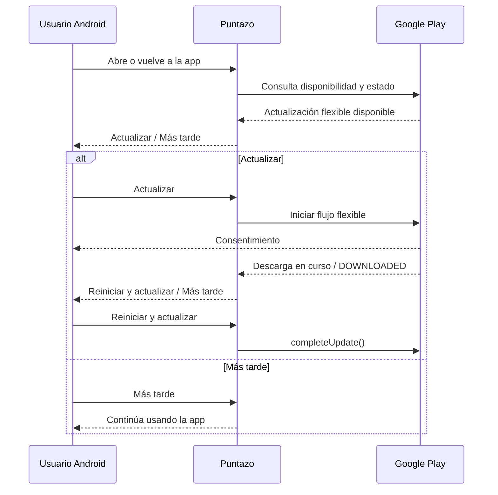

# Actualización flexible Android

Solicitud aprobada por el usuario el 12/10/2026. Implementación en
`gonzalotev/app-fidelidad:codex/android-flexible-updates-20261012`, basada en
`main` remoto `2871299`. Integración a main/testing pendiente. Publicado en el AAB 1.0.0 (16) de
`release/android-internal-20261012`, Google Play internal completed el 12/10/2026;
instalación y ciclo completo en teléfono aún no acreditados. El flujo usa
Expo SDK 54 y Google Play; no modifica API ni datos de Puntazo.

El 12/10/2026 a las 17:48 UTC, el mismo AAB 16 se promovió al canal cerrado
`testing`. La edición nueva registra rollout `completed`, pero el ciclo de
publicación está `IN_REVIEW`: la versión 14 sigue `PUBLISHED` para los testers
cerrados hasta que Google apruebe el cambio. No se recompiló ni se modificaron
los testers. `internal` conserva la versión 16 publicada.

El aviso espera la restauración de sesión y los diálogos registrados. Posponer
o cancelar el consentimiento evita repetir la oferta durante esa sesión del
proceso. Al cerrar y abrir la app puede ofrecerse nuevamente. La descarga
permite seguir usando Puntazo; una descarga completada se recupera al volver a
la app. El reinicio requiere pulsar **Reiniciar y actualizar**.

La falta de conexión o de elegibilidad en Play no bloquea el acceso. Un error
al iniciar, descargar o instalar muestra feedback y permite continuar.
Web, iOS, Expo Go y compilaciones de desarrollo no ejecutan este flujo.

La prueba real necesita un binario con el módulo instalado desde Play y una
versión mayor disponible para esa cuenta/dispositivo. Las compilaciones antiguas
primero deben instalar la versión que incluye esta integración. No se acredita
instalación ni disponibilidad en los teléfonos por una prueba unitaria o un
APK instalado por ADB.

## Referencias de código

- [Coordinador Android, rama fuente](https://github.com/gonzalotev/app-fidelidad/blob/codex/android-flexible-updates-20261012/src/features/appUpdates/components/AndroidUpdatePrompt/Index.android.tsx)
- [Controlador y pruebas, rama fuente](https://github.com/gonzalotev/app-fidelidad/blob/codex/android-flexible-updates-20261012/src/features/appUpdates/lib/flexible-update-controller.mjs)
- [Módulo Play, rama fuente](https://github.com/gonzalotev/app-fidelidad/blob/codex/android-flexible-updates-20261012/modules/puntazo-play-updates/android/src/main/java/expo/modules/puntazoplayupdates/PuntazoPlayUpdatesModule.kt)
